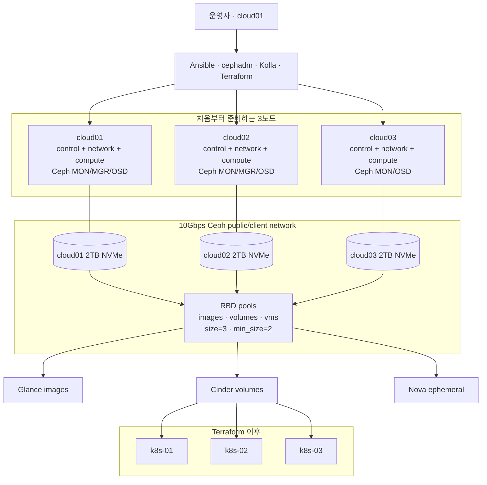

# Three-node OpenStack home cloud

이 저장소는 **세 물리 노드가 모두 준비된 뒤** Ubuntu Server 24.04, Ceph, Kolla-Ansible
OpenStack, management Kubernetes를 새로 설치하는 자동화다. 단일 노드 OpenStack을 먼저
운영하거나 LVM 데이터를 Ceph로 이전하는 경로는 기본 설계에 포함하지 않는다.

실제 장비에는 아직 적용되지 않았다. 공개 저장소의 IP, MAC, 디스크 시리얼은 예시이며
`inventory/*.local.yml`에 실제 값을 넣기 전에는 설치를 시작하면 안 된다.

## 최종 구조



OpenStack API와 Skyline은 `cloud01`~`cloud03`의 HAProxy/Keepalived VIP를 사용한다. MariaDB,
RabbitMQ와 OVN central도 세 컨트롤러에 배치한다. Ceph는 세 호스트를 장애 도메인으로 사용하며,
OpenStack을 처음 배포하기 전에 생성한다.

## 디스크 배치

| 노드 | OS와 Kolla | Ceph | 별도 보존 |
| --- | --- | --- | --- |
| `cloud01` | 128GB SSD: Ubuntu, 1TB SSD: `/var/lib/docker` | 2TB NVMe OSD | 4TB·3TB HDD와 여분 512GB SSD |
| `cloud02` | 512GB SSD: Ubuntu + Docker | 2TB SSD/NVMe OSD | 장비별 여분 디스크 |
| `cloud03` | 512GB SSD: Ubuntu + Docker | 2TB SSD/NVMe OSD | 장비별 여분 디스크 |

세 개의 2TB OSD는 약 6TB raw이며 3중 복제 후 논리 용량은 약 2TB다. 복구와 재조정 여유를
고려한 운영 목표는 약 1.4~1.5TB다. Ceph OSD는 OS 디스크와 분리하고 세 노드에 같은 device
class를 사용한다.

`cloud01`의 4TB·3TB HDD는 Ceph에 넣지 않는다. 3노드 OpenStack 검증이 끝난 뒤 HDD 전용
SATA HBA를 `cloud01` 고정 스토리지 VM에 PCI 패스스루한다. 자세한 내용은
[cloud01 고정 스토리지 VM](docs/storage-vm.md)을 따른다.

## 네트워크

| 용도 | 공개 예시 | 설명 |
| --- | --- | --- |
| 관리/API | `192.0.2.0/24` | SSH, Kolla API VIP `192.0.2.10` |
| Provider VLAN 10 | `198.51.100.0/24` | Floating IP와 외부 연결 |
| Ceph 10Gbps | `192.168.30.0/24` | MON, OSD 복제, Glance/Cinder/Nova RBD |
| Kubernetes tenant | `203.0.113.0/24` | management Kubernetes VM |

Ceph망에는 gateway를 두지 않는다. `ceph0`의 실제 MAC과 주소는 각 노드의 로컬 topology에
기록하며 Ansible이 Netplan을 생성한다. 자세한 연결은 [망분리 설계](docs/network-segmentation.md)에
정리되어 있다.

## 설치 순서

세 노드가 모두 도착하기 전에는 OpenStack과 Ceph 배포 명령을 실행하지 않는다. 준비된 작업
PC에서 각 노드의 seed를 따로 만들고 Ubuntu를 설치한다.

```bash
for node in cloud01 cloud02 cloud03; do
  ./scripts/render-ubuntu-autoinstall.sh "$node"
  ./scripts/build-autoinstall-seed.sh "$node"
done
```

Ubuntu 설치 후 `cloud01`에서 저장소를 clone하고 로컬 topology와 SSH 키를 복원한다. 전체
실행 순서는 다음과 같다.

```bash
./scripts/cluster.sh validate
./scripts/cluster.sh setup
./scripts/cluster.sh render
./scripts/cluster.sh prepare-hosts
# 세 호스트 재부팅

./scripts/cluster.sh openwrt-discover
./scripts/cluster.sh openwrt-plan
# 출력된 확인값으로 openwrt-apply

# cloud01의 1TB Kolla SSD만 초기화; 2TB NVMe와 HDD는 보존
sudo ./scripts/prepare-openstack-storage.sh
# 출력된 확인값으로 --apply 후 cloud01 재부팅

./scripts/cluster.sh verify-hosts

sudo ./scripts/ceph-cluster.sh setup
./scripts/ceph-cluster.sh validate
./scripts/ceph-cluster.sh preflight
# bootstrap → add-hosts → osd-plan → osd-apply → configure-pools
sudo ./scripts/ceph-cluster.sh export-kolla

sudo ./scripts/cluster.sh deploy-openstack
sudo ./scripts/openstack.sh cloud-init
sudo ./scripts/cluster.sh verify-openstack

./scripts/cluster.sh terraform-plan
# 저장된 plan 검토 후 terraform-apply
./scripts/cluster.sh deploy-kubernetes
```

각 파괴적 단계의 정확한 확인 문자열과 검증 명령은
[설치 런북](docs/openstack-runbook.md)에 있다. Ceph 초기 구축은
[Ceph 초기 구축](docs/ceph-transition.md)을 따른다.

## 자동화 경계

- Autoinstall은 각 노드의 `os_disk_serial`과 관리 NIC MAC이 일치할 때만 OS 디스크를 지운다.
- `prepare-openstack-storage.sh`는 `cloud01`의 1TB Kolla SSD만 초기화한다.
- Ceph OSD 적용은 세 장치의 by-id, 시리얼, 크기, class와 manifest SHA-256을 확인한다.
- OpenStack 배포는 세 노드 이상, `storage_backend: ceph`, 내보낸 Ceph client 설정을 요구한다.
- Terraform은 세 management Kubernetes VM을 한 번에 만들며 모두 Ceph 부팅 볼륨을 사용한다.
- 4TB·3TB HDD와 HBA 패스스루 VM은 OpenStack 검증 후 별도 Terraform workload로 만든다.

전체 승인 지점은 [자동화 경계](docs/automation-boundaries.md)에 정리되어 있다.

## 주요 디렉터리

| 경로 | 역할 |
| --- | --- |
| `inventory/openstack-cluster.yml` | 공개 3노드 Ceph topology 예시 |
| `inventory/openstack-cluster.local.yml` | 실제 MAC, IP, OSD by-id를 넣는 ignored 파일 |
| `ubuntu-autoinstall/` | 노드별 Ubuntu seed 입력 |
| `ansible/` | 호스트, Netplan, IOMMU 준비와 검증 |
| `kolla/` | Kolla globals, inventory와 Nova PCI 예시 |
| `scripts/` | 운영자 진입점과 `internal/` 하위 구현 ([구성 설명](scripts/README.md)) |
| `scripts/ceph-cluster.sh` | cephadm 초기 cluster와 OSD/pool/client 구성 |
| `terraform/openstack/` | tenant network와 management Kubernetes VM 3대 |
| `terraform/workloads/` | 이후 애플리케이션·스토리지 VM별 독립 state |

공개하면 안 되는 파일과 백업 위치는
[로컬 설정·비밀·상태](docs/local-secrets-and-state.md)를 따른다.
일반 VM stack 생성과 적용 방식은
[서비스별 Terraform workload](docs/terraform-workloads.md)에 정리되어 있다.

## 이후 확장

`cloud04` 이후는 기존 세 컨트롤러를 유지하면서 compute 노드로 한 대씩 추가할 수 있다.
Ceph 용량을 늘릴 때는 같은 device class의 OSD를 세 장애 도메인에 균형 있게 추가해야 한다.
현재 `osd-plan/osd-apply`는 **빈 클러스터의 최초 OSD 배포만** 자동화하므로 운영 중 OSD 증설은
별도 검토가 필요하다. [3노드 이후 확장](docs/three-node-expansion.md)을 참고한다.
