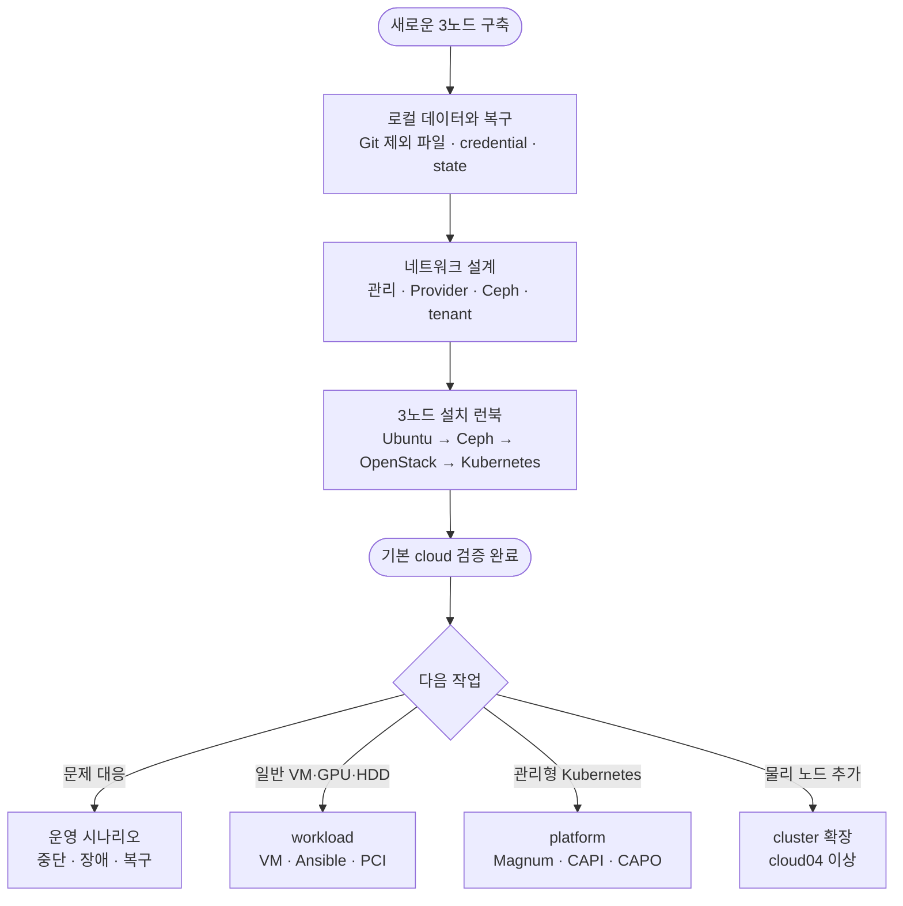

# OpenStack 인프라 문서

이 디렉터리는 문서의 목적에 따라 설치, 설계, 운영, workload, platform으로 나뉜다. 최초
구축 명령은 `getting-started/`만 기준으로 실행하고, 나머지 문서는 설계 근거와 특정 상황의
세부 절차를 설명한다.

```text
docs/
├── README.md                  # 전체 문서 지도
├── getting-started/           # 처음 3노드를 설치하는 단일 실행 순서
├── architecture/              # 네트워크와 자동화 안전 경계
├── operations/                # 장애, 복구, Ceph, OpenWrt, 노드 확장
├── workloads/                 # 일반 VM, Terraform, GPU/HBA 패스스루
└── platform/                  # Magnum, CAPI, CAPO 관리형 서비스
```

## 처음 읽는 순서



1. [로컬 데이터와 복구](operations/local-data-and-recovery.md)에서 Git에 넣지 않을 파일과 백업
   대상을 확인한다.
2. [네트워크 설계](architecture/networking.md)에서 실제 NIC, VLAN, VIP와 주소 대역을 확정한다.
3. [3노드 설치 런북](getting-started/installation.md)을 처음부터 순서대로 실행한다.
4. 설치가 중단되거나 구축 후 변경이 필요하면 [상황별 운영 가이드](operations/scenarios.md)에서
   해당 상황을 선택한다.

## 문서 영역

| 영역 | 안내 | 다루는 범위 |
| --- | --- | --- |
| 최초 설치 | [getting-started](getting-started/README.md) | 새 3노드 Ubuntu, Ceph, OpenStack, management Kubernetes |
| 설계 | [architecture](architecture/README.md) | 망분리, 데이터 경로, 자동화 승인·차단 경계 |
| 운영 | [operations](operations/README.md) | 상태 판단, OpenWrt, Ceph 최초 구축, 복구, 노드 확장 |
| VM과 애플리케이션 | [workloads](workloads/README.md) | Terraform stack, Ansible guest 구성, GPU/HBA VM |
| 관리형 서비스 | [platform](platform/README.md) | Magnum, CAPI, CAPO, Octavia와 Hosted Control Plane 경계 |

## 문서 역할

- [3노드 설치 런북](getting-started/installation.md)은 최초 구축의 유일한 실행 순서다.
- [상황별 운영 가이드](operations/scenarios.md)는 현재 상태에서 어떤 상세 문서를 선택할지
  판단하는 진입점이다.
- `architecture/` 문서는 설정값의 이유와 자동화가 허용하는 범위를 설명한다.
- `operations/`의 구성요소 문서는 해당 단계의 검증, 실패 조건과 복구 경계를 설명한다.
- `workloads/` 문서는 OpenStack 구축이 끝난 뒤 생성하는 VM과 guest 설정만 다룬다.
- 실제 IP, MAC, 디스크 시리얼, SSH 키 경로, credential과 state는 문서나 추적 파일에 기록하지
  않고 ignored 로컬 파일과 저장소 밖 암호화 백업에 둔다.

## 명령 진입점

| 목적 | 명령 |
| --- | --- |
| topology와 도구 | `cluster.sh validate/setup/render` |
| 물리 호스트 | `cluster.sh prepare-hosts/verify-hosts` |
| OpenWrt | `cluster.sh openwrt-discover/plan/apply/status` |
| Ceph | `ceph-cluster.sh validate/preflight/bootstrap/...` |
| OpenStack | `cluster.sh deploy-openstack/verify-openstack` |
| management Kubernetes | `cluster.sh terraform-plan/apply`, `cluster.sh deploy-kubernetes` |
| 일반 VM | `cluster.sh workload-new/plan/show/apply` |
| VM guest 구성 | `cluster.sh workload-inventory/configure` |

스크립트의 공개 진입점과 내부 구현은 [스크립트 안내](../scripts/README.md), Ansible 분류는
[playbook 안내](../ansible/playbooks/README.md)를 따른다.
