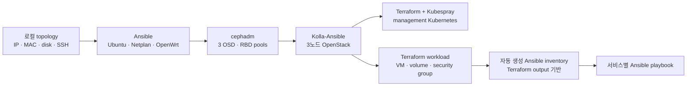
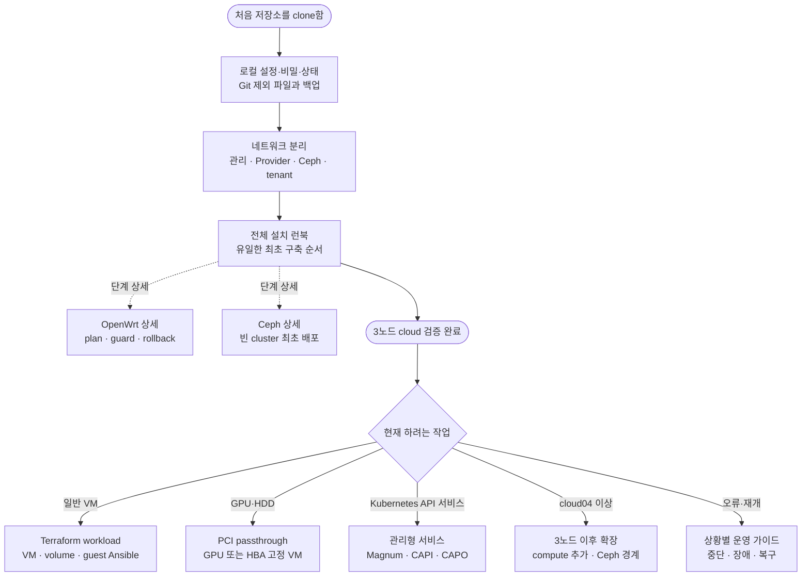

# 문서 안내

이 저장소는 기존 단일 노드를 전환하는 구성이 아니라, `cloud01`~`cloud03`이 모두 준비된
상태에서 Ubuntu Server 24.04, Ceph, OpenStack과 management Kubernetes를 새로 구축하는
자동화다. 실제 IP, MAC, 디스크 시리얼, SSH 키 경로와 인증정보는 Git에서 제외되는 로컬
파일에만 기록한다.

## 자동화 흐름

Terraform 적용과 Ansible 구성은 분리된 단계다. `workload-apply`가 VM을 만든다고 서비스
playbook을 자동 실행하지 않는다. 운영자가 Terraform 결과를 확인한 뒤 `workload-inventory`
또는 `workload-configure`를 실행한다.

## 문서 선택 지도

## 처음 구축할 때 읽는 순서

1. [로컬 전용 설정, 인증정보와 운영 상태](local-secrets-and-state.md)에서 공개 저장소와 로컬
   파일의 경계를 확인한다.
2. [3노드 네트워크 분리](network-segmentation.md)에서 관리, Provider VLAN, Ceph 10Gbps와
   tenant 망을 확정한다.
3. [전체 설치 런북](openstack-runbook.md)을 처음부터 순서대로 실행한다.
4. Ceph 단계에서는 [Ceph 최초 구축과 안전 경계](ceph-transition.md)를 함께 확인한다.
5. OpenWrt 변경 전에는 [OpenWrt Provider VLAN 자동화](openwrt-router.md)의 rollback 조건을
   확인한다.

설치 명령의 기준 문서는 `openstack-runbook.md`다. 구성요소 문서는 상세 조건을 설명하지만
전체 실행 순서를 대체하지 않는다.

구축을 시작한 뒤 특정 오류나 변경 상황에 해당하면
[상황별 운영 가이드](operations-guide.md)에서 지원되는 재개·복구·확장 경로를 먼저 확인한다.

## 구축 후 작업

| 작업 | 기준 문서 | 관리 범위 |
| --- | --- | --- |
| 중단·오류·변경 상황 선택 | [상황별 운영 가이드](operations-guide.md) | 현재 상태 확인, 안전한 재개, 지원 경계 |
| 일반 VM과 서비스 구성 | [서비스별 Terraform workload](terraform-workloads.md) | 독립 Terraform state, 자동 생성 Ansible inventory, 서비스 playbook |
| cloud01 HDD VM | [고정 스토리지 VM](storage-vm.md) | HBA passthrough, host aggregate, 전용 flavor |
| cloud01 GPU VM | [PCI 패스스루 VM](pci-passthrough-vm.md) | GPU VFIO, Nova alias, 고정 배치와 제약 |
| Magnum·CAPI·CAPO | [관리형 서비스](managed-services.md) | management Kubernetes와 OpenStack 관리 서비스 |
| cloud04 이후 추가 | [3노드 이후 확장](three-node-expansion.md) | Kolla compute 확장과 별도 검토가 필요한 Ceph 증설 |

## 참조 문서

| 문서 | 답하는 질문 |
| --- | --- |
| [자동화 범위와 승인 지점](automation-boundaries.md) | 어떤 작업이 자동화되고 어디서 확인값이 필요한가? |
| [로컬 전용 설정, 인증정보와 운영 상태](local-secrets-and-state.md) | 어떤 파일을 Git에서 제외하고 무엇을 백업해야 하는가? |
| [3노드 네트워크 분리](network-segmentation.md) | 각 NIC, VLAN, VIP와 주소 대역의 역할은 무엇인가? |
| [Ceph 최초 구축과 안전 경계](ceph-transition.md) | 어떤 디스크가 초기화되고 기존 OSD가 있으면 왜 중단하는가? |

## 주요 실행 명령

| 단계 | 명령 |
| --- | --- |
| topology 검사와 도구 준비 | `cluster.sh validate`, `cluster.sh setup`, `cluster.sh render` |
| 물리 호스트 | `cluster.sh prepare-hosts`, `cluster.sh verify-hosts` |
| OpenWrt | `cluster.sh openwrt-discover/plan/apply/status` |
| Ceph | `ceph-cluster.sh validate/preflight/bootstrap/...` |
| OpenStack | `cluster.sh deploy-openstack`, `cluster.sh verify-openstack` |
| management Kubernetes | `cluster.sh terraform-plan/apply`, `cluster.sh deploy-kubernetes` |
| 일반 workload VM | `cluster.sh workload-new/plan/show/apply` |
| workload guest 구성 | `cluster.sh workload-inventory/configure` |

사용자가 직접 실행하는 명령과 내부 구현의 구분은 [스크립트 구성](../scripts/README.md),
Ansible playbook 분류는 [Ansible playbook 구성](../ansible/playbooks/README.md)을 따른다.
