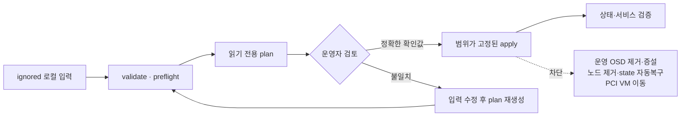

# 자동화 범위와 승인 지점

> 문서 위치: [전체 문서](../README.md) · [아키텍처](README.md)

이 저장소는 새 3노드 Ceph/OpenStack 구축을 기준으로 한다. 각 파괴적 작업은 바로 앞의
읽기 전용 plan이 출력한 확인값을 요구한다.

## 구현 상태

파일이 존재하는 것과 실제 환경에 적용 가능한 자동화, 실제 장비에서 검증된 운영 기능을
구분한다. 저장소 코드는 아래 범위까지 구현돼 있지만 아직 실제 장비에는 적용하지 않았다.

| 영역 | 현재 상태 | 자동화가 수행하는 범위 | 아직 확인하거나 구현할 범위 |
| --- | --- | --- | --- |
| 3노드 OpenStack + Ceph 신규 구축 | 적용 코드 구현, 실환경 미검증 | topology 검증, Ceph bootstrap/OSD/pool, Kolla 배포와 서비스 검사 | 실제 세 장비에서 설치·장애·복원 시험 |
| 네트워크 계획과 복구 guard | 적용 코드 구현, 실환경 미검증 | OpenWrt discovery/plan/apply, 확인 probe, rollback transaction, Netplan 렌더링 | 실제 router·switch·NIC에서 VLAN과 rollback 시험 |
| Terraform VM + Kubespray | 적용 코드 구현, 실환경 미검증 | 저장된 tfplan으로 management VM 생성, inventory 렌더링, Kubernetes 설치·추가 노드 scale | 실제 OpenStack에서 최초 설치와 노드 장애·복구 시험 |
| Magnum + CAPI/CAPO/ORC | 선택형 적용 코드 구현, 기본 비활성화 | 사전조건 검사, 고정 버전 provider 설치, Magnum/Octavia 배포·재구성·상태 검사 | workload image/template 준비와 cluster 생성·확장·업그레이드·삭제 lifecycle 시험 |
| K0smotron Hosted Control Plane | manifest 초안 렌더링만 구현 | flag와 사전조건 검사 후 `Cluster`·`K0smotronControlPlane` 초안 생성 | operator 설치, worker manifest, 실제 apply/status/upgrade/delete, etcd PVC와 API 복구 시험 |

따라서 Magnum/CAPI는 단순 아이디어나 manifest 초안 단계는 아니지만, 기본 topology에서는
의도적으로 꺼져 있다. 반면 K0smotron의 `hosted-plan`은 출력 파일을 검토하기 위한 명령이며
operator를 설치하거나 `kubectl apply`를 실행하지 않는다.

| 단계 | 자동화 | 변경 범위 | 승인값 |
| --- | --- | --- | --- |
| Ubuntu seed | 노드별 autoinstall 렌더 | 일치하는 OS 디스크 | 설치 화면에서 시리얼 확인 |
| OpenWrt | discovery, UCI plan, rollback guard | 관리망·Provider VLAN | plan이 출력한 apply/confirm 값 |
| Kolla data | cloud01 1TB SSD 포맷 | `/var/lib/docker` | `WIPE-OPENSTACK-DATA:...` |
| Ceph bootstrap | MON/MGR cluster 생성 | `/etc/ceph`, cephadm 상태 | `BOOTSTRAP-CEPH:...` |
| Ceph host | MON/MGR host 등록 | 세 Ceph host | `ADD-CEPH-HOSTS:...` |
| Ceph OSD | 빈 디스크 세 개 OSD 생성 | manifest의 by-id만 | `WIPE-CEPH-OSDS:<sha>` |
| Ceph pool | RBD pool과 CRUSH rule | `images`, `volumes`, `vms` | `CONFIGURE-CEPH-POOLS:...` |
| Kolla client | 최소권한 Ceph keyring | ignored generated config | `EXPORT-KOLLA-CEPH-CLIENTS` |
| OpenStack | fresh multinode deploy | 세 host의 Kolla container | root 실행과 사전조건 |
| Terraform | network, volume, VM 3대 | 저장된 tfplan | `APPLY-KUBERNETES-INFRA` |
| Workload 인프라 | 독립 VM stack | 저장된 stack tfplan | plan SHA-256 확인값 |
| Workload guest | Terraform output 기반 inventory와 서비스 playbook | 선택한 VM guest | 명시적인 `workload-configure` 실행 |

## Ubuntu와 디스크

Autoinstall은 topology의 노드별 `os_disk_serial`을 사용한다. 같은 seed를 다른 노드에 재사용하지
않는다. OS 디스크 이외의 Ceph OSD와 HDD는 Autoinstall storage config에 포함하지 않는다.

`prepare-openstack-storage.sh`는 `cloud01`의 1TB SSD 전체를 ext4로 만들어
`/var/lib/docker`에 마운트한다. 다음 장치는 명시적으로 보존한다.

- 128GB OS SSD
- Ceph용 2TB NVMe
- 512GB 여분 SSD
- 4TB와 3TB HDD

공개 예시 시리얼이나 정확하지 않은 확인값으로는 apply가 실행되지 않는다.

## Ceph

Ceph 자동화는 세 host와 빈 cluster의 최초 OSD 배포까지만 담당한다. 다음은 자동화 범위 밖이다.

- 운영 cluster의 OSD 추가·교체·제거
- SATA SSD/HDD class용 추가 pool과 Cinder type
- pool size나 CRUSH failure domain 변경
- 손실된 OSD의 강제 purge
- 재구축 또는 disaster recovery

운영 OSD 변경을 검토할 때는 guard를 제거하지 않고
[Ceph 운영 변경](../operations/ceph-day2.md)의 identity, backup, recovery와 완료 기준을 따른다.

`osd-plan`과 `osd-apply`는 기존 OSD가 하나라도 있으면 중단한다. OSD를 새로 추가할 때 이
guard를 제거하지 말고 별도 증설 workflow를 만든다.

## OpenStack

`deploy-openstack`은 다음 조건을 강제한다.

- 활성 물리 노드가 세 대 이상
- `storage_backend: ceph`
- 세 controller와 세 network node
- Ceph client config와 keyring export 완료
- host 검증 통과

단일 노드 deploy와 LVM-to-Ceph migration은 제공하지 않는다. `expand-openstack`은 이미
검증된 3노드 cloud에 네 번째 이후 host를 추가할 때만 사용한다.

## Terraform과 Kubernetes

기본 Terraform root는 세 management Kubernetes VM을 동시에 선언한다. 세 root volume은
모두 Ceph를 사용하며 control-plane server group은 strict anti-affinity다. tfplan을 새로
만들거나 입력이 바뀌면 이전 확인은 무효다.

애플리케이션 VM은 `terraform/workloads/<stack>`별 독립 state로 관리한다. 공통 module은 root
volume과 instance에 `prevent_destroy`를 설정한다. 교체가 필요한 변경은 먼저 백업과 새
인스턴스 이행 계획을 세운다.

`workload-new`는 Terraform root와 함께 mode `0600`의
`ansible/inventory/workloads/<stack>.local.yml`을 만든다. 이 파일에는 접속 사용자, SSH 키
경로와 주소 선택 방식을 기록하며 Git에서 제외한다. Terraform 적용 후 `workload-inventory`는
`instances` output에서 Floating IP 또는 fixed IP를 선택해 mode `0600`의
`.cache/ansible/workloads/<stack>.yml`을 만든다.

VM 생성과 guest 구성은 의도적으로 분리한다. `workload-apply`는 Ansible을 실행하지 않는다.
운영자가 Terraform 결과와 접속 대상을 확인한 뒤 `workload-configure`를 실행하면 inventory를
다시 만들고 `ansible/playbooks/workloads/<stack>.yml`을 실행한다. 서비스별 package, 설정과
secret 처리 방식은 해당 playbook에 명시하며 자동으로 생성하지 않는다.

다음 조건에서는 inventory 생성이나 구성을 중단한다.

- Terraform output에 인스턴스가 없거나 선택한 주소가 없는 경우
- 주소가 올바른 IP 형식이 아닌 경우
- settings가 존재하지 않는 instance key를 참조하는 경우
- SSH 개인키가 절대경로가 아니거나 읽을 수 없는 경우
- settings 또는 생성 inventory의 권한이 `0600`이 아닌 경우

자세한 작업 순서는 [서비스별 Terraform workload](../workloads/terraform.md)를 따른다.

## cloud01 고정 PCI VM

4TB·3TB HDD용 storage VM과 GPU VM은 3노드 OpenStack 검증 이후에만 만든다. 자동화 경계는
다음과 같다.

1. 운영자가 실제 HBA PCI 주소와 IOMMU group을 확인한다.
2. ignored Nova config에 exact address, vendor/product ID와 장치별 alias를 기록한다.
3. Kolla reconfigure 후 Nova가 PCI 장치를 inventory로 보고하는지 확인한다.
4. Terraform이 cloud01 aggregate, 전용 flavor와 고정 VM을 생성한다.

장치가 연결된 `cloud01`에만 배치되며 live migration이나 HA 대상이 아니다. OS 디스크와 같은
SATA controller를 넘기지 않는다. HBA는 [스토리지 VM](../workloads/storage-vm.md), GPU는
[PCI 패스스루 VM](../workloads/pci-passthrough.md)을 따른다.

## 비밀과 상태

실제 MAC, IP, 디스크 시리얼, SSH 키, Ceph keyring, Kolla passwords, clouds.yaml, Terraform
state와 kubeconfig는 공개 저장소에 넣지 않는다. 파일 목록과 백업 기준은
[로컬 설정·비밀·상태](../operations/local-data-and-recovery.md)에 있다. 복구 archive와 시험은
[백업과 복원](../operations/backup-and-restore.md), 개인 운영 장비 분실과 credential 노출은
[홈랩 보안](../operations/security.md)을 따른다.
