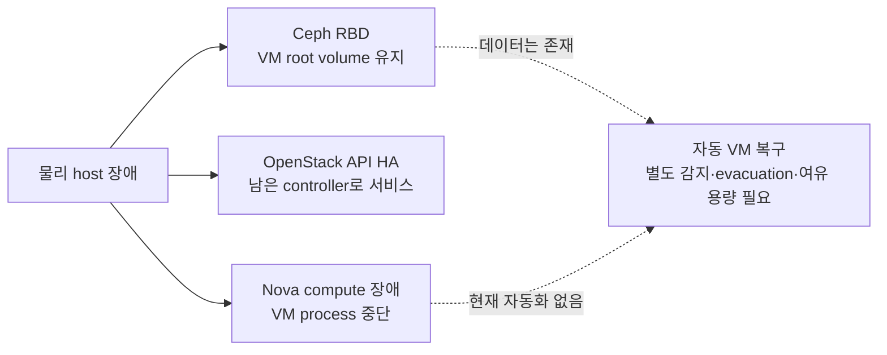

# 현재 한계와 운영 전 검토 사항

> 문서 위치: [전체 문서](../README.md) · [아키텍처](README.md)

이 문서는 현재 저장소 코드가 보장하는 범위와 물리 환경에서 추가로 결정해야 할 사항을
구분한다. Ceph의 데이터 복제, OpenStack control plane HA와 VM 자동 복구는 서로 다른 기능이다.

## 현재 판정

| 항목 | 코드 기준 판정 | 구축 전 결정 |
| --- | --- | --- |
| 물리 노드 장애 후 VM 복구 | 자동 복구를 보장하지 않음 | 장애 시 2개 Kubernetes control plane으로 운영할지, 추가 compute와 자동 evacuation을 둘지 결정 |
| Ceph 디스크 class | 실제 장치와 선언이 다르면 preflight에서 차단 | OpenStack pool에 사용할 같은 class를 세 host에 준비 |
| Ceph 10Gbps 물리망 | 단일 interface와 단일 network 기준 | 단일 switch 장애를 수용하거나 이중 NIC·switch 설계를 별도로 추가 |
| Terraform state | 기본 local state, off-host 자동 백업 없음 | 암호화 백업 주기와 복원 시험 정의 |
| Magnum/CAPI | 기본 비활성화된 후속 단계 | 기본 cloud 검증 후 생성·확장·삭제·복구 시험 |
| 관측과 알림 | Prometheus/Grafana 비활성화, 통합 알림 없음 | metrics, logs, SMART, network 알림과 보존 위치 설계 |

## 1. 물리 노드 장애와 VM 복구

management Kubernetes control plane VM은 Nova server group의 strict `anti-affinity`를 사용한다.
정상 상태에서 세 VM이 세 물리 host에 하나씩 배치되는 것은 보장하지만, 물리 host 한 대가
사라졌을 때 해당 VM을 자동으로 다시 만드는 기능은 아니다.

현재 Kolla 설정은 `enable_masakari: "no"`다. Nova compute 장애를 자동 감지해 instance를
evacuate하는 workflow가 없으며, 세 물리 host에 세 strict anti-affinity VM을 배치한 구조에는
장애 후 세 번째 VM을 수용할 별도 failure domain도 없다. Ceph root volume이 남아 있어도 VM
process가 자동으로 다른 host에서 시작되는 것은 아니다.

한 host 장애 시 나머지 두 Kubernetes control plane과 두 etcd member가 정상이면 quorum은
유지할 수 있다. 이것은 장애 VM이 복구됐다는 뜻은 아니다. 복구 시간을 줄이려면 다음을 함께
설계하고 실제 장애 시험으로 확인한다.

- 네 번째 이상의 compute host와 장애 시 사용할 CPU/RAM 여유
- strict anti-affinity를 유지할지, 복구 시 정책을 완화할지에 대한 명시적 결정
- instance evacuation 또는 Masakari 도입과 fencing 방식
- compute 전원 차단, Ceph volume 재연결, Kubernetes/etcd 정상성 검증 절차

초기 3노드에서 단순히 strict anti-affinity를 soft 정책으로 바꾸면 정상 상태에서도 VM이 같은
host에 모일 수 있으므로 기본 해결책으로 사용하지 않는다.

## 2. Ceph device class와 실제 디스크

추적되는 topology 예시는 OpenStack RBD pool class를 `nvme`로 선언한다. 하지만 자동화가 이
문자열만 믿고 배포하는 것은 아니다.

`ceph-cluster.sh validate`는 다음 조건을 확인한다.

- `openstack_pool_device_class`가 `hdd`, `ssd`, `nvme` 중 하나
- 선택한 pool class가 최소 세 OSD host에 존재
- 선언된 모든 device class가 size=3을 만족하도록 최소 세 host에 존재

`verify-ceph-devices.yml` preflight는 `lsblk`의 `ROTA`, `TRAN`과 실제 device 이름을 확인한다.
SATA/SAS SSD를 `nvme`로 선언하거나 NVMe를 `ssd`로 선언하면 적용 전에 중단한다. 따라서
cloud01이 NVMe이고 cloud02·cloud03이 SATA SSD인 상태를 모두 `nvme`로 속여 구성할 수 없다.

초기 OpenStack pool은 다음 중 하나로 통일한다.

1. 세 host 모두 NVMe를 사용하고 pool class를 `nvme`로 유지한다.
2. 세 host 모두 SATA/SAS SSD를 사용하고 각 OSD 및 pool class를 `ssd`로 바꾼다.
3. 각 class를 세 failure domain에 준비한 뒤 class별 CRUSH rule, pool과 Cinder volume type을
   별도 설계한다. 이 경로는 현재 최초 구축 자동화 범위 밖이다.

용량이 같다는 이유만으로 다른 class를 같은 pool 정책에 섞지 않는다.

## 3. Ceph 10Gbps 네트워크 장애

현재 topology는 host당 하나의 `ceph_interface`와 하나의 Ceph public/client network를 사용한다.
`cluster_network`도 기본적으로 비어 있어 client I/O와 OSD recovery가 같은 10Gbps 경로를
사용한다. 이 경로가 단일 switch에 연결되면 switch는 Ceph 전체의 물리적 단일 장애 지점이다.

초기 홈랩에서 이를 수용한다면 예비 switch, 설정 백업과 교체 절차를 준비한다. 네트워크 HA가
필요하면 다음 항목을 별도 설계해야 하며 현재 Netplan 자동화에는 포함되지 않는다.

- host당 두 개의 Ceph NIC와 bond
- 서로 다른 전원 및 물리 switch
- switch 간 MLAG 또는 동등한 이중화 방식
- bond mode, MTU, failure 감지 시간과 실제 cable/switch 장애 시험

## 4. Terraform state와 복구

management Kubernetes root와 각 workload root는 기본적으로 local state를 사용한다. state를
스택별로 분리해 변경 범위는 줄였지만 운영 host 디스크 손실에 대한 자동 복구는 제공하지
않는다. `terraform.tfstate*`, 실제 변수, cloud credential과 적용 Git commit을 같은 시점의
암호화된 외부 백업으로 보관하고 복원을 시험해야 한다.

workload root는 검토된 remote backend로 이전할 수 있지만 backend의 암호화, locking, 백업과
credential 공급을 별도로 설계해야 한다. management Kubernetes용 `terraform/openstack` state는
현재 Kubespray inventory renderer와 platform 자동화가 로컬 `terraform.tfstate` 경로를 직접
검증한다. 이 root를 remote backend로 옮기려면 state 출력 소비 방식도 함께 수정해야 한다.

세부 파일 목록은 [로컬 데이터와 복구](../operations/local-data-and-recovery.md), workload state
운영은 [Terraform workload](../workloads/terraform.md)를 따른다.

## 5. Magnum/CAPI 후속 단계

기본 topology의 `cluster.platform.magnum_capi.enabled`는 `false`다. 이는 누락이 아니라 기본
Ceph, OpenStack과 management Kubernetes를 먼저 검증하기 위한 순서다. 활성화 전 다음 lifecycle
시험을 별도로 수행한다.

- Kubernetes cluster 생성과 Ready 도달
- worker 및 control plane 확장
- 실패한 machine 교체
- cluster 삭제 후 OpenStack port, volume, Floating IP 정리
- management controller 재시작 후 reconciliation
- credential 만료·교체와 backup 복원

물리 OpenStack host 확장은 관리형 플랫폼 활성화 전에 완료하는 것이 현재 자동화 경계다.

## 6. 관측, 알림과 복원 시험

현재 Kolla 설정은 `enable_prometheus: "no"`, `enable_grafana: "no"`,
`enable_opensearch: "no"`, `enable_fluentd: "yes"`다. Fluentd가 실행된다는 사실만으로 중앙 로그
검색, metrics, alert routing이 완성되지는 않는다.

운영 workload를 올리기 전에 최소한 다음 신호와 대응자를 정한다.

| 영역 | 최소 관측 항목 |
| --- | --- |
| Ceph | health, degraded PG, OSD/MON 상태, 사용률, recovery latency |
| OpenStack | API, Galera/RabbitMQ quorum, nova-compute, Neutron/OVN, Cinder |
| 물리 host | CPU/RAM, filesystem, container, NIC error/drop, 온도 |
| 디스크 | SMART, media error, wear, 예상 교체 시점 |
| Kubernetes | API/etcd, node Ready, control plane pod와 persistent volume |
| 백업 | 마지막 성공 시각, 보존 기간, 정기 복원 시험 결과 |

Prometheus와 Grafana를 켜면 converged 세 노드의 RAM·CPU·디스크 사용량도 증가한다. 활성화 여부만
바꾸지 말고 retention, 외부 알림 목적지, 장애 시에도 남는 저장 위치와 자원 예산을 함께
정한다.

## 적용 우선순위

1. **첫 설치 전:** 실제 세 OSD의 class, 10Gbps switch 장애 수용 여부, state/credential 외부
   백업 위치를 확정한다.
2. **운영 workload 전:** 물리 host 한 대 전원 차단 시험과 Ceph/OpenStack/Kubernetes 상태를
   확인하고 기본 metrics·SMART·알림을 구성한다.
3. **관리형 서비스 전:** CAPI lifecycle과 credential 복구 시험을 완료한다.
4. **규모 확장 시:** 추가 compute 용량, 자동 evacuation, remote state와 이중화 네트워크를
   요구 수준에 맞춰 도입한다.
