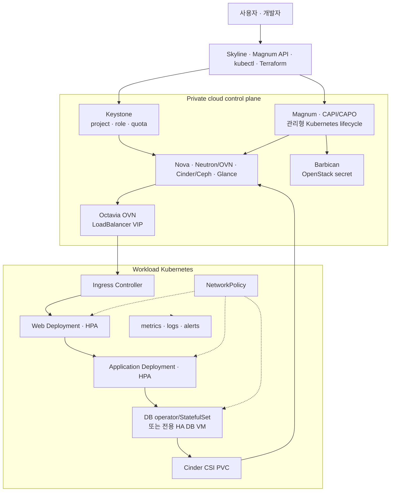

# AWS·Azure·GCP 수준의 관리형 클라우드 목표

> 문서 위치: [전체 문서](../README.md) · [아키텍처](README.md)

이 저장소의 목표는 세 퍼블릭 클라우드의 규모, 전 세계 region 또는 SLA를 복제하는 것이 아니다.
홈랩 사용자가 API와 선언형 입력으로 network, compute, Kubernetes, storage와 load balancer를 만들고
확장·복구·관측할 수 있는 **관리 경험**을 비슷하게 만드는 것이다.

## 서비스 대응표

| 사용자 기능 | AWS | Azure | GCP | 이 저장소의 대응 | 현재 수준 |
| --- | --- | --- | --- | --- | --- |
| VM | EC2 | Virtual Machines | Compute Engine | Nova | 자동화됨 |
| 가상망 | VPC | VNet | VPC | Neutron/OVN | 자동화됨 |
| block volume | EBS | Managed Disk | Persistent Disk | Cinder + Ceph RBD | 자동화됨 |
| image | AMI | Compute Gallery | Machine Image | Glance | 기본 cloud 기능 |
| IAM/project | IAM/Account | Entra/RBAC/Subscription | IAM/Project | Keystone project/role/quota | 기본 cloud 기능, self-service 정책 보강 필요 |
| load balancer | ALB/NLB | Azure Load Balancer/Application Gateway | Cloud Load Balancing | Octavia OVN + Ingress Controller | 플랫폼 자동화됨, workload 시험 필요 |
| 관리형 Kubernetes | EKS | AKS | GKE | Magnum + CAPI/CAPO | 선택적 자동화, lifecycle 검증 필요 |
| Pod 자동 확장 | HPA/KEDA | HPA/VPA/KEDA | HPA/VPA | HPA + metrics adapter | 미구현 |
| node 자동 확장 | Cluster Autoscaler/Karpenter | Cluster Autoscaler/NAP | Cluster Autoscaler/NAP | CAPI MachineDeployment + Cluster Autoscaler | 미구현 |
| 관리형 DB | RDS/Aurora | Azure Database | Cloud SQL/Spanner | Trove 또는 DB operator/HA VM | 미구현 |
| object storage | S3 | Blob Storage | Cloud Storage | Swift 또는 Ceph RGW | 미구현 |
| DNS | Route 53 | Azure DNS | Cloud DNS | Designate | 미구현 |
| secret | Secrets Manager/KMS | Key Vault | Secret Manager/KMS | Barbican + Kubernetes secret controller | OpenStack 계층만 일부 구현 |
| 관측 | CloudWatch | Azure Monitor | Cloud Monitoring | Prometheus/Grafana/log backend/Alertmanager | 기본 비활성 |
| VM host 복구 | EC2 platform recovery | Service Healing | host maintenance/migration | Masakari + fencing | Instance Monitor만 적용 |

`자동화됨`은 저장소 코드가 존재한다는 뜻이며 실제 장비에서 장애·복원 시험을 통과했다는 뜻은
아니다. `선택적 자동화`는 topology flag를 켠 뒤 별도 apply와 lifecycle 검증이 필요한 단계다.

## 퍼블릭 클라우드와 같게 만들 핵심 동작

### 1. Self-service와 선언형 lifecycle

사용자는 물리 host를 직접 선택하지 않고 flavor, volume 크기, network와 replica 수를 선언한다.
Keystone project quota가 한 사용자의 VM, vCPU, RAM, volume과 Floating IP 사용량을 제한해야 한다.
Magnum cluster template은 Kubernetes version, control-plane/worker flavor, node 수, network와 volume
정책을 고정하고 생성·scale·upgrade·delete를 같은 API로 처리해야 한다.

### 2. 공개 endpoint와 private workload

공개 Floating IP는 Octavia LoadBalancer 또는 승인된 reverse proxy에만 둔다. Kubernetes worker,
Web/Application/Database Pod와 DB VM에는 직접 공개 IP를 주지 않는다. Pod 경계는 NetworkPolicy,
VM 경계는 Neutron security group으로 관리한다.

AWS EKS, AKS와 GKE 모두 load balancer와 cluster 내부 정책을 별도 계층으로 다룬다. 예를 들어
[EKS NetworkPolicy](https://docs.aws.amazon.com/eks/latest/userguide/cni-network-policy.html),
[AKS network security 권장사항](https://learn.microsoft.com/en-us/azure/aks/network-policy-best-practices),
[GKE NetworkPolicy](https://cloud.google.com/kubernetes-engine/docs/how-to/network-policy)는 Pod 통신
제어와 load balancer health 경로를 함께 검증하도록 안내한다.

### 3. Pod 확장과 node 확장

Deployment HPA는 replica를 늘리지만 cluster에 빈 자원이 없으면 Pod가 Pending에 머문다. Cluster
Autoscaler는 Pending Pod를 보고 CAPI MachineDeployment의 worker 수를 늘려야 한다. 반대로 scale
down은 PodDisruptionBudget, local storage, Cinder attachment와 DB member를 확인해야 한다.

[AKS scaling 개요](https://learn.microsoft.com/en-us/azure/aks/concepts-scale)와
[GKE Cluster Autoscaler](https://cloud.google.com/kubernetes-engine/docs/how-to/cluster-autoscaler)처럼
Pod와 node 확장을 별도 제어 루프로 취급한다. 이 저장소도 다음 순서로 구현한다.

1. metrics-server와 resource request/limit
2. stateless Web/Application HPA
3. CAPI provider와 호환되는 Cluster Autoscaler
4. node pool별 `min`, `max`, flavor와 project quota
5. load test, Pending Pod scale-up와 safe scale-down 시험

### 4. 데이터 서비스

Ceph replica와 Cinder PVC는 volume block을 보호하지만 RDS, Azure Database, Cloud SQL 같은 관리형
DB를 제공하지 않는다. 같은 사용자 경험을 원하면 다음 중 하나를 별도 서비스로 선택해야 한다.

- OpenStack Trove의 지원 DB/version과 backup lifecycle을 검증해 DBaaS로 제공
- workload Kubernetes에 검증된 DB operator를 설치하고 database별 CRD를 제공
- Terraform/Ansible이 만드는 전용 HA DB VM과 native backup/restore를 표준화

첫 단계에서는 DB 종류를 정하지 않은 범용 자동 설치를 하지 않는다. PostgreSQL, MySQL 등의
복제·승격·upgrade·backup 방식이 다르기 때문이다. 관리형으로 표시하기 전 생성, failover,
point-in-time recovery, credential rotation, version upgrade와 삭제 후 잔여 volume을 시험한다.

### 5. 관측과 운영

퍼블릭 클라우드 수준의 체감 차이는 생성 화면보다 장애 시 상태와 원인을 보여주는 데서 생긴다.
OpenStack API, Ceph, 물리 host, Octavia, CAPI condition, Kubernetes node/Pod, PVC, application SLI와
backup 성공 여부를 한 곳에서 보고 alert를 받아야 한다. 현재 Prometheus/Grafana가 기본
비활성화되어 있으므로 [관측과 알림](../operations/observability.md)의 후속 구현이 필요하다.

## 단계별 완성 기준

| 단계 | 완료 기준 |
| --- | --- |
| 1. IaaS | project 사용자가 Terraform/API로 VM·network·Ceph volume을 만들고 quota와 삭제 경계를 확인 |
| 2. Kubernetes | Magnum cluster 생성, worker scale, upgrade, delete와 orphan 정리 시험 통과 |
| 3. 3티어 | Octavia VIP→Ingress→Web→App→DB, default-deny policy와 Cinder PVC 복원 통과 |
| 4. 탄력성 | HPA 부하 시험과 Cluster Autoscaler node 증감, quota 초과·scale-down 실패 원인 표시 |
| 5. 데이터 서비스 | 선택한 DB 방식의 failover, PITR, upgrade와 credential rotation 통과 |
| 6. 운영 서비스 | 통합 dashboard, alert routing, audit, 정기 backup/restore와 장애 훈련 |

현재 저장소는 1단계 코드와 2단계 기반을 갖췄고, 실제 장비에서 검증해야 한다. 3단계는
[관리형 Kubernetes 3티어](../workloads/kubernetes-three-tier.md)의 설계와 NetworkPolicy 예시를
추가했다. 4~6단계는 아직 구현 완료로 표시하지 않는다.

## 홈랩에서 유지되는 한계

- cloud01~03은 같은 장소와 일부 switch/router를 공유하므로 AWS AZ, Azure Zone, GCP Zone과 같은
  물리 장애 격리가 아니다.
- controller, compute와 Ceph OSD가 같은 세 host에 있어 부하와 장애 영향이 서로 결합된다.
- public cloud처럼 공급자가 control plane을 외부에서 운영해 주지 않으므로 management Kubernetes와
  CAPI 자체도 사용자가 백업·복구해야 한다.
- 인터넷 회선, OpenWrt, 관리 switch와 10Gbps Ceph switch의 장애는 별도 이중화 없이는 남는다.
- 3노드 자원 한계 때문에 node autoscaling의 최대치는 실제 Nova quota와 N+1 여유 안에서만 의미가
  있다. autoscaler가 물리 CPU/RAM을 새로 만들어 주지는 않는다.

이 한계를 숨기지 않고 API, lifecycle, 정책과 운영 절차를 퍼블릭 클라우드와 비슷하게 만드는 것이
이 저장소의 목표다.
