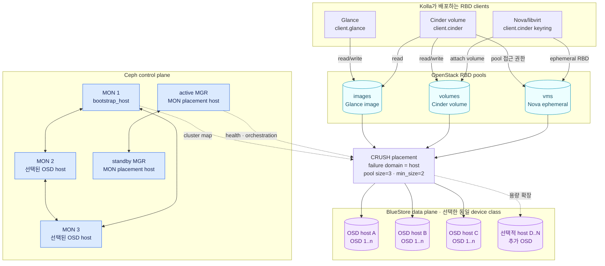
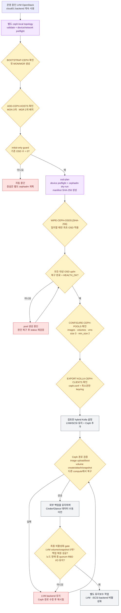
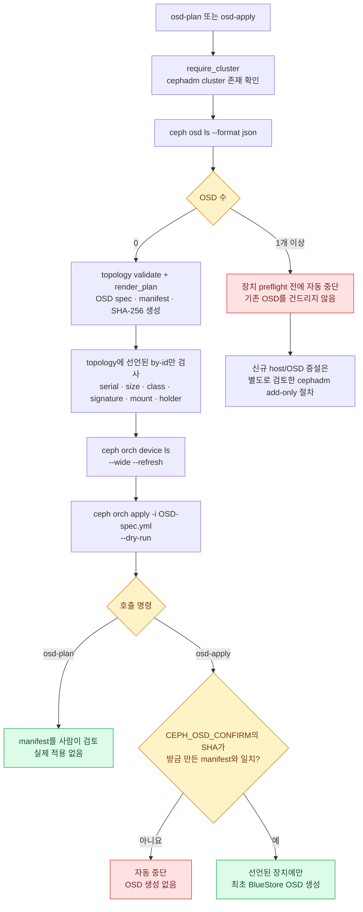

# 외부 Ceph 안전 전환 절차

`scripts/ceph-cluster.sh`는 3대 이상의 Ubuntu 호스트에 cephadm 클러스터를 준비하고,
Kolla-Ansible이 사용할 최소 권한 설정을 내보낸다. 기본 동작은 검증과 dry-run이다. 디스크의
기존 서명을 지우는 명령, OSD 제거 명령, LVM·Glance·Nova 데이터 이전 명령은 제공하지 않는다.

계획된 첫 Ceph 토폴로지는 `cloud01`에서 단일 노드 기간 내내 비워 둔 2TB NVMe와
`cloud02`, `cloud03`의 2TB NVMe를 OSD 한 개씩 사용한다. 세 호스트의 Ceph public/client
주소는 전용 10Gbps 망 `192.168.30.0/24`에 두며, 관리·Provider·OVN 트래픽과 물리 경로를
공유하지 않는다. 실제 NIC 이름, MAC과 주소는 Git에서 제외되는 로컬 Netplan 및 Ceph
토폴로지에 기록하고 세 호스트에서 연결을 검증한 뒤 bootstrap한다.

Ceph OSD를 적용하면 선택한 빈 디스크가 BlueStore 장치로 사용된다. 해당 디스크는 이후 일반
파일시스템이나 로컬 Cinder VG로 사용할 수 없다. 세 복제본을 사용하는 이 구성의 가용 용량은
대략 원시 용량의 3분의 1이며, 한 노드 장애 중 세 번째 복제본을 다시 만들 공간도 남겨야 한다.
Ceph 전용 로컬 topology, keyring과 클러스터 복구 상태의 보관 기준은
[로컬 전용 설정, 인증정보와 운영 상태](local-secrets-and-state.md)를 따른다.

완료된 Ceph의 제어부, OSD와 OpenStack client 관계는 다음과 같다. MON 정족수와
MGR은 클러스터 상태를 관리하고, 실제 RBD 데이터는 같은 device class를 가진 3대
이상의 OSD 호스트에 host failure domain으로 배치된다. 각 RBD object의 복제본
3개는 서로 다른 OSD 호스트를 사용한다. MON은 고정 이름이 아니라
`bootstrap_host`와 정렬된 OSD 호스트 중 앞선 호스트에 배치된다. 기본 3노드
topology에서는 그 결과가 `cloud01`∼`cloud03`이다.



기존 LVM 클라우드를 전환하는 전체 흐름은 다음과 같다. `ceph-cluster.sh`의 자동화
범위는 Kolla client 설정을 내보내는 단계까지다. hybrid Kolla 설정, 기존 데이터
이전과 최종 LVM 비활성화는 각각 검토한 유지보수 작업으로 수행한다. 그림에서
보라색 구간은 저장소 자동화가 제공하는 단계이고, 회색 구간은 별도로 검토해야 하는
운영 변경이다. 노란색은 반드시 통과해야 하는 확인·검증 gate이고, 빨간색에서는
다음 단계로 진행하지 않는다.



## 기존 LVM 클라우드와 topology 분리

현재 LVM OpenStack을 운영 중이면 기본
`inventory/openstack-cluster.local.yml`은 `storage_backend: lvm` 상태로 유지한다. 실제 망과
노드 값을 이어받도록 이 파일을 복사해 Ceph 작업 전용 파일을 별도로 만든다.
`inventory/*.local.yml`은 Git에서 제외된다.

```bash
umask 077
test -e inventory/openstack-cluster.ceph.local.yml || \
  cp inventory/openstack-cluster.local.yml inventory/openstack-cluster.ceph.local.yml
chmod 0600 inventory/openstack-cluster.ceph.local.yml
```

Ceph 전용 파일에서만 다음 값을 설정한다.

- `cluster.storage_backend: ceph`
- `cluster.ceph.enabled: true`
- `cluster.ceph.openstack_pool_device_class: nvme`
- `cloud01`, `cloud02`, `cloud03`을 함께 활성화
- 각 호스트의 실제 `ceph_address`
- 각 OSD 호스트의 빈 디스크를 `/dev/disk/by-id`로 명시

모든 Ceph 명령에는 이 파일을 명시한다.

```bash
export OPENSTACK_CLUSTER_CONFIG=inventory/openstack-cluster.ceph.local.yml
```

이 분리는 기존 LVM 클라우드의 Kolla globals가 Ceph 전용 설정으로 바뀌는 것을 막는다. 전환이
끝나기 전에는 Ceph topology를 지정한 상태에서 `scripts/cluster.sh deploy-openstack` 또는
`expand-openstack`을 실행하지 않는다. 새 3노드 클라우드를 처음부터 Ceph로 설치하는 경우에만
기본 cluster topology 자체를 Ceph로 설정할 수 있다.

## OSD 장치 입력

각 장치는 다음 네 값을 모두 가져야 한다.

```yaml
ceph_osd_devices:
  - by_id: /dev/disk/by-id/wwn-0xREPLACE_WITH_REAL_WWN
    serial: REPLACE_WITH_EXACT_LSBLK_SERIAL
    min_size_bytes: 3900000000000
    device_class: hdd
```

장치명 `/dev/sdb`처럼 재부팅 후 바뀔 수 있는 경로는 허용하지 않는다. `device_class`는 `hdd`,
`ssd`, `nvme` 중 하나다. 이는 제조사나 모델명이 아니라 Ceph가 매체 특성별로 구분하는
장치 class다. 동일 모델일 필요는 없지만, 선택한 OpenStack 풀 class가 적어도 세 호스트에
있어야 한다. 크기와 성능이 비슷한 장치를 쓰는 편이 좋다. 크기가 다른 OSD를 사용하면 호스트
장애 도메인과 `size=3` 배치 때문에 가장 작은 호스트의 용량이 전체 가용 용량을 제한할 수
있다.

`cluster.ceph.openstack_pool_device_class`는 `images`, `volumes`, `vms` 풀에 사용할 class를
하나 고른다. 기본 예시는 `nvme`다. 자동화는 선택한 class만 쓰는 host failure-domain CRUSH
rule을 만들고 세 풀을 그 rule에 고정하므로 HDD와 SSD를 임의로 섞지 않는다. 다른 class도
사용하려면 별도 풀, CRUSH rule과 Cinder volume type을 설계해야 한다.

OSD를 두지 않는 compute 전용 노드는 `ceph_osd_devices: []`로 둔다. 이 노드는 OSD preflight와
cephadm host 등록 대상에서 제외되며, Kolla가 배포한 RBD client로 Ceph를 사용한다. bootstrap
호스트와 명시적인 OSD 호스트만 cephadm cluster member가 되고, OSD 호스트는 항상 세 대 이상
필요하다.

preflight는 다음 조건을 모두 확인한다.

- by-id 링크, 실제 시리얼, 최소 바이트 크기, 장치 class가 topology와 일치
- 전체 디스크이며 파티션이나 mapped child가 없음
- 파일시스템·GPT·LVM·RAID 등 `wipefs`/`blkid` 서명이 없음
- 마운트, swap, LVM PV, holder가 아님
- 활성 root 파일시스템의 상위 디스크가 아님
- Ceph public network와 선택한 cluster network 주소가 호스트에 실제로 존재
- cephadm container와 충돌할 수 있는 host 설치 `ceph-osd` 패키지가 없음

하나라도 실패하면 스크립트는 디스크를 정리하지 않고 중단한다. 기존 서명이 있는 디스크는
백업과 물리 장치 재확인을 마친 뒤 운영자가 별도 절차로 비워야 한다.

## 검증과 cephadm bootstrap

먼저 topology와 모든 장치를 읽기 전용으로 확인한다.

```bash
sudo ./scripts/ceph-cluster.sh setup
./scripts/ceph-cluster.sh validate
./scripts/ceph-cluster.sh preflight
```

bootstrap은 `config/versions.env`의 정확한 `CEPH_IMAGE` 태그를 사용한다. `latest` 태그를
사용하지 않는다. topology의 `cluster.ssh_private_key`와 그 `.pub` 파일은 모든 노드의
`ansible_user`에 이미 등록되어 있어야 하고, 그 사용자는 암호 없이 sudo를 실행할 수 있어야
한다.

```bash
export CEPH_BOOTSTRAP_CONFIRM='BOOTSTRAP-CEPH:cloud01,cloud02,cloud03'
sudo --preserve-env=OPENSTACK_CLUSTER_CONFIG,CEPH_BOOTSTRAP_CONFIRM \
  ./scripts/ceph-cluster.sh bootstrap
```

bootstrap은 첫 MON/MGR과 cephadm 설정만 만든다. OSD는 만들지 않는다. 다음 명령으로 나머지
호스트를 명시된 Ceph 주소로 추가하고, 세 호스트에 MON을 배치하며 두 MGR을 요청한다.
기존 `/etc/ceph/ceph.conf` 또는 `/var/lib/ceph/<FSID>` 상태가 있으면 새 cluster bootstrap을
거부한다.

```bash
export CEPH_HOSTS_CONFIRM='ADD-CEPH-HOSTS:cloud01,cloud02,cloud03'
sudo --preserve-env=OPENSTACK_CLUSTER_CONFIG,CEPH_HOSTS_CONFIRM \
  ./scripts/ceph-cluster.sh add-hosts
sudo --preserve-env=OPENSTACK_CLUSTER_CONFIG \
  ./scripts/ceph-cluster.sh status
```

하이퍼컨버지드 노드에서 Ceph가 OpenStack 메모리를 잠식하지 않도록 topology의
`osd_memory_target_ratio`를 적용한다. 기본 계획은 `0.2`다. 실제 VM 수와 RAM에 맞춰 부하
시험 후 조정한다.

## OSD dry-run과 적용 확인

`osd-plan`과 `osd-apply`는 OSD가 하나도 없는 Ceph 클러스터의 **최초 OSD 배포 전용**이다.
두 명령은 먼저 `ceph osd ls --format json` 결과를 검사하며 기존 OSD가 하나라도 있으면 장치
preflight 전에 중단한다. 운영 중인 Ceph에 새 호스트나 OSD만 추가하는 증설 workflow는 아직
구현되지 않았으므로 이 명령을 반복 실행하지 않는다. 기존 OSD를 지워서 guard를 우회하지 말고
별도로 검토한 cephadm 증설 절차를 사용해야 한다.



`osd-plan`은 장치 preflight를 다시 수행한 직후 cephadm dry-run을 실행한다. 출력의 호스트와
장치 경로가 topology와 정확히 일치하는지 확인한다.

```bash
sudo --preserve-env=OPENSTACK_CLUSTER_CONFIG \
  ./scripts/ceph-cluster.sh osd-plan
cat .cache/ceph/ceph-osd-manifest.txt
cat .cache/ceph/ceph-osd-manifest.sha256
```

실제 적용은 같은 preflight와 dry-run을 다시 실행하며, 현재 manifest의 SHA256이 확인 문자열과
정확히 같아야 한다.

```bash
plan_sha=$(cat .cache/ceph/ceph-osd-manifest.sha256)
export CEPH_OSD_CONFIRM="WIPE-CEPH-OSDS:${plan_sha}"
sudo --preserve-env=OPENSTACK_CLUSTER_CONFIG,CEPH_OSD_CONFIRM \
  ./scripts/ceph-cluster.sh osd-apply
```

Ceph dry-run은 그 시점의 장치 상태만 보여준다. plan 이후 케이블, HBA, 디스크 또는 topology가
바뀌었다면 다시 `osd-plan`부터 실행한다. 이 스크립트는 `--all-available-devices`를 사용하지
않으며 topology에 적힌 by-id 경로만 OSD spec에 넣는다.

적용한 cephadm OSD spec은 지속적으로 reconcile된다. topology의 같은 by-id 디스크를 외부
명령으로 제거하고 다시 비우면 cephadm이 그 디스크에 OSD를 다시 만들 수 있다. 이 저장소는
그 제거·zap 명령을 제공하지 않는다. 장치를 폐기하거나 교체할 때는 먼저 해당 OSD service
spec을 조회하고 managed 상태를 중단하거나 경로를 제거하는 별도 변경 계획이 필요하다.

## RBD 풀과 Kolla client export

세 호스트에서 OSD가 `up`이면서 `in` 상태가 되고 복구가 끝난 뒤 풀을 만든다. 스크립트는
세 OSD 호스트뿐 아니라 명령 시점의 `HEALTH_OK`도 요구한다.

```bash
export CEPH_POOL_CONFIRM='CONFIGURE-CEPH-POOLS:nvme:size3:min2'
sudo --preserve-env=OPENSTACK_CLUSTER_CONFIG,CEPH_POOL_CONFIRM \
  ./scripts/ceph-cluster.sh configure-pools
```

`images`, `volumes`, `vms` 풀을 생성하거나 기존 설정을 확인하고 각각 `size=3`, `min_size=2`,
PG autoscaler와 RBD application을 적용한다. 예시에서 `nvme`를 다른 class로 바꿨다면 확인
문자열에도 같은 class를 사용한다. 선택한 class의 `up/in` OSD가 세 호스트에 없거나 풀의
CRUSH rule이 해당 class와 host failure domain을 사용하지 않으면 중단한다.

Kolla용 `client.glance`와 `client.cinder`를 만들고 설정을 내보낸다.

```bash
export CEPH_EXPORT_CONFIRM='EXPORT-KOLLA-CEPH-CLIENTS'
sudo --preserve-env=OPENSTACK_CLUSTER_CONFIG,CEPH_EXPORT_CONFIRM \
  ./scripts/ceph-cluster.sh export-kolla
```

파일은 Git에서 제외되는 `kolla/generated/ceph-config/` 아래에 mode `0600`으로 생성된다.

```text
glance/ceph.conf
glance/ceph.client.glance.keyring
cinder/ceph.conf
cinder/cinder-volume/ceph.client.cinder.keyring
nova/ceph.conf
nova/ceph.client.cinder.keyring
```

`client.cinder`는 `volumes`와 `vms`, 그리고 `images` 읽기 권한만 가진다. Nova도 Kolla 기본값에
따라 같은 사용자를 쓴다. `export-kolla`는 `/etc/kolla`를 변경하거나 Kolla reconfigure를
실행하지 않는다.

## 기존 OpenStack 전환 경계

기존 클라우드에서는 내보낸 파일을 검토한 뒤 별도 hybrid Kolla 설정으로 Ceph를 **추가**한다.
이 단계에서는 로컬 백엔드를 계속 유지해야 한다.

```yaml
enable_cinder_backend_lvm: "yes"
enable_cinder_backend_iscsi: "yes"
cinder_backend_ceph: "yes"
glance_backend_file: "yes"
glance_backend_ceph: "yes"
```

Nova ephemeral 디스크까지 Ceph로 전환할 준비가 끝나기 전에는 `nova_backend_ceph` 변경도
분리해서 검토한다. Ceph backend를 Kolla로 reconfigure한 후 새 테스트 볼륨의 생성, 연결,
분리, snapshot, 재부팅과 복구를 먼저 시험한다.

이 저장소는 LVM 볼륨을 자동으로 Ceph에 복사하지 않는다. Cinder 마이그레이션은 백업과 복원
시험을 완료한 뒤, snapshot이 없고 분리된 볼륨을 명시적으로 한 개씩 처리해야 한다. 부팅
볼륨은 VM 중지·재생성이 필요할 수 있다. Glance file 이미지와 Nova 로컬 ephemeral 디스크도
자동 이전되지 않는다. 다음 조건을 모두 확인한 후에만 LVM/iSCSI backend를 끈다.

- 로컬 backend에 남은 볼륨과 snapshot이 0개
- 대표 VM과 데이터의 외부 백업 복원 시험 성공
- Ceph RBD에서 새 VM 부팅과 다른 compute 노드 복구 성공
- 한 물리 노드 중지 시험에서 MON quorum과 RBD I/O 유지

Ceph 구성 중 문제가 생겨도 데이터 이전 전에는 기존 LVM backend를 그대로 사용할 수 있다.
이 스크립트에는 OSD 제거, 강제 host drain, `--zap` 또는 Ceph cluster 삭제 명령이 없다.

공식 참고 자료:

- [Kolla-Ansible external Ceph](https://docs.openstack.org/kolla-ansible/2026.2/reference/storage/external-ceph-guide.html)
- [cephadm OSD와 dry-run](https://docs.ceph.com/en/latest/cephadm/services/osd/)
- [Ceph OpenStack RBD 풀과 권한](https://docs.ceph.com/en/latest/rbd/rbd-openstack/)
- [Cinder 볼륨 마이그레이션](https://docs.openstack.org/cinder/2025.2/cli/cli-manage-volumes.html#migrate-a-volume)
