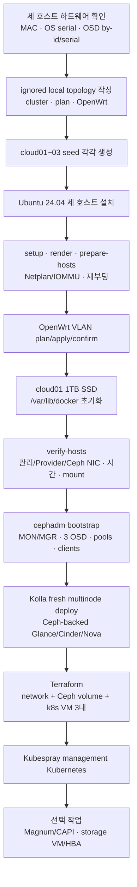
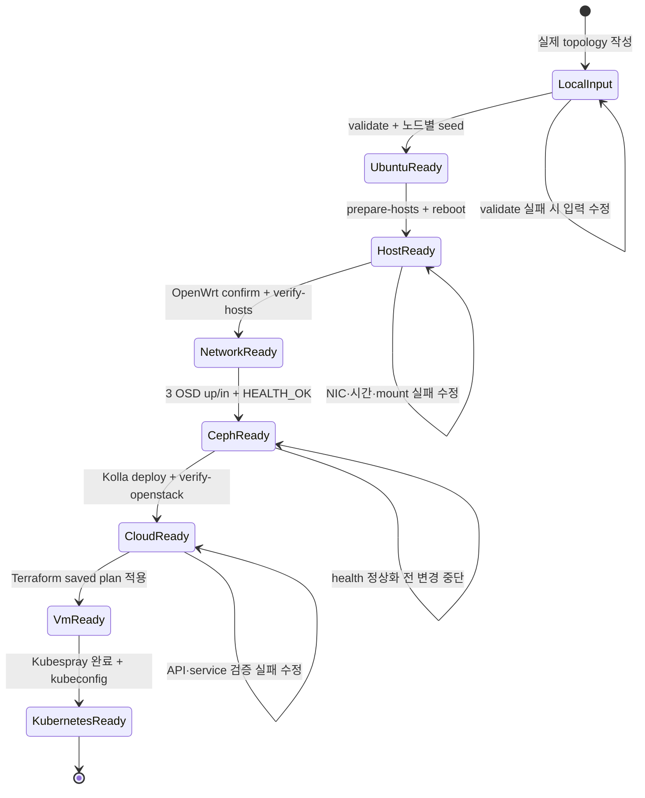

# Ubuntu Server · Ceph · OpenStack · Kubernetes 설치 런북

> 문서 위치: [전체 문서](../README.md) · [최초 설치](README.md)

이 런북은 `cloud01`, `cloud02`, `cloud03` 세 대를 모두 준비한 뒤 새 클라우드를 만드는
절차다. 단일 노드 OpenStack은 설치하지 않으며 이전할 기존 LVM 데이터도 만들지 않는다.

## 전체 흐름



각 단계는 다음 검증 지점을 통과한 뒤에만 다음 상태로 넘어간다. 중간에 중단되면 확인 문자열을
다시 실행하기 전에 마지막으로 통과한 검증 지점부터 찾는다.



## 1. 장비와 로컬 입력 준비

세 호스트에서 다음 값을 확인한다.

```bash
sudo ./scripts/inspect-openstack-storage.sh
ip -br link
ls -l /dev/disk/by-id/
```

로컬 전용 파일을 만든다.

```bash
umask 077
cp inventory/openstack-cluster.yml inventory/openstack-cluster.local.yml
cp inventory/openstack-plan.yml inventory/openstack-plan.local.yml
cp inventory/openwrt-router.example.yml inventory/openwrt-router.local.yml
chmod 0600 inventory/*.local.yml
${EDITOR:-vi} inventory/openstack-cluster.local.yml \
  inventory/openstack-plan.local.yml \
  inventory/openwrt-router.local.yml
```

`openstack-cluster.local.yml`에서 반드시 바꿀 값은 다음과 같다.

- 세 노드의 관리 NIC MAC, IP, OS 디스크 시리얼
- 세 노드의 10Gbps `ceph_interface`, MAC, `ceph_address`
- 세 2TB OSD의 `/dev/disk/by-id`, 시리얼과 실제 device class
- `cloud01`에서 실행할 operator SSH 개인키 절대 경로

세 노드는 모두 `enabled: true`여야 한다. `storage_backend: ceph`와
`cluster.ceph.enabled: true`를 유지한다. 공개 예시 topology는 검증용일 뿐 실제 설치 입력으로
사용할 수 없다.

```bash
./scripts/cluster.sh validate
```

## 2. 노드별 Ubuntu seed 생성

작업 PC에 다음 패키지가 필요하다.

```bash
sudo apt update
sudo apt install -y cloud-image-utils openssl python3-yaml
export UBUNTU_OPERATOR_PASSWORD_HASH="$(openssl passwd -6)"
export UBUNTU_OPERATOR_SSH_PUBLIC_KEY="$(cat ~/.ssh/id_ed25519.pub)"
```

각 노드의 OS 디스크 시리얼과 MAC이 다르므로 seed도 세 개를 따로 만든다.

```bash
for node in cloud01 cloud02 cloud03; do
  ./scripts/render-ubuntu-autoinstall.sh "$node"
  ./scripts/build-autoinstall-seed.sh "$node"
done
```

생성된 ISO와 SHA-256, 로컬 topology, SSH 개인키를 서버 외부의 암호화 저장소에 백업한다.
Ubuntu 설치 화면에서 해당 노드의 OS 디스크 시리얼을 다시 확인한다. Autoinstall은 OS
디스크만 지우며 2TB Ceph 디스크와 4TB·3TB HDD를 대상으로 삼지 않는다.

설치가 끝나면 세 호스트에서 다음을 확인한다.

```bash
hostname
sudo -n true
sudo visudo -cf /etc/sudoers.d/90-operator-ansible
```

## 3. cloud01에 운영 저장소 복원

`cloud01`의 `operator` 계정에서 저장소를 clone한다.

```bash
cd /home/operator
git clone https://github.com/overture-1928/Infra.git Openstack
cd Openstack
```

Git에서 제외된 파일을 외부 백업에서 복원한다.

```bash
chmod 0700 ~/.ssh
chmod 0600 ~/.ssh/id_ed25519 inventory/*.local.yml
ssh cloud02 true
ssh cloud03 true
```

`cloud02`, `cloud03`의 host key를 직접 확인해 `known_hosts`에 등록한다. 자동화는 host key
검사를 끄지 않는다.

## 4. 도구와 세 호스트 준비

```bash
./scripts/cluster.sh validate
./scripts/cluster.sh setup
./scripts/cluster.sh render
./scripts/cluster.sh prepare-hosts
```

세 호스트를 재부팅한다. Ansible은 다음을 설정한다.

- 안정적인 hostname과 `/etc/hosts`
- 관리 NIC와 Provider VLAN 10
- gateway가 없는 전용 `ceph0` 10Gbps 주소
- chrony, 커널 네트워크 설정, IOMMU와 VFIO

## 5. OpenWrt와 Provider VLAN

```bash
./scripts/cluster.sh openwrt-discover
./scripts/cluster.sh openwrt-plan
```

출력된 UCI batch, 변경 대상과 확인 문자열을 검토한 후에만 적용한다.

```bash
export OPENWRT_APPLY_CONFIRM='<plan이 출력한 값>'
export OPENWRT_CONFIRM='<plan이 출력한 값>'
./scripts/cluster.sh openwrt-apply
./scripts/cluster.sh openwrt-status
```

최초 적용부터 `cloud01`~`cloud03`의 probe가 모두 성공해야 한다. 자세한 rollback 절차는
[OpenWrt 라우터](../operations/openwrt.md)를 따른다.

## 6. cloud01 Kolla 데이터 SSD

이 단계는 `cloud01`의 1TB 데이터 SSD 전체를 `/var/lib/docker`로 만든다. Ceph NVMe와
4TB·3TB HDD는 건드리지 않는다.

```bash
sudo ./scripts/prepare-openstack-storage.sh
```

출력된 시리얼을 실제 라벨과 대조한 뒤 정확한 확인값으로 적용한다.

```bash
export OPENSTACK_STORAGE_CONFIRM='WIPE-OPENSTACK-DATA:<data-serial>:KEEP-CEPH:<ceph-serial>'
sudo --preserve-env=OPENSTACK_STORAGE_CONFIRM \
  ./scripts/prepare-openstack-storage.sh --apply
sudo reboot
```

`cloud02`와 `cloud03`은 512GB OS SSD에서 Docker를 사용하므로 별도 Kolla 데이터 디스크
마운트를 요구하지 않는다.

```bash
findmnt /var/lib/docker
./scripts/cluster.sh verify-hosts
```

## 7. Ceph 최초 구축

OpenStack보다 먼저 Ceph를 만든다. 모든 명령은 실제 local topology를 사용한다.

```bash
export OPENSTACK_CLUSTER_CONFIG="$PWD/inventory/openstack-cluster.local.yml"
sudo --preserve-env=OPENSTACK_CLUSTER_CONFIG ./scripts/ceph-cluster.sh setup
./scripts/ceph-cluster.sh validate
./scripts/ceph-cluster.sh preflight
```

preflight가 세 OSD의 by-id, 시리얼, 크기, class, 빈 장치 상태와 `ceph0` 주소를 모두 확인해야
한다.

```bash
export CEPH_BOOTSTRAP_CONFIRM='BOOTSTRAP-CEPH:cloud01,cloud02,cloud03'
sudo --preserve-env=OPENSTACK_CLUSTER_CONFIG,CEPH_BOOTSTRAP_CONFIRM \
  ./scripts/ceph-cluster.sh bootstrap

export CEPH_HOSTS_CONFIRM='ADD-CEPH-HOSTS:cloud01,cloud02,cloud03'
sudo --preserve-env=OPENSTACK_CLUSTER_CONFIG,CEPH_HOSTS_CONFIRM \
  ./scripts/ceph-cluster.sh add-hosts
```

OSD dry-run이 출력한 manifest와 SHA-256을 검토한다.

```bash
sudo --preserve-env=OPENSTACK_CLUSTER_CONFIG ./scripts/ceph-cluster.sh osd-plan
cat .cache/ceph/ceph-osd-manifest.txt
cat .cache/ceph/ceph-osd-manifest.sha256

export CEPH_OSD_CONFIRM='WIPE-CEPH-OSDS:<출력된-sha256>'
sudo --preserve-env=OPENSTACK_CLUSTER_CONFIG,CEPH_OSD_CONFIRM \
  ./scripts/ceph-cluster.sh osd-apply
```

세 OSD가 `up/in`이고 recovery가 끝난 뒤 pool과 client를 만든다.

```bash
sudo --preserve-env=OPENSTACK_CLUSTER_CONFIG ./scripts/ceph-cluster.sh status

export CEPH_POOL_CONFIRM='CONFIGURE-CEPH-POOLS:nvme:size3:min2'
sudo --preserve-env=OPENSTACK_CLUSTER_CONFIG,CEPH_POOL_CONFIRM \
  ./scripts/ceph-cluster.sh configure-pools

export CEPH_EXPORT_CONFIRM='EXPORT-KOLLA-CEPH-CLIENTS'
sudo --preserve-env=OPENSTACK_CLUSTER_CONFIG,CEPH_EXPORT_CONFIRM \
  ./scripts/ceph-cluster.sh export-kolla
```

상세 안전 조건은 [Ceph 초기 구축](../operations/ceph-initial-deployment.md)에 정리되어 있다.

## 8. 3노드 OpenStack 배포

```bash
sudo --preserve-env=OPENSTACK_CLUSTER_CONFIG ./scripts/cluster.sh deploy-openstack
sudo ./scripts/openstack.sh cloud-init
sudo ./scripts/cluster.sh verify-openstack
```

배포 명령은 세 노드 이상과 Ceph backend를 강제하고, 내보낸 Ceph client 설정이 없으면
중단한다. 다음을 확인한다.

```bash
sudo cephadm shell -- ceph -s
sudo env OS_CLIENT_CONFIG_FILE=/etc/kolla/clouds.yaml OS_CLOUD=admin \
  .cache/kolla-venv/bin/openstack compute service list
sudo env OS_CLIENT_CONFIG_FILE=/etc/kolla/clouds.yaml OS_CLOUD=admin \
  .cache/kolla-venv/bin/openstack network agent list
sudo env OS_CLIENT_CONFIG_FILE=/etc/kolla/clouds.yaml OS_CLOUD=admin \
  .cache/kolla-venv/bin/openstack volume service list
sudo env OS_CLIENT_CONFIG_FILE=/etc/kolla/clouds.yaml OS_CLOUD=admin \
  .cache/kolla-venv/bin/openstack image list
```

Skyline은 공개 예시 기준 `http://192.0.2.10:9999`다.

## 9. management Kubernetes 3대

```bash
sudo install -m 0600 -o "$(id -u)" -g "$(id -g)" \
  /etc/kolla/clouds.yaml terraform/openstack/clouds.yaml
export OS_CLIENT_CONFIG_FILE="$PWD/terraform/openstack/clouds.yaml"

cp terraform/openstack/terraform.tfvars.example \
  terraform/openstack/terraform.tfvars
chmod 0600 terraform/openstack/terraform.tfvars
${EDITOR:-vi} terraform/openstack/terraform.tfvars
```

`enable_resources = true`로 바꾸기 전에 세 노드와 주소를 검토한다. `k8s-01`~`k8s-03`의
120GiB root volume은 모두 `ceph` Cinder type을 사용한다.

```bash
./scripts/cluster.sh terraform-plan
export TERRAFORM_APPLY_CONFIRM=APPLY-KUBERNETES-INFRA
./scripts/cluster.sh terraform-apply
./scripts/cluster.sh deploy-kubernetes
```

strict anti-affinity 때문에 세 control-plane VM은 서로 다른 compute host에 배치된다.

## 10. 일반 workload VM과 서비스 구성

OpenStack 구축 후 일반 VM은 stack별 Terraform root와 state로 관리한다. 다음 명령은 `web`
stack의 코드와 mode `0600` 로컬 입력을 만든다.

```bash
./scripts/cluster.sh workload-new web
${EDITOR:-vi} terraform/workloads/web/terraform.tfvars \
  ansible/inventory/workloads/web.local.yml
```

처음에는 `enable_instances = false`로 cloud 인증, resource ID와 입력을 검증한다. 변경이 없는
plan을 확인한 후 `true`로 바꾸고 다시 plan을 만든다.

```bash
./scripts/cluster.sh workload-plan web
./scripts/cluster.sh workload-show web

export TERRAFORM_WORKLOAD_APPLY_CONFIRM='APPLY-TERRAFORM-WORKLOAD:web:<plan-sha256>'
./scripts/cluster.sh workload-apply web
./scripts/cluster.sh workload-output web
```

guest 설정이 필요하면 `ansible/playbooks/workloads/web.yml`을 만들고 생성 inventory의
`workload` 그룹을 대상으로 작성한다. Terraform output에서 접속 inventory를 먼저 확인한 뒤
playbook을 실행한다.

```bash
./scripts/cluster.sh workload-inventory web
ansible-inventory -i .cache/ansible/workloads/web.yml --graph
./scripts/cluster.sh workload-configure web
```

`workload-apply`는 guest playbook을 자동 실행하지 않는다. Terraform 적용 결과와 IP를 검토한
뒤 `workload-configure`를 명시적으로 실행한다. `terraform.tfvars`, `<stack>.local.yml`,
Terraform state와 생성 inventory는 Git에서 제외하며 외부의 암호화 저장소에 백업한다. 자세한
입력, 확인값과 실패 조건은 [서비스별 Terraform workload](../workloads/terraform.md)를 따른다.

## 11. 이후 작업

OpenStack과 Ceph의 장애 시험, 외부 상태 백업, Kubernetes 검증이 끝난 뒤 다음을 진행한다.

- [Magnum/CAPI와 container platform](../platform/managed-services.md)
- [cloud01 고정 스토리지 VM과 HBA 패스스루](../workloads/storage-vm.md)
- [5·7노드 또는 compute 노드 확장](../operations/cluster-expansion.md)

스토리지 VM의 root volume은 Ceph에 둘 수 있지만 HBA와 4TB·3TB HDD는 `cloud01`에 묶인다.
해당 VM에는 HA나 live migration을 기대하지 않는다.
