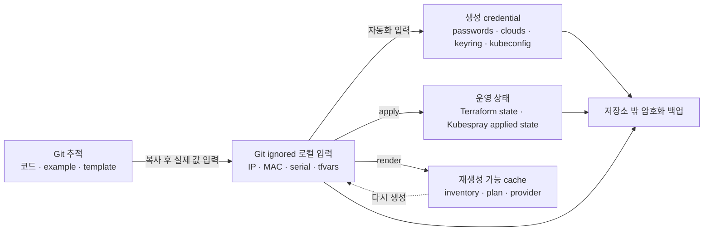

# 로컬 전용 설정, 인증정보와 운영 상태

공개 저장소에 추적되는 인벤토리와 변수 파일은 실행 구조를 설명하기 위한 예시다. 실제 IP,
MAC 주소, 디스크 시리얼, 장비 포트와 인증정보는 예시 파일에 직접 쓰지 않는다. 실제 환경은
Git에서 제외되는 로컬 입력 파일과 자동 생성되는 비밀 파일로 관리한다.

기본 원칙은 다음과 같다.

1. `inventory/*.yml`, `*.example`, `*.template`처럼 추적되는 파일에는 예시값만 둔다.
2. 직접 작성하는 실제 환경값은 `*.local.yml` 또는 `terraform.tfvars`에 기록하고 mode를
   `0600`으로 제한한다.
3. 비밀번호, token, keyring과 kubeconfig는 해당 스크립트가 생성하게 하고 수동으로 YAML에
   복사하지 않는다.
4. 복구에 필요한 비밀과 상태는 저장소 밖의 암호화된 백업에 함께 보관한다.



Git clone만으로는 환경을 복구할 수 없다. 로컬 입력, credential과 state를 같은 시점의 암호화
백업으로 보관해야 한다.

## 직접 작성하는 로컬 입력

| 로컬 파일 | 기준 파일 | 기록할 내용 |
| --- | --- | --- |
| `inventory/openstack-cluster.local.yml` | `inventory/openstack-cluster.yml` | 실제 관리 IP와 API VIP, DNS, NIC·MAC, OS 디스크 시리얼, 노드 역할, SSH 개인키 **경로**, Ceph 주소와 OSD `by-id`·시리얼 |
| `inventory/openstack-plan.local.yml` | `inventory/openstack-plan.yml` | 실제 관리·Provider·tenant 망, Floating IP 범위, Kolla SSD와 보호 대상 디스크 시리얼 |
| `inventory/openwrt-router.local.yml` | `inventory/openwrt-router.example.yml` | OpenWrt 주소와 계정, SSH 키 **경로**, discovery에서 확인한 모델·버전·DSA bridge·포트, 실제 VLAN과 망 계획 |
| `terraform/openstack/terraform.tfvars` | `terraform/openstack/terraform.tfvars.example` | 실제 Provider·tenant·관리망, gateway·DNS·Floating IP 범위, SSH 공개키, Kubernetes VM 주소·역할·볼륨 |
| `terraform/workloads/<stack>/terraform.tfvars` | `terraform/workloads/_template/terraform.tfvars.example` | 서비스 VM의 OpenStack UUID, 허용 CIDR, `instances` map과 선택적 Floating IP 설정 |
| `ansible/inventory/workloads/<stack>.local.yml` | `ansible/inventory/workloads/settings.example.yml` | Terraform output에서 Ansible inventory를 만들 때 사용할 주소 우선순위, SSH 사용자·포트·개인키 경로와 서비스 변수 |
| `kolla/config/nova/nova-compute.conf` | `kolla/config/nova/nova-compute.conf.example` | cloud01 HBA의 정확한 PCI 주소, vendor/product ID와 alias |
| `kolla/config/nova.conf` | `kolla/config/nova.conf.example` | nova-api와 compute가 공유할 `storage-hba` alias |

처음 네 파일은 다음처럼 기존 파일을 덮어쓰지 않고 만든다.

```bash
umask 077
test -e inventory/openstack-cluster.local.yml || \
  cp inventory/openstack-cluster.yml inventory/openstack-cluster.local.yml
test -e inventory/openstack-plan.local.yml || \
  cp inventory/openstack-plan.yml inventory/openstack-plan.local.yml
test -e inventory/openwrt-router.local.yml || \
  cp inventory/openwrt-router.example.yml inventory/openwrt-router.local.yml
test -e terraform/openstack/terraform.tfvars || \
  cp terraform/openstack/terraform.tfvars.example terraform/openstack/terraform.tfvars
chmod 0600 \
  inventory/openstack-cluster.local.yml \
  inventory/openstack-plan.local.yml \
  inventory/openwrt-router.local.yml \
  terraform/openstack/terraform.tfvars
```

GPU 또는 HBA 패스스루를 사용할 때만 Nova 로컬 설정도 같은 방식으로 만든다.

```bash
umask 077
test -e kolla/config/nova/nova-compute.conf || \
  cp kolla/config/nova/nova-compute.conf.example kolla/config/nova/nova-compute.conf
test -e kolla/config/nova.conf || \
  cp kolla/config/nova.conf.example kolla/config/nova.conf
chmod 0600 kolla/config/nova/nova-compute.conf kolla/config/nova.conf
```

Ceph도 동일한 3노드 `inventory/openstack-cluster.local.yml`을 사용한다. 별도의 전환
topology는 만들지 않는다. 입력 절차는 [Ceph 최초 구축](ceph-transition.md)을 따른다.

`openstack-cluster.local.yml`과 `openstack-plan.local.yml`의 실제 망과 디스크 역할은 서로
일치해야 한다. `openwrt-router.local.yml`은 discovery 결과를 확인하기 전까지
`enabled: false`를 유지한다. `terraform.tfvars`에서는 RFC 5737 예시 주소를 모두 실제 로컬
인벤토리의 주소로 바꾸고 `enable_resources = false` 상태에서 첫 plan을 확인한다.

일반 VM 스택은 `cluster.sh workload-new <stack>`으로 만든다. 명령이 생성한
`terraform/workloads/<stack>/terraform.tfvars`와
`ansible/inventory/workloads/<stack>.local.yml`도 mode `0600`으로 유지하며 첫 plan까지
`enable_instances = false`로 둔다. 서비스별 state를 섞지 않으며 자세한 생성·적용 절차는
[서비스별 OpenStack VM Terraform 스택](terraform-workloads.md)을 따른다.

실제 비밀번호, OpenStack application credential secret, kubeconfig 내용과 SSH 개인키 본문은
이 입력 파일에 적지 않는다. cloud-init user data에도 비밀번호, 장기 token, SSH 개인키나
application credential secret을 넣지 않는다. 해당 내용은 Terraform plan과 state에 복사될 수
있다. 추적되는 cloud-init 예시에는 비밀 없는 초기 설정만 둔다.

## 저장소 밖에 두는 키와 시스템 파일

| 위치 | 용도 |
| --- | --- |
| `/home/operator/.ssh/id_ed25519` | Ansible과 OpenWrt 접속용 SSH 개인키. 인벤토리에는 이 경로만 기록 |
| `/home/operator/.ssh/known_hosts` | 일반 사용자 Ansible이 검토한 호스트 지문 |
| `/root/.ssh/known_hosts` | root로 실행되는 Kolla가 검토한 원격 호스트 지문 |
| `/etc/kolla/` | 배포된 Kolla 설정과 인증정보. `passwords.yml`, `clouds.yaml`, Magnum kubeconfig를 포함 |
| `/etc/ceph/` | Ceph 설정과 관리자 keyring. 특히 `ceph.client.admin.keyring`은 최고 권한 credential |
| `/var/lib/ceph/<FSID>/` | Ceph MON과 클러스터 운영 상태 |

SSH 개인키는 mode `0600`, `.ssh` 디렉터리는 `0700`으로 유지한다. 호스트 키 검사를 끄는 대신
검토한 `known_hosts`를 사용한다.

## 로컬 인증정보와 반드시 백업할 상태

다음 파일은 인증정보 또는 운영 상태이므로 저장소 밖에 암호화해 백업한다. 자동화가 생성한
파일은 임의로 다시 만들지 말고 원본을 유지한다.

| 경로 | 출처와 의미 | 복구 기준 |
| --- | --- | --- |
| `kolla/generated/passwords.yml` | `cluster.sh setup`이 최초 한 번 생성하는 OpenStack 서비스 비밀번호 | 배포 후 새로 생성하면 기존 서비스와 불일치하므로 필수 백업 |
| `terraform/openstack/clouds.yaml` | `/etc/kolla/clouds.yaml`의 mode `0600` 로컬 복사본 | 관리자 credential이므로 제한된 접근과 암호화 백업 |
| `secure.yaml`, `secure.yml`, `secure.json` | 사용자가 선택적으로 만들며 OpenStackSDK가 `clouds.yaml`과 병합해 읽는 credential 파일. 이 저장소는 생성하지 않음 | 사용한다면 mode `0600`과 암호화 백업을 적용하고 Git에 포함하지 않음 |
| `terraform/openstack/terraform.tfstate*` | Terraform이 관리하는 OpenStack 자원 결합 상태 | 유실하면 자동 복구되지 않고 import가 필요하므로 필수 백업 |
| `terraform/workloads/<stack>/terraform.tfstate*` | 해당 서비스 VM·포트·볼륨과 Terraform resource 주소의 결합 상태 | 스택별로 코드 commit과 함께 암호화 백업. 유실 시 빈 state를 적용하지 않고 복원 또는 import |
| `terraform/workloads/<stack>/terraform.tfvars` | 해당 서비스가 참조하는 OpenStack UUID와 VM 사양 | mode `0600` 유지, state와 같은 복구 세트로 암호화 백업 |
| `kubeconfig/admin.conf` | Kubespray가 만든 management Kubernetes 관리자 kubeconfig | cluster-admin credential로 취급하고 필수 백업 |
| `kubeconfig/openstack-management.env` | 전용 OpenStack application credential의 한 번만 반환되는 secret | 자동화가 기존 credential을 교체하지 않으므로 필수 백업 |
| `kolla/generated/magnum/kubeconfig` | Magnum용 장기 ServiceAccount token kubeconfig | management cluster 복구 세트에 포함 |
| `kolla/generated/ceph-config/` | Glance·Cinder·Nova용 Ceph 설정과 keyring | Ceph가 살아 있으면 재수출할 수 있지만 재해 복구용으로 백업 |
| `state/kubespray/openstack/applied-nodes.json` | 마지막으로 적용된 Kubernetes 노드와 역할 | kubeconfig와 함께 복원해야 안전한 scale 가능 |
| `state/openwrt/` | OpenWrt sysupgrade 및 `/etc/config` 백업 | Wi-Fi 키 등 라우터 비밀이 포함될 수 있으므로 필수 암호화 백업 |

Kolla MariaDB 백업, Cinder 볼륨, Glance 이미지와 Ceph MON 데이터는 저장소 파일이 아니다.
해당 서버에서 만든 백업을 별도 저장소로 복사하고 실제 복원을 시험해야 한다.

## Git에서는 제외되지만 재생성 가능한 항목

다음 항목은 필요할 때 다시 만들 수 있으므로 일반적으로 복구 백업의 기준 원본으로 삼지 않는다.

- `.cache/`의 CLI, Python 환경, 다운로드 파일과 렌더링 결과
- `.terraform/`의 provider 캐시와 `*.tfplan`
- `.terraform.tfstate.lock.info`의 실행 중 local state 잠금 정보
- `.cache/terraform/workloads/`의 저장된 workload plan과 `.tfplan.context.json`. 재생성
  가능하지만 plan에는 민감한 값이 포함될 수 있으므로 공개하거나 Git에 추가하지 않음
- `.cache/ansible/workloads/`의 Terraform output 기반 workload inventory
- `kolla/inventory/multinode.local`, `kolla/generated/multinode`, `globals.yml`
- `.cache/cluster/`, `.cache/ceph/`, `.cache/kubespray-inventory/`의 plan과 manifest
- `ubuntu-autoinstall/generated/`의 user-data, meta-data와 seed ISO

Autoinstall 결과는 재생성할 수 있지만 보관 중에는 암호 해시, SSH 공개키, MAC 주소와 디스크
시리얼을 포함한다. 설치가 끝나면 안전하게 삭제하거나 암호화된 설치 기록으로 보관한다.

## 환경 변수

`UBUNTU_OPERATOR_PASSWORD_HASH`와 `UBUNTU_OPERATOR_SSH_PUBLIC_KEY`는 Autoinstall을 렌더링하는
현재 shell에만 설정한다. `OPENSTACK_CLUSTER_CONFIG`, `OPENSTACK_PLAN_CONFIG`,
`OPENWRT_INVENTORY`, `OS_CLIENT_CONFIG_FILE`, `MANAGEMENT_KUBECONFIG`는 로컬 파일을 선택하는
변수다. OpenStack CLI에서는 `OS_CLOUD`가 `OS_CLIENT_CONFIG_FILE`이 가리키는 `clouds.yaml`
안의 cloud 이름을 선택한다. workload Terraform provider가 사용할 항목은 각 스택의
`cloud_name` 변수로 지정한다. plan context는 현재 `OS_*` 환경도 함께 지문화하므로 인증 환경을
바꿨다면 새 workload plan을 만든다.

`OPENSTACK_STORAGE_CONFIRM`, `OPENWRT_*_CONFIRM`, `CEPH_*_CONFIRM`,
`TERRAFORM_APPLY_CONFIRM`, `OPENSTACK_EXPAND_CONFIRM`, `MANAGEMENT_CLOUD_CONFIRM`과
`PLATFORM_SERVICES_CONFIRM`, `KUBERNETES_CONTROL_PLANE_SCALE_CONFIRM`,
`TERRAFORM_WORKLOAD_APPLY_CONFIRM`은 비밀번호가 아니라 변경 승인 문자열이다. workload 적용은
`APPLY-TERRAFORM-WORKLOAD:<stack>:<plan-sha256>` 형식의 출력값을 사용한다. 매번 새 plan이
출력한 값을 검토한 뒤 현재 shell에서만 설정하고 장기 설정 파일에 저장하지 않는다.

`.env`와 `.env.*`는 Git에서 제외되지만 이 저장소의 스크립트는 자동으로 읽지 않는다. 로컬
환경 파일을 사용하는 경우 직접 `source`해야 하며, 장기 credential은 평문 환경 파일 대신
위의 mode `0600` 전용 파일과 암호화 백업으로 관리한다.

## 커밋 전 확인

`.gitignore`는 아직 Git이 추적하지 않는 파일만 막는다. 이미 추적한 파일이나 `git add -f`로
추가한 파일은 보호하지 못한다. 현재 디렉터리에 `.git`이 없다면 처음 한 번 초기화한다.

```bash
git init -b main
```

그다음 저장소 검사와 ignore 규칙을 확인하고 파일을 staging한 뒤, 실제 커밋 대상을 검토한다.

```bash
make check
git check-ignore -v \
  inventory/openstack-cluster.local.yml \
  inventory/openstack-plan.local.yml \
  inventory/openwrt-router.local.yml \
  terraform/openstack/terraform.tfvars \
  terraform/workloads/example/terraform.tfvars \
  terraform/workloads/example/terraform.tfstate \
  ansible/inventory/workloads/example.local.yml \
  terraform/openstack/clouds.yaml \
  kolla/config/nova/nova-compute.conf \
  kolla/config/nova.conf \
  secure.yaml \
  kolla/generated/passwords.yml
git add --all
git ls-files -ci --exclude-standard
git status --short
git diff --cached --name-only
git diff --cached
```

`git check-ignore -v`는 각 로컬 경로와 이를 막은 `.gitignore` 규칙을 출력해야 한다.
`git ls-files -ci --exclude-standard`는 아무것도 출력하지 않아야 한다. 출력되는 파일이 있으면
내용을 지우는 커밋만 추가하지 말고 먼저 `git rm --cached -- <파일>`로 index에서 제거한다.
credential이 원격 저장소에 한 번이라도 올라갔다면 Git에서 삭제하는 것만으로 끝내지 않고
해당 비밀번호, token 또는 key를 폐기하고 교체한다.

세부 생성 순서는 [OpenStack 설치 런북](openstack-runbook.md), OpenWrt 입력은
[OpenWrt Provider VLAN 자동화](openwrt-router.md), Ceph 입력과 keyring은
[Ceph 최초 구축](ceph-transition.md), management credential과 kubeconfig는
[Magnum CAPI 관리형 서비스](managed-services.md), 일반 VM의 독립 state는
[서비스별 OpenStack VM Terraform 스택](terraform-workloads.md)을 따른다.
