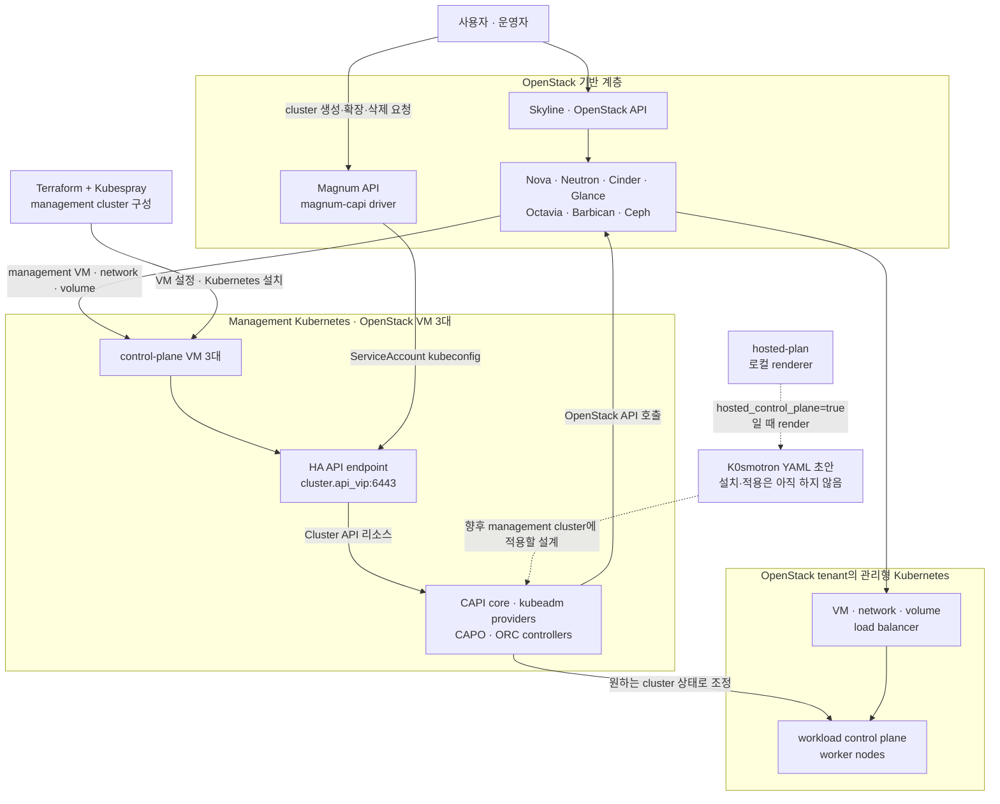

# Magnum CAPI 관리형 서비스

현재 단일 노드에서는 모든 관리형 서비스 플래그를 끈다. `platform-services.sh`는 물리 노드
3대, 세 OSD 호스트의 정상 Ceph, Ready 상태인 management Kubernetes control plane 3대가
확인되기 전에는 Kubernetes와 OpenStack을 변경하지 않는다. Management cluster에는 동적
프로비저닝을 지원하는 비로컬 기본 StorageClass도 정확히 하나 있어야 한다.
Application credential, kubeconfig와 Terraform 상태의 보관·백업 기준은
[로컬 전용 설정, 인증정보와 운영 상태](local-secrets-and-state.md)를 따른다.

## 전체 계층과 요청 흐름



Management Kubernetes는 Terraform과 Kubespray로 먼저 만드는 운영 기반이며 CAPO가 자기 자신을
만드는 구조가 아니다. 이후 Magnum API가 받은 cluster 요청을 `magnum-capi` driver가 management
Kubernetes의 Cluster API 리소스로 전달한다. CAPI, kubeadm provider, CAPO와 ORC controller는
그 리소스를 보고 OpenStack API를 호출해 workload cluster용 VM, 네트워크, 볼륨과 load
balancer를 만든다. 그림의 점선 `hosted-plan` 경로는 검토용 manifest 생성까지만 구현되어 있다.

## 3노드 이후 활성화 순서

기존 LVM 데이터를 Ceph로 옮기고 복구 시험까지 끝낸 뒤 로컬 topology에서 다음 값만 먼저
활성화한다.

```yaml
cluster:
  storage_backend: ceph
  platform:
    magnum_capi:
      enabled: true
      hosted_control_plane: false
    container_service:
      enabled: false
      provider: kubernetes
```

`container_service`는 아직 켜지 않는다. 이 플래그는 Magnum으로 만든 전용 runtime cluster와
별도 container API가 준비되는 후속 단계용이다. 현재 고정한 Kolla-Ansible 2026.2에는 Zun
배포 지원이 없으므로 provider는 계속 `kubernetes`를 사용한다.

토폴로지를 렌더링하고 Terraform 변수에 management control plane 세 대를 선언한다. 기존
`k8s-01`의 `fast` 부팅 볼륨 유형은 그대로 유지한다. 이를 `ceph`로 바꾸면 Terraform이 볼륨
교체를 계획하고 `prevent_destroy`가 적용을 막는다. 새 `k8s-02`, `k8s-03`만 `ceph`로 만들며,
기존 부팅 볼륨의 이전은 별도 유지보수 작업으로 처리한다.

`terraform/openstack/terraform.tfvars`의 `management_api_address`는 최종 Ceph topology의
`cluster.api_vip`와 같아야 한다. `kubernetes_api_host_number`는 tenant network 안의 내부
kube-vip 주소를 고른다. 두 주소는 용도가 다르다.

```bash
./scripts/cluster.sh render
./scripts/cluster.sh terraform-plan
export TERRAFORM_APPLY_CONFIRM=APPLY-KUBERNETES-INFRA
./scripts/cluster.sh terraform-apply
```

관리용 Kubernetes가 OpenStack API를 사용할 전용 non-admin `member` 사용자와 restricted
application credential을 한 번 만든다. 운영자가 읽을 수 있는 admin `clouds.yaml`을
지정해야 한다. 첫 실행은 프로젝트 ID가 포함된 정확한 확인 문자열을 출력하고 아무 사용자도
만들지 않는다.

```bash
export OS_CLIENT_CONFIG_FILE="$PWD/terraform/openstack/clouds.yaml"
export OS_CLOUD=admin
./scripts/cluster.sh prepare-k8s-cloud
# 위 명령이 출력한 값을 그대로 검토해 설정한다.
export MANAGEMENT_CLOUD_CONFIRM='CREATE-K8S-CLOUD-PRINCIPAL:<project-id>:kubespray-management:member'
./scripts/cluster.sh prepare-k8s-cloud
./scripts/cluster.sh deploy-kubernetes
```

임의로 만든 사용자 비밀번호는 application credential 발급 직후 폐기한다. application
credential secret은 화면에 출력하지 않고 Git에서 제외된
`kubeconfig/openstack-management.env`에 mode `0600`으로 저장한다. 자동화는 기존 사용자나
credential을 삭제·재설정·회전하지 않는다. 생성 도중 실패하면 이번 실행이 새로 만든 전용
사용자만 롤백한다. 롤백까지 실패하면 정확한 user ID와 domain ID를 출력하고 재실행을
거부하므로 운영자가 해당 원격 상태를 먼저 검토해야 한다. admin cloud의 `cacert`도 저장해
CCM과 Cinder CSI가 같은 CA를 사용한다.

Magnum 플래그가 활성화된 경우 Kubespray renderer는 external OpenStack CCM, controller 3개의
Cinder CSI, 기본 `ceph` StorageClass와 Octavia OVN 설정을 자동 생성한다. 기존 local-path
StorageClass는 남지만 기본값에서는 제외된다.

## Magnum, CAPI와 CAPO 적용

읽기 중심 사전 검사와 정확한 확인 문자열을 먼저 출력한다.

```bash
sudo --preserve-env=OPENSTACK_CLUSTER_CONFIG,MANAGEMENT_KUBECONFIG \
  ./scripts/cluster.sh platform-plan
```

`MANAGEMENT_KUBECONFIG`를 지정하지 않으면 `kubeconfig/admin.conf`를 사용한다. 출력된 값을
검토한 뒤 최초 적용에서는 다음 형태로 실행한다.

`platform-apply`와 `platform-reconfigure`는 Kolla를 root로 실행한다. 원격 OpenStack 노드의
검토된 지문이 `/root/.ssh/known_hosts`에 준비되어 있어야 한다. 명시적인
`UserKnownHostsFile` 방식을 사용한다면 `ANSIBLE_SSH_COMMON_ARGS`도 해당 `sudo --preserve-env`
목록에 추가한다.

```bash
export PLATFORM_SERVICES_CONFIRM='APPLY-MAGNUM-CAPI:v1.14.3:v1.14.3:v0.15.1:v2.6.0'
sudo --preserve-env=OPENSTACK_CLUSTER_CONFIG,PLATFORM_SERVICES_CONFIRM,MANAGEMENT_KUBECONFIG \
  ./scripts/cluster.sh platform-apply
sudo --preserve-env=OPENSTACK_CLUSTER_CONFIG,MANAGEMENT_KUBECONFIG \
  ./scripts/cluster.sh platform-status
```

자동화는 고정 버전 ORC, CAPI core, kubeadm bootstrap/control-plane provider와 CAPO를 management
cluster에 설치한 뒤 Magnum, Barbican과 Octavia OVN provider를 Kolla로 배포한다. 재적용에는
`platform-reconfigure`와 plan이 출력한 `RECONFIGURE-MAGNUM-CAPI:...` 확인 문자열을 사용한다.
다운로드하는 `clusterctl`, ORC manifest와 Kubespray용 `kubectl`은 `config/versions.env`의
SHA-256과 일치해야 실행한다. 관리형 프로필을 켠 뒤에는 일반 `deploy-openstack`과
`expand-openstack`이 차단되므로 플랫폼 변경은 `platform-apply` 또는
`platform-reconfigure`로 수행한다.

Kolla 2026.2 Magnum 이미지에는 VEXXHOST `magnum-cluster-api` driver가 포함되어 있다. 자동화는
배포된 `magnum.conf`에서 `k8s_cluster_api` driver가 비활성화되지 않았는지 검사한다. 플랫폼
적용 후에는 호환되는 Kubernetes workload image를 Glance에 등록하고 Magnum cluster template을
만든 뒤, 첫 cluster의 생성·접속·확장·업그레이드·삭제 lifecycle을 검증한다.

Magnum용 `magnum-capi` ServiceAccount와 장기 token Secret은 `magnum-system`에 생성한다. 해당
cluster-admin kubeconfig는 `kolla/generated/magnum/kubeconfig`에 mode `0600`으로 저장되고,
Kolla가 `/etc/kolla/config/magnum/kubeconfig`로 복사한다. 두 파일은 관리 비밀로 취급한다.

Kolla는 `cluster.api_vip:6443`에 management Kubernetes API용 HAProxy listener를 만들고
Terraform의 세 control-plane Floating IP를 backend로 사용한다. Kubespray는 이 주소를 API
인증서 SAN에 넣으며 Magnum kubeconfig도 이 HA endpoint를 사용한다. 복구에 필요한
`state/kubespray/openstack/applied-nodes.json`, `kubeconfig/admin.conf`,
`kolla/generated/magnum/kubeconfig`, `kubeconfig/openstack-management.env`를 암호화된 외부
백업에 함께 보관한다.

## Hosted Control Plane과 컨테이너 API

`hosted-plan`은 `cluster.platform.magnum_capi.hosted_control_plane=true`일 때만 K0smotron
초안을 `.cache/platform/`에 만든다. 실제 K0smotron 설치나 리소스 적용은 하지 않는다.
Hosted control plane의 etcd 저장소, LoadBalancer endpoint, CAPO worker와 복구 절차를 검토한
후 별도 적용 자동화를 추가해야 한다.

```bash
export HOSTED_K0S_VERSION='v1.36.0+k0s.0'
sudo --preserve-env=OPENSTACK_CLUSTER_CONFIG,HOSTED_K0S_VERSION,MANAGEMENT_KUBECONFIG \
  ./scripts/cluster.sh hosted-plan
```

ECS와 유사한 container API도 현재 단계에서는 배포하지 않는다. Magnum/CAPI workload cluster가
실제로 생성되고 격리·quota·이미지 정책이 정해진 뒤, 그 API가 전용 Kubernetes runtime
cluster의 Deployment, Job과 Service를 조정하도록 추가한다.

Driver와 workload 준비 절차는
[VEXXHOST Magnum Cluster API driver](https://vexxhost.github.io/magnum-cluster-api/),
[시작 안내](https://vexxhost.github.io/magnum-cluster-api/user/getting-started/),
[workload image 안내](https://vexxhost.github.io/magnum-cluster-api/user/images/)를 따른다.
