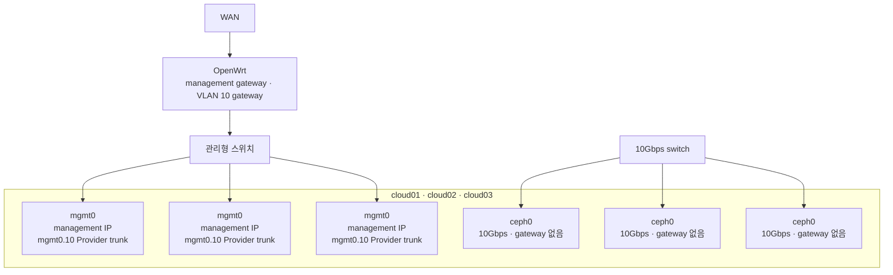
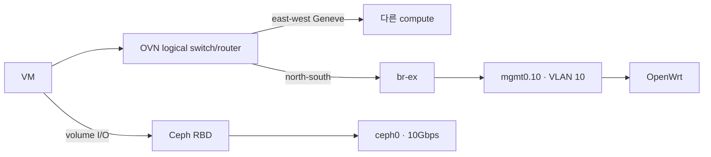

# 3노드 네트워크 분리

최초 OpenStack 배포 전에 세 host의 관리/Provider 경로와 전용 10Gbps Ceph 경로를 모두
준비한다.

## 물리·논리 배치



| 망 | 공개 예시 | gateway | 트래픽 |
| --- | --- | --- | --- |
| management/API | `192.0.2.0/24` | OpenWrt | SSH, Kolla API, RabbitMQ, Galera, OVN control |
| Provider VLAN 10 | `198.51.100.0/24` | OpenWrt | Floating IP, north-south |
| Ceph public/client | `192.168.30.0/24` | 없음 | MON, OSD replication/recovery, RBD client |
| tenant overlay | Geneve | 없음 | VM east-west |

현재 설계는 하나의 10Gbps Ceph public network로 client I/O와 OSD 복제·복구를 함께 처리한다.
별도 `cluster_network`는 두 번째 storage fabric을 실제로 추가할 때만 설정한다.

## 노드 주소 예시

| 노드 | management | Ceph |
| --- | --- | --- |
| `cloud01` | `192.0.2.2/24` | `192.168.30.2/24` |
| `cloud02` | `192.0.2.4/24` | `192.168.30.4/24` |
| `cloud03` | `192.0.2.5/24` | `192.168.30.5/24` |
| API VIP | `192.0.2.10/24` | 해당 없음 |

실제 주소는 로컬 topology에서 바꾼다. `ceph0`에는 DNS와 default route를 설정하지 않는다.

## Ansible Netplan

각 노드에 다음 값이 필요하다.

```yaml
management_interface: mgmt0
management_mac: 실제-관리-NIC-MAC
management_address: 실제-관리-IP/프리픽스
neutron_external_interface: mgmt0.10
neutron_external_vlan_id: 10
ceph_interface: ceph0
ceph_mac: 실제-10G-NIC-MAC
ceph_address: 실제-Ceph-IP
```

`prepare-hosts`가 MAC 기반 이름 고정, 관리 주소, Provider VLAN과 Ceph 주소를
`/etc/netplan/99-openstack-network.yaml`에 렌더한다. 재부팅 후 `verify-hosts`가 세 interface,
Ceph 주소와 `min_link_mbps: 10000` 이상의 실제 negotiated speed를 확인한다.

## OpenStack 데이터 경로



Kolla의 `network_interface`, `api_interface`와 `tunnel_interface`는 관리 NIC를 사용한다.
Ceph traffic은 cephadm과 RBD client가 `192.168.30.0/24`를 사용한다. 관리망과 Ceph망을 같은
Linux bridge로 합치지 않는다.

## MTU

- 관리와 Provider VLAN은 스위치/라우터와 동일한 MTU를 사용한다.
- Geneve tenant MTU는 encapsulation overhead를 반영해 Neutron이 계산하도록 한다.
- Ceph jumbo frame을 사용할 경우 NIC, 10Gbps 스위치와 모든 세 host에서 end-to-end로 먼저
  검증한다.
- 일부 구간만 9000으로 바꾸지 않는다. 초기 구축은 1500으로 시작해도 된다.

## 방화벽 원칙

- 관리/API망은 운영자 관리 CIDR과 세 host 사이의 cluster traffic만 허용한다.
- Provider VLAN은 외부 서비스용 Floating IP traffic을 전달한다.
- Ceph망은 세 Ceph host와 승인된 RBD client host만 통신하도록 제한한다.
- Ceph망은 인터넷 default route나 일반 사용자 단말 경로로 사용하지 않는다.

## 5·7노드 확장

새 compute도 관리, Provider VLAN과 Ceph client망에 연결한다. OSD가 없는 compute는
`ceph_osd_devices: []`지만 RBD를 사용하려면 Ceph망에 접근해야 한다. 기존 세 controller와
API VIP의 주소는 유지한다.
