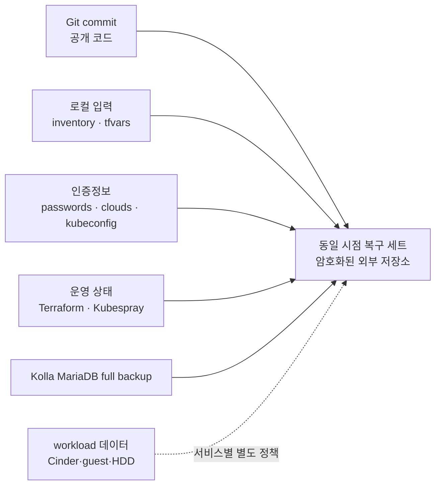
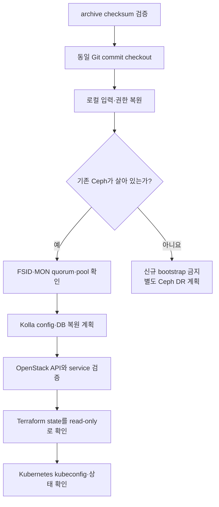

# 백업과 복원 실행서

> 문서 위치: [전체 문서](../README.md) · [운영과 복구](README.md)

이 문서는 Git에 없는 로컬 입력과 상태, Kolla MariaDB, Ceph 설정 및 Kubernetes 인증정보를
같은 복구 시점으로 보관하고 복원 가능성을 확인하는 절차다. Ceph 3중 복제는 디스크 장애를
견디기 위한 것이며 삭제, 잘못된 변경, 사이트 장애를 되돌리는 백업이 아니다.

## 보호 범위



| 계층 | 필수 대상 | 이 문서의 자동화 수준 |
| --- | --- | --- |
| 코드 | 적용한 Git commit ID와 깨끗한 저장소 | 확인 명령 제공 |
| 로컬 입력 | `inventory/*.local.yml`, 실제 Nova local config, workload settings | 파일 목록과 archive 절차 제공 |
| 비밀 | Kolla passwords, clouds.yaml, Ceph keyring, SSH key, kubeconfig | 암호화 저장소에 복사, Git 금지 |
| 상태 | management/workload Terraform state, Kubespray applied state | 같은 시점 archive와 checksum |
| OpenStack DB | Kolla `mariadb-backup --full` 결과 | `openstack.sh backup` 지원 |
| VM·애플리케이션 데이터 | Cinder volume, guest DB, HBA HDD 파일 | workload별 snapshot/export/복원 설계 필요 |

## 백업 전 점검

변경 도중의 파일과 DB를 섞지 않는다. Terraform, Kolla, Ceph 변경 작업이 없는 시간에 다음을
확인한다.

```bash
git status --short
git rev-parse HEAD
make check
./scripts/cluster.sh validate
sudo ./scripts/ceph-cluster.sh status
sudo ./scripts/cluster.sh verify-openstack
```

하나라도 실패하면 실패 원인을 기록하고 정상 백업으로 승격하지 않는다. 장애 중 증거 보존용
복사본은 `incident`로 따로 표시한다.

## 복구 세트 생성

백업 대상은 서버 로컬 디스크가 아닌 암호화된 외부 mount에 둔다. 아래 경로는 예시이며 실제
mount와 남은 용량을 먼저 확인한다.

```bash
export BACKUP_ROOT=/mnt/encrypted-backup/openstack
export BACKUP_ID="$(date -u +%Y%m%dT%H%M%SZ)"
export BACKUP_DIR="$BACKUP_ROOT/$BACKUP_ID"
test -d "$BACKUP_ROOT"
findmnt "$BACKUP_ROOT"
mkdir -m 0700 "$BACKUP_DIR"
git rev-parse HEAD >"$BACKUP_DIR/git-commit.txt"
```

MariaDB는 실행 중인 volume을 직접 tar로 읽지 않고 Kolla의 full backup을 먼저 실행한다.

```bash
sudo ./scripts/openstack.sh backup
sudo docker volume inspect mariadb_backup
```

`docker volume inspect`가 출력한 mountpoint에서 방금 생성된 backup의 시각과 크기를 확인한다.
이 경로는 배포 환경에 따라 달라질 수 있으므로 문서에 고정값으로 가정하지 않는다.

다음 목록을 기준으로 복구 archive를 만든다. 존재하지 않는 선택 파일은 제외하되 목록과 이유를
`backup-notes.txt`에 기록한다.

```text
inventory/*.local.yml
ansible/inventory/workloads/*.local.yml
terraform/openstack/clouds.yaml
terraform/openstack/terraform.tfvars
terraform/openstack/terraform.tfstate*
terraform/workloads/*/terraform.tfvars
terraform/workloads/*/terraform.tfstate*
kolla/generated/passwords.yml
kolla/generated/magnum/kubeconfig
kolla/config/nova/nova-compute.conf
kolla/config/nova.conf
kubeconfig/
state/kubespray/
/etc/kolla/
/etc/ceph/
운영자 SSH private key와 known_hosts
Kolla MariaDB full backup 결과
```

로컬 파일은 권한과 상대경로를 보존한다. `/etc`와 MariaDB backup mountpoint는 root 권한으로
별도 archive한 뒤 같은 `BACKUP_DIR`에 둔다.

```bash
backup_paths=(inventory ansible/inventory/workloads terraform kolla/generated kolla/config)
for optional_path in kubeconfig state; do
  test ! -e "$optional_path" || backup_paths+=("$optional_path")
done
tar --create --gzip --file "$BACKUP_DIR/repository-local.tgz" \
  --exclude='.terraform' --exclude='*.tfplan' --exclude='.cache' \
  "${backup_paths[@]}"
sudo tar --create --gzip --file "$BACKUP_DIR/system-config.tgz" /etc/kolla /etc/ceph
export MARIADB_BACKUP_MOUNT="$(sudo docker volume inspect mariadb_backup --format '{{ .Mountpoint }}')"
test -d "$MARIADB_BACKUP_MOUNT"
sudo tar --create --gzip --file "$BACKUP_DIR/mariadb-full.tgz" \
  --directory "$MARIADB_BACKUP_MOUNT" .
export OPERATOR_SSH_KEY=/home/operator/.ssh/id_ed25519
test -r "$OPERATOR_SSH_KEY"
tar --create --gzip --file "$BACKUP_DIR/operator-ssh.tgz" \
  "$OPERATOR_SSH_KEY" "${OPERATOR_SSH_KEY}.pub" /home/operator/.ssh/known_hosts
sudo chown "$(id -u):$(id -g)" \
  "$BACKUP_DIR/system-config.tgz" "$BACKUP_DIR/mariadb-full.tgz"
sha256sum "$BACKUP_DIR"/*.tgz >"$BACKUP_DIR/SHA256SUMS"
chmod 0600 "$BACKUP_DIR"/*
```

명령 전에 archive에 포함될 파일을 검토한다. workload 애플리케이션 데이터는 이 archive에 자동으로
들어가지 않는다. 각 서비스의 database dump, Cinder backup/export 또는 guest 파일 백업을 같은
`BACKUP_ID`로 연결해 기록한다.

## 백업 검증

파일이 존재한다는 것만으로 성공으로 판단하지 않는다.

```bash
cd "$BACKUP_DIR"
sha256sum --check SHA256SUMS
tar --list --file repository-local.tgz | less
sudo tar --list --file system-config.tgz | less
```

다음을 확인한 뒤 `backup-notes.txt`에 결과를 기록한다.

- Git commit과 topology 파일이 실제 적용 시점과 일치한다.
- Kolla passwords와 `/etc/kolla/clouds.yaml`이 포함되며 mode가 archive에서 보존된다.
- 모든 Terraform root의 `terraform.tfstate`와 해당 `terraform.tfvars`가 짝을 이룬다.
- Kubespray `applied-nodes.json`과 management kubeconfig가 함께 있다.
- MariaDB backup이 0 byte가 아니고 Kolla 명령 실행 시각과 일치한다.
- `mariadb-full.tgz` 안에 Kolla full backup 결과가 있고 archive test가 성공한다.
- 외부 저장소를 분리했다가 다시 mount해 checksum 검증이 통과한다.

## 복원 순서

복원은 빈 시험 환경에서 먼저 수행한다. 살아 있는 운영 환경 위에 archive를 바로 덮어쓰지 않는다.



1. `SHA256SUMS`를 검증하고 `git-commit.txt`의 commit을 checkout한다.
2. 로컬 archive를 임시 디렉터리에 풀어 diff와 file mode를 확인한 뒤 원래 경로로 복사한다.
3. 기존 Ceph cluster라면 FSID, MON quorum, OSD와 pool을 먼저 확인한다. Ceph가 사라진 상태에서
   이 저장소의 `bootstrap`을 실행하면 다른 cluster가 되므로 중단한다.
4. `/etc/kolla`, passwords와 MariaDB backup이 같은 복구 시점인지 확인한다.
5. MariaDB restore는 현재 wrapper에 구현돼 있지 않다. 사용 중인 Kolla-Ansible 고정 버전의
   restore 절차를 별도 변경 계획으로 검토하기 전에는 운영 DB를 변경하지 않는다.
6. API가 복구된 뒤 Terraform state를 mode `0600`으로 복원하고 먼저 output과 refresh-only
   plan을 검토한다. 빈 state로 apply하지 않는다.
7. management Kubernetes API와 node 상태를 확인한 후에만 Kubespray scale이나 플랫폼 작업을
   재개한다.

## 복원 성공 기준

- `make check`, topology validate와 render가 통과한다.
- Ceph FSID가 백업 전 cluster와 같고 필수 pool의 데이터가 보인다.
- OpenStack token 발급, compute/network/volume service와 Skyline 검증이 통과한다.
- Terraform plan에 예상하지 않은 생성·교체·삭제가 없다.
- management Kubernetes `/readyz`, node Ready와 필수 StorageClass가 정상이다.
- 대표 workload가 실제 데이터를 읽고 쓸 수 있다.
- 새 복구 시점 백업을 다시 생성해 checksum 검증까지 완료한다.

복구가 한 번도 시험되지 않은 backup은 운영 복구 수단으로 확정하지 않는다. 분기마다 최소 한 번
격리된 환경에서 archive 해제, credential 권한, Terraform state 조회와 대표 데이터 복원을
시험한다.
