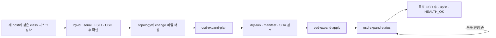
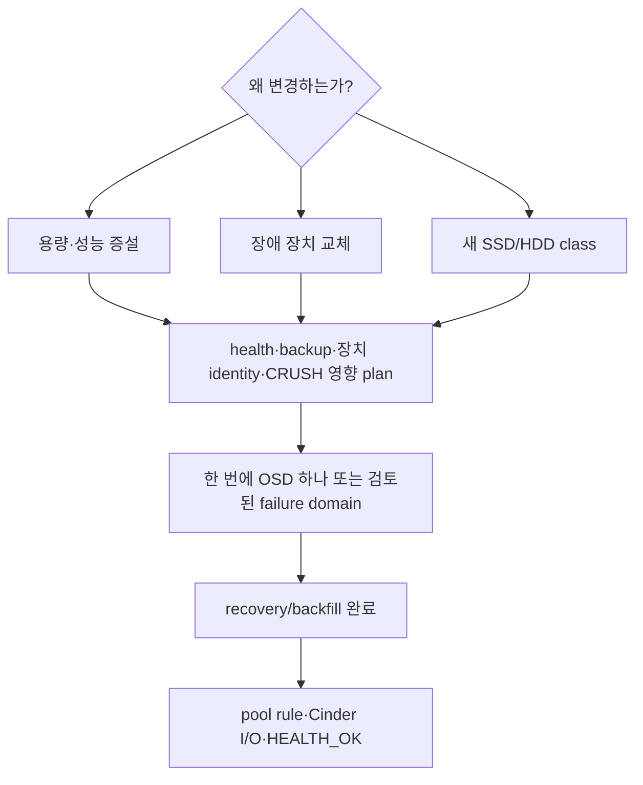

# Ceph 운영 변경: 증설·교체·제거

> 문서 위치: [전체 문서](../README.md) · [운영과 복구](README.md)

최초 OSD 세 개는 [Ceph 최초 구축](ceph-initial-deployment.md)의 자동화로 만든다. 이 문서는
운영 중 균형 OSD 추가 자동화와 장애 장치 교체·제거의 별도 검토 기준을 설명한다.
`osd-plan/osd-apply`는 계속 빈 cluster 전용이며 운영 추가에는
`osd-expand-plan/osd-expand-apply/osd-expand-status`만 사용한다.

## 실행 위치와 전체 순서

이 절차는 최초 3노드 Ceph와 OpenStack 구축이 끝난 뒤, Ceph bootstrap host인 `cloud01`에서
저장소 루트를 현재 디렉터리로 두고 실행한다. 세 storage host가 모두 켜져 있고 SSH로 접근 가능해야
한다. 새 디스크를 장착했더라도 아래 plan이 통과하기 전에는 partition, filesystem, LVM PV를 만들지
않는다.



| 단계 | 작업 | 다음 단계 조건 |
| --- | --- | --- |
| 장착 | 같은 class와 비슷한 용량의 디스크를 세 storage host에 균형 장착 | 세 host에서 안정적인 by-id와 serial 확인 |
| 입력 | topology에는 전체 OSD 장치, change 파일에는 이번 추가 장치만 기록 | FSID와 현재 OSD 수가 실제 cluster와 일치 |
| Plan | 장치 preflight와 cephadm dry-run 실행 | 모든 검사 성공, 예상 OSD 수와 대상 장치 검토 |
| Apply | 출력된 SHA 확인값으로 동일 manifest 제출 | cephadm이 의도한 OSD만 생성 |
| 완료 | recovery/backfill, OSD class와 Cinder I/O 확인 | 목표 OSD 수, 모든 OSD `up/in`, `HEALTH_OK` |

이 작업 전에 [백업과 복원](backup-and-restore.md)의 최근 복원 검증과
[관측과 알림](observability.md)의 Ceph·디스크 경보가 준비돼 있어야 한다.

## 변경 원칙



- `HEALTH_OK`와 최근 검증된 외부 backup 없이 변경하지 않는다.
- `/dev/sdX` 대신 topology와 실제 label이 일치하는 `/dev/disk/by-id`와 serial을 사용한다.
- 서로 다른 `hdd`, `ssd`, `nvme` class를 하나의 CRUSH rule에 우연히 섞지 않는다.
- 한 OSD 작업이 recovery를 끝내기 전에 다음 OSD를 변경하지 않는다.
- pool `size=3/min_size=2`와 host failure domain을 유지한다.
- Ceph replication을 backup으로 간주하지 않는다.

## 변경 전 기록

```bash
export CEPH_CHANGE_ID="$(date -u +%Y%m%dT%H%M%SZ)-osd-change"
mkdir -m 0700 -p ".cache/ceph/changes/$CEPH_CHANGE_ID"
sudo cephadm shell -- ceph -s >".cache/ceph/changes/$CEPH_CHANGE_ID/ceph-s.txt"
sudo cephadm shell -- ceph health detail >".cache/ceph/changes/$CEPH_CHANGE_ID/health.txt"
sudo cephadm shell -- ceph osd tree >".cache/ceph/changes/$CEPH_CHANGE_ID/osd-tree.txt"
sudo cephadm shell -- ceph osd df tree >".cache/ceph/changes/$CEPH_CHANGE_ID/osd-df.txt"
sudo cephadm shell -- ceph osd pool ls detail --format json \
  >".cache/ceph/changes/$CEPH_CHANGE_ID/pools.json"
sudo cephadm shell -- ceph osd crush rule dump \
  >".cache/ceph/changes/$CEPH_CHANGE_ID/crush-rules.txt"
```

`.cache` 기록은 Git에 넣지 않는다. 작업 전후 비교용이며 최종 결과는 암호화된 운영 기록으로
옮긴다.

대상 host에서 다음을 확인한다.

```bash
ls -l /dev/disk/by-id/
lsblk -o NAME,PATH,SIZE,MODEL,SERIAL,ROTA,TRAN,FSTYPE,MOUNTPOINTS
sudo wipefs --no-act /dev/disk/by-id/<검토한-장치>
sudo smartctl -x /dev/disk/by-id/<검토한-장치>
```

`wipefs --no-act` 결과, holder, mount, LVM PV, mdraid 또는 기존 Ceph signature가 있으면 추가 OSD
후보로 승인하지 않는다. 기존 데이터를 지우는 명령은 이 문서에서 자동 실행하지 않는다.

## 용량 증설 설계

### 기존 class 확장

현재 OpenStack pool이 `nvme`라면 추가 NVMe를 어느 host에 둘지 결정한다. 한 host에만 OSD를 많이
추가하면 host 장애 시 손실되는 raw 비율과 recovery 부하가 커진다. 세 failure domain에 같은
class와 비슷한 용량을 균형 있게 추가하는 것을 기본으로 한다.

| 확인 | 판단 기준 |
| --- | --- |
| 현재 사용률 | 70%에서 구매·작업 계획, 75% 전에 여유 확보 |
| host별 raw | 한 host 장애 후 `min_size=2` I/O를 유지할 수 있는지 |
| recovery 여유 | 새 OSD 추가 중 VM latency를 감당할 수 있는 시간대인지 |
| network | 10Gbps error/drop과 switch 여유가 정상인지 |
| memory | 추가 OSD의 memory target을 converged host가 감당하는지 |

### 새 class 추가

SATA SSD는 `ssd`, HDD는 `hdd` class로 세 host 이상에 준비한다. 새 class에는 다음을 각각 만든다.

1. class와 host failure domain을 선택하는 별도 CRUSH rule
2. 목적별 pool과 `size=3/min_size=2`
3. 필요하면 Cinder backend/volume type과 명확한 이름
4. 해당 type으로 volume 생성, attach, write/read, detach 시험
5. 용량과 latency를 구분한 모니터링

HDD pool을 VM root와 latency-sensitive database의 기본 type으로 만들지 않는다. archive나 backup
목적을 명시한다.

## OSD 추가 변경 계획

OSD 추가 자동화는 장치 검색 결과를 보고 임의의 디스크를 선택하지 않는다. topology와 별도 change
파일에 동일한 장치를 두 번 명시하고, 현재 cluster identity와 OSD 수까지 고정한다.

```bash
umask 077
cp inventory/ceph-osd-expansion.example.yml \
  inventory/ceph-osd-expansion.local.yml
chmod 0600 inventory/ceph-osd-expansion.local.yml

sudo cephadm shell -- ceph fsid
sudo cephadm shell -- ceph osd ls --format json
```

다음 두 파일에 새 장치를 기록한다.

1. `inventory/openstack-cluster.local.yml`의 각 host `ceph_osd_devices`에 새 장치를 추가한다.
2. `inventory/ceph-osd-expansion.local.yml`에는 **이번 변경에 추가할 장치만** 기록한다.

각 change 장치는 topology의 한 항목과 by-id, serial, 최소 크기와 class가 정확히 같아야 한다.
같은 class는 세 storage host 이상에 동일한 개수로 추가해야 한다. FSID와 현재 OSD 수는 위 명령의
직전 출력으로 채운다.

```yaml
schema_version: 1
change_id: add-ssd-tier-01
expected_fsid: 11111111-2222-3333-4444-555555555555
expected_current_osd_count: 3
devices:
  cloud01:
    - by_id: /dev/disk/by-id/ata-실제-cloud01-ssd-id
      serial: 실제-cloud01-시리얼
      min_size_bytes: 1800000000000
      device_class: ssd
  cloud02:
    - by_id: /dev/disk/by-id/ata-실제-cloud02-ssd-id
      serial: 실제-cloud02-시리얼
      min_size_bytes: 1800000000000
      device_class: ssd
  cloud03:
    - by_id: /dev/disk/by-id/ata-실제-cloud03-ssd-id
      serial: 실제-cloud03-시리얼
      min_size_bytes: 1800000000000
      device_class: ssd
```

### 증설 plan과 apply

```bash
export OPENSTACK_CLUSTER_CONFIG="$PWD/inventory/openstack-cluster.local.yml"
export CEPH_OSD_EXPANSION_CONFIG="$PWD/inventory/ceph-osd-expansion.local.yml"

sudo --preserve-env=OPENSTACK_CLUSTER_CONFIG,CEPH_OSD_EXPANSION_CONFIG \
  ./scripts/ceph-cluster.sh osd-expand-plan
```

Plan은 다음 조건을 모두 검사한다.

- topology가 유효한 3노드 이상 Ceph 구성이다.
- change의 모든 장치가 topology에 정확히 존재한다.
- class별로 세 host 이상에 동일한 장치 수를 추가한다.
- 실제 FSID와 현재 OSD 수가 change 파일과 같다.
- Ceph가 `HEALTH_OK`다.
- by-id, serial, 크기, 회전 여부와 transport가 선언한 class와 같다.
- mount, holder, filesystem, LVM, mdraid와 기존 Ceph signature가 없는 빈 장치다.
- cephadm OSD service spec dry-run이 성공한다.

출력된 manifest, OSD 수 변화와 SHA-256을 검토한 뒤 출력된 확인값을 그대로 사용한다.

```bash
export CEPH_OSD_EXPANSION_CONFIRM='ADD-CEPH-OSDS:<change-id>:<현재-osd수>:<sha256>'
sudo --preserve-env=OPENSTACK_CLUSTER_CONFIG,CEPH_OSD_EXPANSION_CONFIG,CEPH_OSD_EXPANSION_CONFIRM \
  ./scripts/ceph-cluster.sh osd-expand-apply
```

Apply는 plan 전체를 다시 실행한다. 그 사이 FSID, OSD 수, health, 장치 상태 또는 manifest가
바뀌면 중단한다. 적용 후 다음 명령으로 목표 OSD 수와 recovery를 확인한다.

```bash
sudo --preserve-env=OPENSTACK_CLUSTER_CONFIG,CEPH_OSD_EXPANSION_CONFIG \
  ./scripts/ceph-cluster.sh osd-expand-status
```

목표 OSD 수에 도달하고 `HEALTH_OK`가 될 때까지 다른 OSD 변경을 시작하지 않는다. 이 자동화는
OSD 추가만 수행한다. 새 `ssd`/`hdd` class의 CRUSH rule, pool과 Cinder backend/type은 I/O 시험과
OpenStack 설정 변경이 포함되므로 별도 변경으로 적용한다.

## 장애 OSD 교체

OSD `down`만으로 즉시 디스크 고장이라고 판단하지 않는다. daemon, host 전원, NIC, SMART와 kernel
log를 함께 확인한다.

```bash
sudo cephadm shell -- ceph health detail
sudo cephadm shell -- ceph orch ps --daemon-type osd
sudo cephadm shell -- ceph osd tree
ssh <host> 'sudo journalctl -k --since "-2 hours"'
ssh <host> 'sudo smartctl -x /dev/disk/by-id/<대상-장치>'
```

교체 전 반드시 OSD ID와 실제 by-id/serial의 연결을 확인한다. Ceph가 해당 OSD를 안전하게 제거할
수 있다고 판정하기 전에는 purge, zap 또는 물리 제거를 실행하지 않는다. 정확히 세 host와 세
OSD뿐인 초기 구성에서는 OSD 하나를 제거한 동안 세 번째 복제본을 다른 host에 재생성할 수 없다.
따라서 교체 시간 전체가 degraded 상태이며 두 번째 장애를 허용하지 않는다.

대상 OSD ID를 실제 관찰 결과로 정한 뒤 다음 읽기 전용 조회와 안전 판정을 기록한다.

```bash
sudo cephadm shell -- ceph osd find <확인한-osd-id>
sudo cephadm shell -- ceph osd metadata <확인한-osd-id>
sudo cephadm shell -- ceph device ls-by-daemon osd.<확인한-osd-id>
sudo cephadm shell -- ceph osd safe-to-destroy <확인한-osd-id>
```

`safe-to-destroy`가 실패하면 제거 작업을 진행하지 않는다. 성공하더라도 ID와 serial 대응, 두 번째
장애 유무와 backup을 다시 확인해야 하며, 이 판정 자체가 purge 승인은 아니다.

교체 순서는 다음 상태 전이로 관리한다.

1. 원인 확인과 대상 identity 고정
2. backup/복원 검증과 유지보수 시간 확보
3. Ceph safe-to-destroy 판정 및 제거 plan 검토
4. OSD daemon/CRUSH/auth 제거를 pin된 Ceph 절차로 실행
5. host에서 정확한 serial의 장치만 물리 교체
6. 새 by-id/serial/class를 local topology에 반영
7. 새 OSD 적용, `up/in`, recovery/backfill 완료 대기
8. pool rule, 사용률, Cinder I/O와 `HEALTH_OK` 검증

## 변경 중 관찰과 중단

```bash
watch -n 10 'sudo cephadm shell -- ceph -s'
sudo cephadm shell -- ceph progress
sudo cephadm shell -- ceph osd df tree
```

다음이면 새 OSD 작업을 추가하지 않는다.

- inactive/undersized PG가 예상 범위를 벗어나 증가
- 두 번째 OSD 또는 host 이상
- client I/O timeout이나 Cinder volume 오류
- Ceph network error/drop 또는 host memory pressure
- recovery 완료 예상이 유지보수 시간을 초과

## 완료 기준

- 모든 의도한 OSD가 `up/in`이며 class와 host 위치가 계획과 같다.
- `images`, `volumes`, `vms`와 새 pool이 의도한 CRUSH rule, size, min_size를 사용한다.
- recovery/backfill이 끝나고 `HEALTH_OK`다.
- 시험 Cinder volume의 생성·attach·write/read·detach·delete가 성공한다.
- topology의 by-id/serial과 실제 장치가 일치한다.
- host별 raw와 사용률 불균형을 기록했다.
- 변경 후 새 backup과 [장애 훈련](failure-drills.md) 범위를 갱신했다.

운영 OSD 추가는 최초 배포 guard와 분리된 `osd-expand-plan/apply/status`만 사용한다. 장애 OSD
교체·제거는 `safe-to-destroy`와 장치 identity를 다루는 별도 자동화가 구현되기 전까지 수동 검토
범위로 유지한다.
