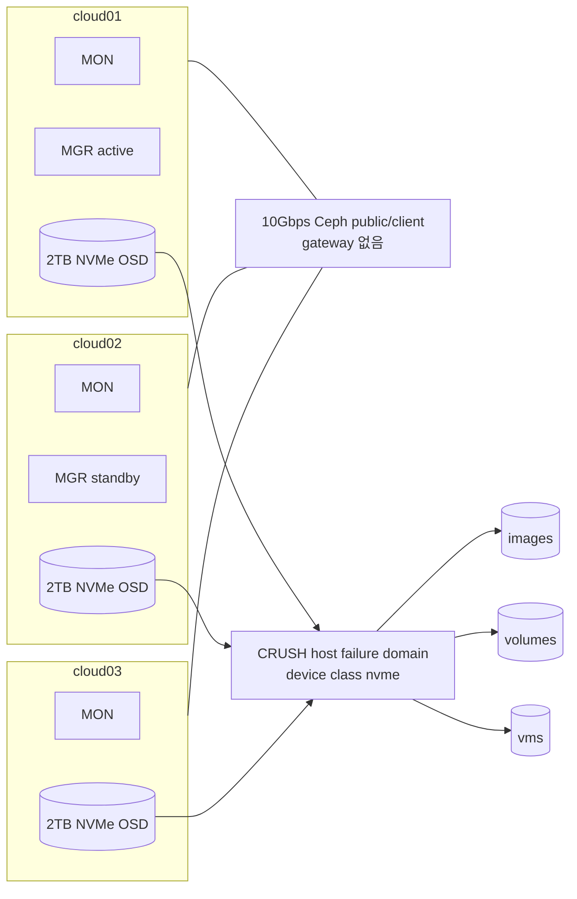
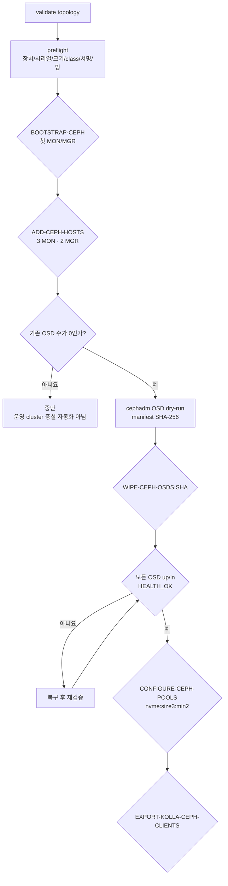

# Ceph 최초 구축과 안전 경계

> 문서 위치: [전체 문서](../README.md) · [운영과 복구](README.md)

이 저장소는 기존 LVM OpenStack을 Ceph로 이전하지 않는다. 세 물리 노드와 세 OSD를 먼저
준비하고 **빈 Ceph 클러스터를 만든 뒤** OpenStack을 처음 배포한다.

## 최초 토폴로지



세 pool은 `size=3`, `min_size=2`를 사용한다. OpenStack Glance, Cinder와 Nova는 처음부터
이 pool을 사용하므로 LVM backend나 데이터 이전 단계가 없다.

## topology 입력

실제 입력은 ignored 파일 하나를 사용한다.

```bash
cp inventory/openstack-cluster.yml inventory/openstack-cluster.local.yml
chmod 0600 inventory/openstack-cluster.local.yml
export OPENSTACK_CLUSTER_CONFIG="$PWD/inventory/openstack-cluster.local.yml"
```

다음 조건을 유지한다.

- `cluster.storage_backend: ceph`
- `cluster.ceph.enabled: true`
- `cloud01`~`cloud03` 모두 enabled
- 세 노드에 control, network, compute, storage 역할
- 각 노드에 실제 `ceph_interface`, MAC과 `ceph_address`
- 각 노드에 하나 이상의 명시적인 `ceph_osd_devices`

OSD 입력 형식은 다음과 같다.

```yaml
ceph_osd_devices:
  - by_id: /dev/disk/by-id/nvme-실제-고정-ID
    serial: 실제-lsblk-시리얼
    min_size_bytes: 1800000000000
    device_class: nvme
```

`/dev/nvme0n1`처럼 부팅 순서에 따라 바뀔 수 있는 이름은 허용하지 않는다. OpenStack pool에
선택한 device class는 적어도 세 호스트에 있어야 한다.

## 자동화 흐름



### 검증과 bootstrap

```bash
sudo --preserve-env=OPENSTACK_CLUSTER_CONFIG ./scripts/ceph-cluster.sh setup
./scripts/ceph-cluster.sh validate
./scripts/ceph-cluster.sh preflight

export CEPH_BOOTSTRAP_CONFIRM='BOOTSTRAP-CEPH:cloud01,cloud02,cloud03'
sudo --preserve-env=OPENSTACK_CLUSTER_CONFIG,CEPH_BOOTSTRAP_CONFIRM \
  ./scripts/ceph-cluster.sh bootstrap

export CEPH_HOSTS_CONFIRM='ADD-CEPH-HOSTS:cloud01,cloud02,cloud03'
sudo --preserve-env=OPENSTACK_CLUSTER_CONFIG,CEPH_HOSTS_CONFIRM \
  ./scripts/ceph-cluster.sh add-hosts
```

### 최초 OSD 배포 전용

`osd-plan`과 `osd-apply`는 `ceph osd ls --format json` 결과가 비어 있을 때만 동작한다. 이미
OSD가 하나라도 있으면 운영 중 증설로 판단하고 중단한다.

```bash
sudo --preserve-env=OPENSTACK_CLUSTER_CONFIG ./scripts/ceph-cluster.sh osd-plan
cat .cache/ceph/ceph-osd-manifest.txt
cat .cache/ceph/ceph-osd-manifest.sha256

export CEPH_OSD_CONFIRM='WIPE-CEPH-OSDS:<sha256>'
sudo --preserve-env=OPENSTACK_CLUSTER_CONFIG,CEPH_OSD_CONFIRM \
  ./scripts/ceph-cluster.sh osd-apply
```

manifest의 각 행에서 host, by-id, 시리얼, 최소 크기와 class를 실제 라벨과 다시 대조한다.

### pool과 Kolla client

```bash
sudo --preserve-env=OPENSTACK_CLUSTER_CONFIG ./scripts/ceph-cluster.sh status

export CEPH_POOL_CONFIRM='CONFIGURE-CEPH-POOLS:nvme:size3:min2'
sudo --preserve-env=OPENSTACK_CLUSTER_CONFIG,CEPH_POOL_CONFIRM \
  ./scripts/ceph-cluster.sh configure-pools

export CEPH_EXPORT_CONFIRM=EXPORT-KOLLA-CEPH-CLIENTS
sudo --preserve-env=OPENSTACK_CLUSTER_CONFIG,CEPH_EXPORT_CONFIRM \
  ./scripts/ceph-cluster.sh export-kolla
```

export 결과는 ignored `kolla/generated/ceph-config/`에 저장된다. `deploy-openstack`이 이 파일을
`/etc/kolla/config`에 설치한다. keyring은 공개 저장소에 커밋하지 않는다.

## preflight가 차단하는 상태

- by-id 링크와 topology 시리얼 불일치
- 최소 용량 미달 또는 device class 불일치
- 파티션, GPT, filesystem, LVM, RAID 서명 존재
- mount, swap, LVM PV, holder로 사용 중
- 활성 root filesystem의 상위 디스크
- `ceph0` 주소가 없거나 public network 밖에 있음
- host에 설치된 `ceph-osd` 패키지와 cephadm 충돌 가능성

스크립트는 기존 서명을 자동으로 지우지 않는다. 장치를 재사용해야 한다면 외부 백업과 실제
복원 확인 후 별도 유지보수 절차로 비운다.

## 용량과 장애 기준

2TB OSD 세 개는 약 6TB raw, 3중 복제 후 약 2TB logical이다. 70~75% 수준에서 다음 확장을
계획해 약 1.4~1.5TB를 운영 목표로 삼는다. 정확히 세 장애 도메인만 있을 때 한 노드가
사라지면 남은 두 복제본으로 I/O를 계속할 수 있지만 세 번째 복제본은 대체 호스트나 복구된
노드가 생기기 전까지 재생성할 수 없다.

다음 항목을 정기적으로 확인한다.

```bash
sudo cephadm shell -- ceph -s
sudo cephadm shell -- ceph df
sudo cephadm shell -- ceph osd df tree
sudo cephadm shell -- ceph orch ps
```

## 이후 SATA SSD/HDD 확장

SATA SSD를 추가할 때는 세 노드에 같은 class와 비슷한 용량으로 추가하고 `ssd` CRUSH rule과
별도 pool/Cinder type을 만든다. HDD는 VM root나 데이터베이스 대신 백업·아카이브용 `hdd`
pool로 분리한다.

새 장치를 topology에 적었다고 `osd-apply`를 다시 실행해서는 안 된다. 운영 cluster의 균형 OSD
추가는 별도 `inventory/ceph-osd-expansion.local.yml`과 `osd-expand-plan/apply/status`를 사용한다.
구체적인 변경 기록, device class, 장애 교체와 완료 기준은
[Ceph 운영 변경](ceph-day2.md)을 따른다.
