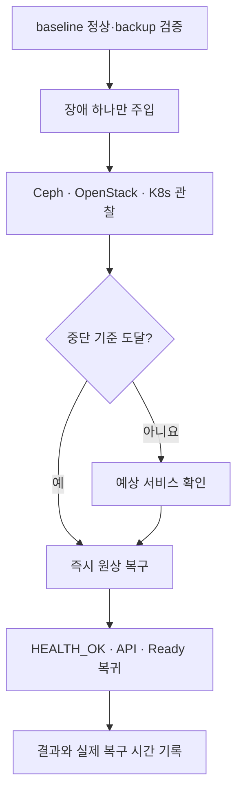

# 장애 훈련 실행서

> 문서 위치: [전체 문서](../README.md) · [운영과 복구](README.md)

이 문서는 실제 3노드 구축 후 예상한 장애 특성을 검증하는 계획이다. 최초 설치 직후 운영
workload를 올리기 전, 그리고 주요 버전 변경 후 유지보수 시간에 실행한다. 한 번에 장애 하나만
주입하며 Ceph가 복구 중이거나 backup 검증이 실패한 상태에서는 시작하지 않는다.

## 공통 준비

```bash
git rev-parse HEAD
git status --short
./scripts/cluster.sh validate
./scripts/cluster.sh verify-hosts
sudo ./scripts/ceph-cluster.sh status
sudo ./scripts/cluster.sh verify-openstack
```

management Kubernetes가 있으면 다음 baseline도 저장한다.

```bash
export OS_CLIENT_CONFIG_FILE="$PWD/terraform/openstack/clouds.yaml"
export OS_CLOUD=admin
test -r "$OS_CLIENT_CONFIG_FILE"
source config/versions.env
case "$(uname -m)" in x86_64) kubectl_arch=amd64;; aarch64|arm64) kubectl_arch=arm64;; esac
export KUBECTL="$PWD/.cache/kubernetes/bin/kubectl-${KUBECTL_VERSION}-${kubectl_arch}"
test -x "$KUBECTL"
export KUBECONFIG="$PWD/kubeconfig/admin.conf"
"$KUBECTL" get nodes -o wide
"$KUBECTL" get pods -A
"$KUBECTL" get pvc -A
```

시험 기록에는 시작·종료 시각, 적용 Git commit, 대상 host/장치, 시작 전 상태, 관찰 결과와 수동
개입을 남긴다. 최근 검증된 [백업과 복원](backup-and-restore.md)이 없으면 전원·디스크 시험을
실행하지 않는다.



## 중단 기준

다음 중 하나가 발생하면 추가 장애를 만들지 않고 대상부터 원복한다.

- Ceph `HEALTH_ERR`, MON quorum 상실 또는 pool I/O 중단
- 두 번째 물리 host, OSD 또는 controller에 비정상 징후 발생
- MariaDB/RabbitMQ quorum 상실 또는 OpenStack token 발급 실패가 예상 시간 이상 지속
- management Kubernetes API 또는 etcd quorum 상실
- 예상하지 않은 Terraform 자원 삭제·재생성
- 스토리지 오류, 과열, NIC flap처럼 시험 대상 밖의 하드웨어 문제

## 시험 1: compute service 중단

물리 전원 장애 전에 영향이 작은 Nova compute container 중단부터 확인한다. 대상 host에 있는
시험 VM을 기록하고 운영 VM이 없는 유지보수 시간에 수행한다.

```bash
OS_CLOUD=admin .cache/kolla-venv/bin/openstack server list --all-projects --host cloud03
ssh cloud03 'sudo docker ps --format "{{.Names}}" | grep nova_compute'
ssh cloud03 'sudo docker stop nova_compute'
```

예상 결과는 `cloud03`의 compute service가 `down`이 되고 그 host의 VM 실행 상태가 영향을 받는
것이다. 현재 Masakari와 자동 evacuation이 비활성화돼 있으므로 VM이 다른 host에서 자동으로
재기동되는 것을 성공 조건으로 삼지 않는다. API와 다른 두 compute는 계속 동작해야 한다.

```bash
sudo ./scripts/cluster.sh verify-openstack
ssh cloud03 'sudo docker start nova_compute'
```

container 복구 후 compute service가 `enabled/up`으로 돌아오고 기존 VM 상태를 직접 확인한다.

## 시험 2: 물리 host 한 대 중단

`cloud03`처럼 관리 접속과 console 경로가 확인된 host를 대상으로 한다. 그 host의 VM 목록과 Ceph
OSD ID를 먼저 기록하고, 원격 전원 복구 또는 현장 접근 수단을 준비한다.

```bash
OS_CLOUD=admin .cache/kolla-venv/bin/openstack server list --all-projects --host cloud03
sudo cephadm shell -- ceph osd tree
ssh cloud03 'sudo systemctl poweroff'
```

기대 상태는 다음과 같다.

| 영역 | 예상 상태 |
| --- | --- |
| Ceph | 해당 OSD `down`, pool은 `size=3/min_size=2`로 I/O 지속, 완전한 HEALTH_OK는 아님 |
| OpenStack API | 남은 controller의 HAProxy/MariaDB/RabbitMQ로 API 지속 |
| Nova | 해당 compute `down`; 그 host VM은 자동 복구되지 않음 |
| management Kubernetes | 남은 control plane/etcd 2개가 건강하면 quorum 유지 |
| 용량 | 세 번째 복제본을 다른 failure domain에 재생성할 여유 host가 없음 |

API token, 기존 다른 host VM의 network/volume I/O와 Kubernetes `/readyz`를 확인한다. 시험을 오래
유지해 Ceph가 불필요한 recovery를 시작하게 하지 말고 관찰이 끝나면 host를 다시 켠다.

복구 후 다음이 모두 정상일 때 종료한다.

```bash
./scripts/cluster.sh verify-hosts
sudo ./scripts/ceph-cluster.sh status
sudo ./scripts/cluster.sh verify-openstack
"$KUBECTL" get nodes
```

Ceph가 `HEALTH_OK`, 모든 OSD가 `up/in`, compute가 `enabled/up`, Kubernetes node가 Ready가 될
때까지 다음 시험을 시작하지 않는다.

## 시험 3: Ceph OSD daemon 재시작

물리 디스크를 제거하는 시험은 최초 운영 검증에 포함하지 않는다. 먼저 OSD daemon 하나의
재시작과 자동 복귀만 확인한다.

```bash
sudo cephadm shell -- ceph orch ps --daemon-type osd
sudo cephadm shell -- ceph osd tree
```

대상 daemon 이름을 기록하고 `ceph orch daemon restart <daemon-name>`을 실행한다. 임의의 OSD ID를
추측하지 않는다. restart 중 Cinder volume과 시험 VM I/O가 계속되는지 확인하고, daemon이 다시
running이며 OSD가 `up/in`으로 돌아오는지 확인한다.

디스크 pull, OSD `out`, purge와 교체는 [Ceph 운영 변경](ceph-day2.md)의 별도 변경 계획 없이는
시험하지 않는다.

## 시험 4: Ceph 10Gbps 경로 중단

현재 단일 Ceph interface와 단일 switch 구조에서는 switch 전체 전원 차단이 세 노드 스토리지를
동시에 끊는 사이트 장애와 같다. 최초 시험은 한 host의 Ceph cable 또는 interface만 대상으로
하고 management NIC는 유지한다.

중단 전 해당 NIC 이름과 console 접근을 확인한다. 연결을 끊은 뒤 Ceph health detail, OSD 상태와
host NIC error/drop을 관찰한다. OpenStack volume I/O가 멈추거나 두 번째 경로 이상이 생기면 즉시
원복한다. 단일 switch 전체 장애는 자동 복구가 기대되지 않으므로 운영 workload 환경에서
실행하지 않는다.

## 시험 5: OpenStack API endpoint

controller 하나의 HAProxy container 재시작으로 VIP가 남은 controller를 통해 응답하는지 확인한다.
대상 container 이름은 `docker ps`에서 확인한다.

```bash
ssh cloud02 'sudo docker ps --format "{{.Names}}" | grep haproxy'
ssh cloud02 'sudo docker restart haproxy'
sudo ./scripts/cluster.sh verify-openstack
```

VIP token 발급과 Skyline 응답이 계속되고 HAProxy가 healthy로 복귀해야 한다. Keepalived VIP owner
자체를 바꾸는 시험은 실제 owner와 backup interface를 확인한 별도 작업 기록으로 수행한다.

## 시험 6: management Kubernetes control plane

한 control-plane VM을 정상 종료하기 전에 해당 VM이 어느 물리 host에 있는지 기록한다.

```bash
OS_CLOUD=admin .cache/kolla-venv/bin/openstack server list --long
"$KUBECTL" get nodes -o wide
```

한 VM만 중단하고 남은 API `/readyz`, etcd 기반 workload 조회와 controller reconciliation을
확인한다. 두 control plane을 동시에 중단하지 않는다. VM을 다시 시작한 후 node Ready, system
Pod와 volume mount가 정상이어야 한다. 이 시험도 Nova 자동 evacuation을 검증하는 것이 아니다.

## 합격 기록

각 시험은 다음 항목을 채워야 완료로 처리한다.

| 기록 | 내용 |
| --- | --- |
| 장애 감지 시간 | 상태가 처음 비정상으로 표시된 시각 |
| 서비스 영향 | 실패한 API, VM, volume, Pod와 사용자 영향 |
| 예상과 차이 | 설계 문서와 실제 결과의 차이 |
| 원복 시간 | 대상 복귀부터 전체 health 정상까지 |
| 수동 개입 | 실행한 명령과 변경한 설정 |
| 후속 조치 | 자동화·모니터링·용량 보강 항목 |

실제 결과가 문서와 다르면 결과를 숨기지 않고 [현재 한계](../architecture/current-limitations.md)와
관련 runbook을 먼저 수정한 뒤 다음 시험을 진행한다.
