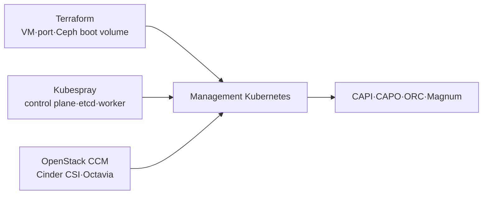

# Management Kubernetes 일상 운영

> 문서 위치: [전체 문서](../README.md) · [운영과 복구](README.md)

이 문서는 Terraform과 Kubespray로 만든 management Kubernetes의 상태, node 추가, OpenStack
cloud integration과 PVC 문제를 진단한다. 이 cluster는 CAPI provider와 Magnum을 운영하는 관리
계층이며 CAPO가 다시 생성하는 workload cluster가 아니다.

## 관리 구조



Terraform은 VM 수명주기, Kubespray는 Kubernetes node membership과 설정을 담당한다. VM만
Terraform에서 제거하거나 Kubernetes node만 수동 삭제해 두 상태를 분리하지 않는다.

## pinned kubectl과 kubeconfig

```bash
source config/versions.env
case "$(uname -m)" in x86_64) kubectl_arch=amd64;; aarch64|arm64) kubectl_arch=arm64;; esac
export KUBECTL="$PWD/.cache/kubernetes/bin/kubectl-${KUBECTL_VERSION}-${kubectl_arch}"
export KUBECONFIG="$PWD/kubeconfig/admin.conf"
export OS_CLIENT_CONFIG_FILE="$PWD/terraform/openstack/clouds.yaml"
export OS_CLOUD=admin
test -x "$KUBECTL"
test -r "$KUBECONFIG"
test -r "$OS_CLIENT_CONFIG_FILE"
"$KUBECTL" version
```

`admin.conf`는 cluster-admin credential이다. 공개 저장소, 일반 workload VM 또는 공유 shell
history에 내용을 넣지 않는다.

## 기본 상태 확인

```bash
"$KUBECTL" get --raw=/readyz
"$KUBECTL" get nodes -o wide
"$KUBECTL" get pods -A -o wide
"$KUBECTL" get storageclass
"$KUBECTL" get pvc -A
"$KUBECTL" get events -A --sort-by=.lastTimestamp
```

정상 기준은 control plane/etcd node 세 대가 Ready이고, system Pod가 반복 restart하지 않으며,
동적 provisioning을 지원하는 non-local 기본 StorageClass가 정확히 하나인 것이다. 플랫폼 활성화
후에는 다음 검증도 실행한다.

```bash
sudo --preserve-env=OPENSTACK_CLUSTER_CONFIG,MANAGEMENT_KUBECONFIG \
  ./scripts/cluster.sh platform-status
```

## Node가 NotReady인 경우

```bash
"$KUBECTL" describe node <node-name>
"$KUBECTL" get pods -A --field-selector spec.nodeName=<node-name> -o wide
OS_CLOUD=admin .cache/kolla-venv/bin/openstack server show <management-vm-id>
```

다음 순서로 계층을 구분한다.

1. 물리 compute와 Nova service 상태
2. management VM 전원, port, Floating/fixed IP와 Ceph boot volume
3. VM SSH, 시간, filesystem과 kubelet/container runtime
4. CNI와 node condition
5. control plane/etcd quorum

초기 구성은 Masakari Host Monitor가 비활성화돼 있으므로 물리 host 장애로 VM이 중단되면
Kubernetes가 그 VM 자체를 다른 host에 만들지 않는다. fencing과 Host Monitor를 추가한 뒤에는
Masakari가 먼저 VM evacuation을 시도하고 Kubernetes는 복귀한 Node 상태를 확인한다. 초기에는
남은 두 control plane으로 quorum이 유지되는지 확인하고 물리 host/VM을 복구한다.

node object를 먼저 삭제하거나 새 이름의 VM을 만들지 않는다. Terraform state,
`state/kubespray/openstack/applied-nodes.json`과 실제 node 이름을 비교한다.

## Node 추가

`terraform/openstack/terraform.tfvars`의 `kubernetes_nodes`에 새 map key와 role을 추가한다. 기존
key나 role을 바꾸지 않는다.

```bash
./scripts/cluster.sh terraform-plan
export TERRAFORM_APPLY_CONFIRM=APPLY-KUBERNETES-INFRA
./scripts/cluster.sh terraform-apply
./scripts/cluster.sh deploy-kubernetes
```

worker 추가는 Kubespray scale 경로를 사용한다. control-plane/etcd 추가는 renderer가 출력하는
별도 확인값을 요구하며 membership이 일치해야 한다. node와 role 제거는 현재 자동화가 차단한다.

적용 후 node Ready, system Pod, Cinder CSI topology와 새 node의 volume mount를 시험한다.

## PVC가 Pending 또는 attach 실패인 경우

```bash
"$KUBECTL" get pvc -A
"$KUBECTL" describe pvc -n <namespace> <pvc-name>
"$KUBECTL" get volumeattachments.storage.k8s.io
"$KUBECTL" get pods -n kube-system -o wide
.cache/kolla-venv/bin/openstack volume list --all-projects --long
sudo cephadm shell -- ceph -s
```

StorageClass provisioner, PVC event, CSI controller/node Pod, OpenStack volume와 Ceph 순서로 확인한다.
Kubernetes VolumeAttachment와 Cinder attachment를 동시에 수동 삭제하지 않는다. 어느 controller가
desired state를 관리하는지 확인하고 원인을 복구해 reconciliation하게 한다.

## LoadBalancer가 Pending인 경우

플랫폼 활성화 전에는 Octavia 연동이 준비되지 않았을 수 있다. 활성화 후에는 Service event,
cloud controller log와 OpenStack LoadBalancer/port/quota를 확인한다.

```bash
"$KUBECTL" describe service -n <namespace> <service-name>
.cache/kolla-venv/bin/openstack loadbalancer list
.cache/kolla-venv/bin/openstack floating ip list
.cache/kolla-venv/bin/openstack quota show <project-id>
```

Service annotation, subnet, security group, port/Floating IP quota와 OVN provider 등록을 순서대로
확인한다. `platform-status`가 실패하면 workload Service만 반복 생성하지 않는다.

## Control plane 변경과 backup

다음 파일은 management cluster 복구 세트다.

- `terraform/openstack/terraform.tfstate*`와 `terraform.tfvars`
- `state/kubespray/openstack/applied-nodes.json`
- `kubeconfig/admin.conf`
- `kubeconfig/openstack-management.env`
- 플랫폼 활성화 시 `kolla/generated/magnum/kubeconfig`

같은 시점으로 [백업과 복원](backup-and-restore.md)에 포함한다. etcd snapshot 자동화는 현재
저장소에 구현돼 있지 않으므로 control plane backup 완료로 표시하지 않는다. snapshot 위치,
암호화, 보존과 실제 restore 시험을 추가해야 한다.

## 완료 기준

- API `/readyz`와 세 control plane/etcd node가 정상이다.
- system Pod와 cloud provider controller가 Available이며 반복 restart가 없다.
- 기본 StorageClass가 하나이고 시험 PVC 생성·mount·삭제가 성공한다.
- 플랫폼 사용 시 Octavia LoadBalancer와 `platform-status`가 정상이다.
- Terraform/Kubespray desired state와 실제 node membership이 일치한다.
- state와 kubeconfig의 외부 backup checksum을 검증했다.

Kubernetes version 변경은 이 문서의 node 추가 흐름과 분리해
[업그레이드와 유지보수](upgrades.md)를 따른다.
