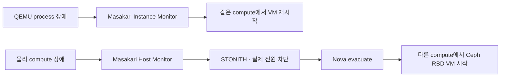

# Masakari VM 복구

> 문서 위치: [전체 문서](../README.md) · [운영과 복구](README.md)

Masakari는 Ceph 복제나 Kubernetes 고가용성을 대신하지 않는다. Masakari는 Nova VM의 장애를
감지하고 복구 workflow를 실행하는 계층이다. 이 저장소는 안전하게 검증할 수 있는 범위와 물리
전원 fencing이 필요한 범위를 분리한다.



## 현재 적용 범위

Kolla 기본 설정은 다음 상태다.

```yaml
enable_masakari: "yes"
enable_masakari_instancemonitor: "yes"
enable_masakari_hostmonitor: "no"
```

따라서 Masakari API와 Engine, Instance Monitor는 최초 OpenStack과 함께 배포한다. Host Monitor와
자동 host evacuation은 실제 fencing 장치와 N+1 용량을 검증하기 전까지 배포하지 않는다.

`kolla/config/masakari.conf`는 host와 instance failure 모두 `HA_Enabled=True` metadata가 있는
VM만 대상으로 제한한다. Management Kubernetes VM에는 Terraform이 이 metadata를 넣는다.
cloud01 고정 GPU·HBA VM에는 넣지 않는다.

Management Kubernetes control-plane server group은 `soft-anti-affinity`다. 정상 상태에서는 세
compute에 분산하려고 시도하고, 한 compute가 fencing된 뒤에는 남은 두 compute 중 하나에
evacuation할 수 있다. 이 정책은 정상 배치 자체를 3개 failure domain에 강제하지 않으므로 최초
생성 후 실제 host 분산을 확인한다.

```bash
openstack server list --long
openstack server show k8s-01 -c host -c properties
openstack server show k8s-02 -c host -c properties
openstack server show k8s-03 -c host -c properties
```

## 최초 검증

OpenStack 배포 후 저장소의 검증 명령은 Masakari API도 호출한다.

```bash
sudo ./scripts/cluster.sh verify-openstack

export OS_CLIENT_CONFIG_FILE=/etc/kolla/clouds.yaml
export OS_CLOUD=admin
.cache/kolla-venv/bin/openstack service list --service masakari
.cache/kolla-venv/bin/openstack endpoint list --service masakari
.cache/kolla-venv/bin/openstack segment list
```

Management Kubernetes를 만든 뒤 metadata와 정상 분산을 확인한다. Instance Monitor 시험은 운영
workload가 없는 유지보수 시간에 시험 VM 하나로 수행한다. 임의의 QEMU process를 찾아 kill하지
말고, 대상 VM과 compute를 기록한 별도 장애 시험 절차를 먼저 만든다.

## Host Monitor 활성화 조건

다음 조건이 모두 충족되기 전에는 `enable_masakari_hostmonitor`를 `yes`로 바꾸지 않는다.

1. 각 compute의 전원을 외부에서 확실히 끌 수 있는 IPMI/Redfish 또는 검증된 STONITH agent가 있다.
2. fencing 제어망과 전원이 장애 대상 host에 의존하지 않는다.
3. fencing 성공을 확인한 뒤에만 evacuation이 시작된다.
4. 남은 두 compute에 HA 대상 VM의 RAM, vCPU와 PCI가 아닌 일반 자원을 수용할 여유가 있다.
5. Ceph가 한 host 손실 상태에서 RBD I/O를 지속한다.
6. GPU·HBA·로컬 디스크 VM은 `HA_Enabled` 대상에서 제외돼 있다.
7. 관리 접속 단절, Ceph망 단절과 실제 host 장애를 구분하는 시험을 통과했다.

공유 Ceph volume을 사용하는 host가 실제로 살아 있는데 다른 compute에서 같은 VM을 시작하면 두
QEMU가 같은 디스크를 사용할 수 있다. 따라서 ping이나 Corosync heartbeat 단절만으로 evacuation을
허용하지 않는다.

Host Monitor를 활성화할 때는 다음 작업을 하나의 변경으로 검토한다.

- Kolla의 Host Monitor와 HA cluster 역할 활성화
- Pacemaker/Corosync 통신망과 quorum 확인
- 각 compute의 STONITH resource 등록과 실제 전원 차단 시험
- `auto` recovery failover segment 생성과 compute host 등록
- host별 workload와 N+1 capacity 확인
- Masakari notification, Nova evacuation, Ceph attach와 guest 부팅 시간 측정

현재 저장소는 이 물리 fencing 정보를 알 수 없으므로 Host Monitor apply와 segment 생성을 자동화하지
않는다. fencing 장치를 확정한 뒤 장치별 credential을 ignored 로컬 파일에 넣고, 읽기 전용 plan과
정확한 확인값을 요구하는 별도 workflow를 추가해야 한다.

## Management Kubernetes와 CAPI

Management Kubernetes VM은 Terraform/Kubespray가 만들며 CAPI가 자기 자신을 교체하지 않는다.
이 VM은 Masakari의 우선 복구 대상이다. Workload Kubernetes VM은 CAPI가 관리하므로 Masakari와
`MachineHealthCheck`가 동시에 동작하지 않도록 시간을 분리한다.

| 대상 | 첫 복구 | 후속 복구 |
| --- | --- | --- |
| Management Kubernetes VM | Masakari | 운영자 복구 |
| CAPI workload control plane | Masakari 5분 이내 시도 | 10~15분 이후 CAPI remediation |
| CAPI worker | Pod 재배치 | CAPI MachineHealthCheck |
| PCI passthrough VM | 자동 복구 없음 | 같은 물리 host 복구 후 수동 시작 |

Workload cluster template에 `HA_Enabled=True`를 넣을지는 cluster별로 결정한다. 넣는 경우 CAPI
MachineHealthCheck의 NotReady timeout을 Masakari 목표 복구 시간보다 길게 두고, 동시에 교체할 수
있는 Machine 수를 제한한다.

## 완료 기준

Host Monitor 단계는 다음을 실제 장비에서 확인해야 완료다.

- 장애 host가 fencing된 후에만 동일 VM이 다른 compute에서 시작한다.
- Ceph RBD volume과 Neutron port가 정상 연결된다.
- Management Kubernetes의 etcd와 API가 quorum을 잃지 않는다.
- CAPI가 Masakari 복구 중 같은 Machine을 먼저 삭제하지 않는다.
- 실패한 compute가 자동으로 workload를 다시 가져가지 않으며 수동 복귀 절차가 있다.
- 장애·복구 시각과 실제 RTO가 장애 훈련 기록에 남는다.

