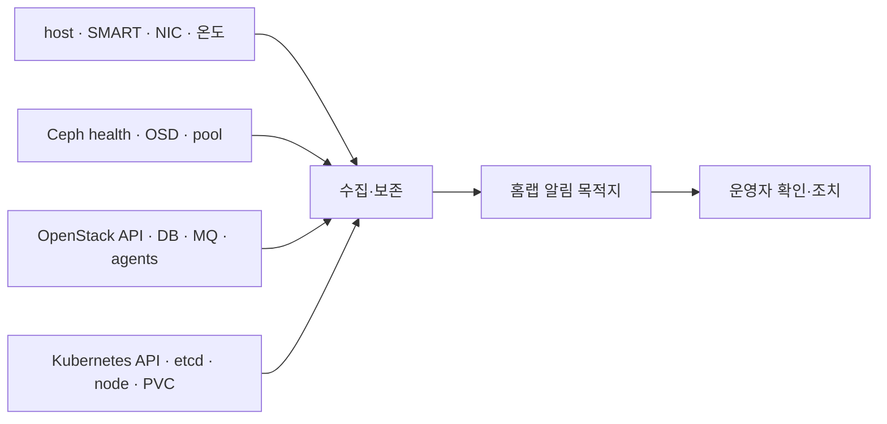

# 관측과 알림 운영서

> 문서 위치: [전체 문서](../README.md) · [운영과 복구](README.md)

현재 Kolla 설정은 Fluentd만 활성화하고 Prometheus, Grafana와 OpenSearch는 비활성화한다.
따라서 최초 설치 직후에는 아래 읽기 전용 점검을 사용하고, 실제 세 노드의 남은 RAM·디스크를
측정한 뒤 metrics와 중앙 로그 보존을 단계적으로 추가한다.

## 관측 구조



단일 Grafana 화면이 정상이라는 이유로 실제 서비스를 정상으로 판정하지 않는다. 원본 API와
CLI health check가 기준이며 dashboard와 알림은 이를 빠르게 발견하기 위한 보조 수단이다.

## 최초 설치 직후 점검

다음 명령은 변경하지 않고 현재 상태를 읽는다.

```bash
./scripts/cluster.sh verify-hosts
sudo ./scripts/ceph-cluster.sh status
sudo cephadm shell -- ceph health detail
sudo cephadm shell -- ceph df
sudo cephadm shell -- ceph osd df tree
sudo cephadm shell -- ceph orch ps
sudo ./scripts/cluster.sh verify-openstack
sudo ./scripts/openstack.sh check
```

management Kubernetes가 있으면 다음도 확인한다.

```bash
source config/versions.env
case "$(uname -m)" in x86_64) kubectl_arch=amd64;; aarch64|arm64) kubectl_arch=arm64;; esac
export KUBECTL="$PWD/.cache/kubernetes/bin/kubectl-${KUBECTL_VERSION}-${kubectl_arch}"
test -x "$KUBECTL"
export KUBECONFIG="$PWD/kubeconfig/admin.conf"
"$KUBECTL" get --raw=/readyz
"$KUBECTL" get nodes
"$KUBECTL" get pods -A
"$KUBECTL" get pvc -A
"$KUBECTL" get events -A --sort-by=.lastTimestamp
```

## 최소 신호와 경보 기준

정확한 임계값은 실제 baseline을 일주일 이상 기록한 뒤 조정한다. 아래 조건은 즉시 확인해야 하는
초기 기준이다.

| 영역 | 수집 항목 | 즉시 확인 조건 |
| --- | --- | --- |
| Ceph | health, MON quorum, OSD up/in, PG 상태 | `HEALTH_ERR`, quorum 감소, OSD down/out, inactive PG |
| Ceph 용량 | pool/raw 사용률, nearfull, recovery | 70% 계획 경보, 75% 증설 결정, nearfull 발생 |
| OpenStack API | token, compute/network/volume endpoint | 연속 실패 또는 VIP 접근 불가 |
| MariaDB/RabbitMQ | cluster/quorum, container restart | quorum 감소, 반복 restart, queue 비정상 증가 |
| Nova/Neutron/Cinder | service/agent up 상태 | topology의 enabled host가 down |
| 물리 host | CPU, RAM, load, filesystem, Docker volume | 지속 swap, `/var/lib/docker` 80%, inode 부족 |
| NIC | link, error, drop, speed | Ceph 10Gbps link down/속도 저하, error 지속 증가 |
| 디스크 | SMART overall, media error, wear, 온도 | failed SMART, uncorrectable error, wear 임계값 |
| Kubernetes | `/readyz`, etcd/control plane, Node Ready | API 실패, control plane 2개 미만, Node NotReady |
| 백업 | 마지막 성공 시각, checksum, restore 시험 | 정해진 주기 초과 또는 checksum 실패 |

## 물리 host와 디스크

세 host에서 실제 장치 이름을 먼저 확인한다.

```bash
lsblk -o NAME,SIZE,MODEL,SERIAL,ROTA,TRAN,FSTYPE,MOUNTPOINTS
ip -s link
df -hT
df -ih
free -h
sudo docker ps --format 'table {{.Names}}\t{{.Status}}'
```

SMART는 장치 유형에 맞게 실행한다. HBA 뒤의 HDD는 host가 아니라 패스스루 VM에서 확인한다.

```bash
sudo smartctl --scan-open
sudo smartctl -x /dev/<확인한-장치>
```

OSD나 OS 디스크를 추측한 `/dev/sdX`로 자동 순회하지 않는다. topology의 by-id/serial과 대조한다.

## OpenStack 상태 판정

`verify-openstack`은 token 발급, topology compute, hypervisor와 Skyline을 검사한다. 추가 서비스
상태는 admin cloud로 확인한다.

```bash
export OS_CLIENT_CONFIG_FILE="$PWD/terraform/openstack/clouds.yaml"
export OS_CLOUD=admin
test -r "$OS_CLIENT_CONFIG_FILE"
.cache/kolla-venv/bin/openstack compute service list
.cache/kolla-venv/bin/openstack hypervisor list
.cache/kolla-venv/bin/openstack network agent list
.cache/kolla-venv/bin/openstack volume service list
.cache/kolla-venv/bin/openstack endpoint list
```

한 service가 down이면 곧바로 container를 재시작하지 않는다. 먼저 해당 host, Ceph, 시간 동기화,
container 상태와 최근 로그를 같은 시각 기준으로 확인한다.

```bash
ssh <host> 'sudo docker ps -a --format "table {{.Names}}\t{{.Status}}"'
ssh <host> 'sudo find /var/log/kolla -type f -mmin -30 -print'
```

로그에는 token, URL query와 사용자 데이터가 포함될 수 있으므로 공개 issue나 Git에 원문을 올리지
않는다.

## Metrics stack 활성화 전 결정

`enable_prometheus`와 `enable_grafana`를 `yes`로 바꾸는 것만으로 운영 준비가 끝나지 않는다.
다음을 실제 topology에 기록한 뒤 Kolla reconfigure 변경으로 적용한다.

1. controller별 추가 RAM/CPU와 metrics volume 용량
2. retention 기간과 예상 증가량
3. Grafana 접근 network와 인증 방식
4. 외부 알림 목적지와 야간 알림 여부
5. OpenStack/Ceph/Kubernetes 중 어디까지 한 stack에서 수집할지
6. monitoring stack 자체가 중단됐을 때 사용할 CLI 점검 경로

변경 절차는 다음 순서다.

```bash
./scripts/cluster.sh validate
./scripts/cluster.sh render
git diff -- kolla/globals.yml kolla
sudo ./scripts/openstack.sh reconfigure
sudo ./scripts/openstack.sh validate-config
sudo ./scripts/openstack.sh check
sudo ./scripts/cluster.sh verify-openstack
```

현재 저장소에는 Prometheus/Grafana retention, dashboard와 alert rule이 구현돼 있지 않다. 해당
설정을 추가하기 전까지 활성화 완료로 표시하지 않는다.

## 점검 주기

| 주기 | 확인 |
| --- | --- |
| 매일 또는 자동 알림 | Ceph health, API, node/agent 상태, backup 성공 |
| 매주 | 용량 추세, SMART 변화, NIC error/drop, container restart |
| 매월 | 복구 여유 용량, credential/certificate 만료, 업데이트 후보 |
| 분기 | [장애 훈련](failure-drills.md), backup restore 시험, 알림 수신 시험 |
| 장비 변경 후 | 새 baseline 수집, 임계값과 dashboard 수정 |

장애가 끝난 뒤 단순히 경보를 닫지 않는다. 최초 감지 시각, 실제 영향, 복구 시간과 다음에 더 빨리
발견할 신호를 기록해 경보 기준을 조정한다.
