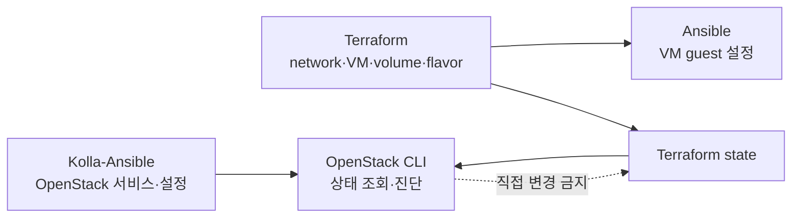

# OpenStack 일상 운영과 진단

> 문서 위치: [전체 문서](../README.md) · [운영과 복구](README.md)

이 문서는 3노드 배포 후 OpenStack API와 자원 상태를 확인하고 VM 생성·network·volume 문제를
진단하는 절차다. Terraform이 관리하는 자원을 OpenStack CLI로 수정하거나 삭제하는 절차는
제공하지 않는다. CLI는 우선 읽기 전용 조사에 사용한다.

## 관리 경계



| 변경 | 사용 경로 |
| --- | --- |
| OpenStack 서비스 설정 | topology/Kolla config 변경 → render → reconfigure |
| management Kubernetes VM | `terraform/openstack` plan/apply |
| 일반 VM·volume·flavor·aggregate | `terraform/workloads/<stack>` plan/apply |
| VM 내부 package·service | workload Ansible playbook |
| 상태 조사 | admin OpenStack CLI와 Kolla/Ceph read-only 명령 |

## admin CLI 준비

운영자 계정으로 mode `0600`인 로컬 cloud 파일을 사용한다.

```bash
export OS_CLIENT_CONFIG_FILE="$PWD/terraform/openstack/clouds.yaml"
export OS_CLOUD=admin
test -r "$OS_CLIENT_CONFIG_FILE"
.cache/kolla-venv/bin/openstack token issue
```

token이나 `clouds.yaml` 내용을 terminal 기록, Git diff 또는 공개 issue에 붙이지 않는다.

## 기본 상태 확인

```bash
sudo ./scripts/cluster.sh verify-openstack
.cache/kolla-venv/bin/openstack endpoint list
.cache/kolla-venv/bin/openstack compute service list
.cache/kolla-venv/bin/openstack hypervisor list
.cache/kolla-venv/bin/openstack network agent list
.cache/kolla-venv/bin/openstack volume service list
.cache/kolla-venv/bin/openstack image list
```

다음을 정상 기준으로 삼는다.

- topology의 모든 compute가 `enabled/up`
- 필요한 Neutron/OVN agent와 Cinder service가 `up`
- compute host 수와 hypervisor 수가 topology와 일치
- `ubuntu-24.04`와 workload가 참조하는 image가 active
- API VIP token 발급과 Skyline 검증 통과

## 자원과 quota 확인

```bash
.cache/kolla-venv/bin/openstack project list
.cache/kolla-venv/bin/openstack quota show <project-id>
.cache/kolla-venv/bin/openstack limits show --absolute
.cache/kolla-venv/bin/openstack flavor list
.cache/kolla-venv/bin/openstack network list
.cache/kolla-venv/bin/openstack subnet list
.cache/kolla-venv/bin/openstack router list
.cache/kolla-venv/bin/openstack volume type list
```

VM 수, vCPU, RAM, port, Floating IP, volume와 GiB quota를 함께 본다. scheduler 실패를 host RAM
부족으로 단정하기 전에 project quota, flavor extra spec, aggregate, anti-affinity와 Ceph volume
상태를 확인한다.

quota 변경이 필요하면 변경 전후 값, project ID와 이유를 로컬 기록에 남긴다. 관리형 플랫폼이
사용하는 project quota는 CAPI cluster scale과 LoadBalancer/port 수까지 고려한다.

## VM 생성 또는 scheduling 실패

Terraform apply를 반복하기 전에 저장된 plan과 해당 server request를 확인한다.

```bash
./scripts/cluster.sh workload-show <stack>
.cache/kolla-venv/bin/openstack server list --all-projects --long
.cache/kolla-venv/bin/openstack server show <server-id>
.cache/kolla-venv/bin/openstack console log show <server-id>
.cache/kolla-venv/bin/openstack hypervisor stats show
```

`server show`의 status, fault, flavor, attached volume, addresses와 host를 기록한다. 일반적인 확인
순서는 다음과 같다.

1. project quota와 전체 hypervisor capacity
2. flavor extra spec과 host aggregate metadata
3. affinity/anti-affinity server group의 남은 failure domain과 정책 충족 여부
4. image 상태와 boot volume type
5. Neutron network/subnet/port와 security group
6. Cinder service, Ceph health와 volume 상태
7. 대상 compute의 nova-compute log

실패 server를 CLI로 삭제한 뒤 Terraform을 다시 실행하면 state와 실제 자원이 어긋날 수 있다.
먼저 Terraform state 주소와 OpenStack ID를 비교하고, 필요하면 별도 import/복구 계획을 세운다.

## Network와 Floating IP 진단

```bash
.cache/kolla-venv/bin/openstack port list --server <server-id>
.cache/kolla-venv/bin/openstack port show <port-id>
.cache/kolla-venv/bin/openstack floating ip list
.cache/kolla-venv/bin/openstack security group rule list <security-group-id>
.cache/kolla-venv/bin/openstack router show <router-id>
```

fixed IP, MAC, binding host, security group, router interface와 Floating IP 연결을 순서대로 확인한다.
Provider VLAN 장애가 의심되면 [네트워크 설계](../architecture/networking.md)와
[OpenWrt 운영](openwrt.md)의 host probe를 먼저 확인한다. guest 방화벽과 OpenStack security
group 문제를 구분한다.

## Volume 진단

```bash
.cache/kolla-venv/bin/openstack volume list --all-projects --long
.cache/kolla-venv/bin/openstack volume show <volume-id>
.cache/kolla-venv/bin/openstack server volume list <server-id>
sudo cephadm shell -- ceph -s
sudo cephadm shell -- ceph df
```

volume type, status, attachment server/host와 bootable 여부를 확인한다. `in-use` volume을 강제로
state reset하거나 attachment를 직접 삭제하지 않는다. Nova와 Cinder 양쪽에 attachment가 남았는지,
compute가 살아 있는지, Ceph RBD I/O가 정상인지 먼저 조사한다.

## Kolla 설정 변경

```bash
./scripts/cluster.sh validate
./scripts/cluster.sh render
git diff -- kolla inventory ansible
sudo ./scripts/openstack.sh reconfigure
sudo ./scripts/openstack.sh validate-config
sudo ./scripts/openstack.sh check
sudo ./scripts/cluster.sh verify-openstack
```

release upgrade, controller 제거, DB restore와 service database 직접 수정은 이 흐름에 포함되지
않는다. upgrade는 [업그레이드와 유지보수](upgrades.md), DB 복구는
[백업과 복원](backup-and-restore.md)을 따른다.

## 진단 종료 기준

- 원인을 quota, placement, image, network, volume, compute 또는 guest 계층으로 구분했다.
- Terraform state와 OpenStack resource ID의 관계를 기록했다.
- 임시 CLI 변경 없이 코드 또는 명시적 복구 plan으로 수정했다.
- Ceph와 OpenStack 전체 검증이 다시 통과한다.
- 관련 workload plan에 예상하지 않은 생성·교체·삭제가 없다.
- 재발을 감지할 metric/log 항목을 [관측과 알림](observability.md)에 반영했다.
