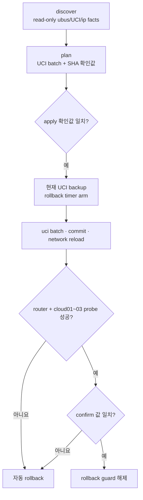

# OpenWrt Provider VLAN 자동화

> 문서 위치: [전체 문서](../README.md) · [운영과 복구](README.md)

OpenWrt는 세 OpenStack host의 관리망 gateway와 Provider VLAN 10 gateway를 제공한다. 최초
OpenStack 배포 전에 `cloud01`~`cloud03` 전체의 probe를 통과해야 한다.

## 처리 흐름



## 로컬 입력

```bash
cp inventory/openwrt-router.example.yml inventory/openwrt-router.local.yml
chmod 0600 inventory/openwrt-router.local.yml
${EDITOR:-vi} inventory/openwrt-router.local.yml
```

실제 router 주소, SSH host key fingerprint, bridge/VLAN device와 세 host의 probe 주소를 넣는다.
최초 배포 전에는 OpenStack에 편입된 host가 없으므로 `deployed_nodes: []`를 유지하고 세 host
모두 임시 probe 대상으로 둔다.

## discovery와 plan

```bash
./scripts/cluster.sh openwrt-discover
./scripts/cluster.sh openwrt-plan
```

다음을 검토한다.

- SSH fingerprint가 실제 OpenWrt key와 같은지
- VLAN 10이 올바른 물리 trunk/bridge에 생성되는지
- Provider gateway와 DHCP/방화벽 범위
- `cloud01`, `cloud02`, `cloud03` probe interface와 주소
- `.cache/openwrt/uci.batch`가 기존 관리 경로를 끊지 않는지

## 적용과 rollback

```bash
export OPENWRT_APPLY_CONFIRM='<plan 출력값>'
export OPENWRT_CONFIRM='<plan 출력값>'
./scripts/cluster.sh openwrt-apply
./scripts/cluster.sh openwrt-status
```

apply는 backup과 rollback timer를 먼저 만든다. confirm까지 성공하지 못하면 이전 UCI를
복원한다. guard가 남아 있고 수동 복원이 필요하면 plan이 출력한 rollback 확인값을 사용한다.

```bash
export OPENWRT_ROLLBACK_CONFIRM='<plan 출력값>'
./scripts/cluster.sh openwrt-rollback
```

## OpenStack 배포 후

OpenStack이 `br-ex`를 소유한 다음에는 임시 probe 주소를 그대로 유지하지 않는다. 로컬
OpenWrt inventory의 `deployed_nodes`를 활성 host 전체로 갱신하고, renderer가 요구하는
provider 검증 방식을 따른다. 새 compute를 추가할 때는 새 노드의 probe를 먼저 통과시킨 후
Kolla 확장을 실행한다.

OpenWrt 자동화는 10Gbps Ceph망을 구성하지 않는다. Ceph망은 별도 스위치와 각 host Netplan에서
gateway 없이 구성한다.
