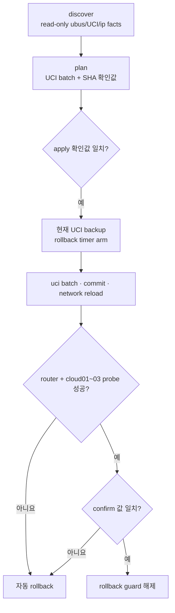

# OpenWrt Provider VLAN 자동화

> 문서 위치: [전체 문서](../README.md) · [운영과 복구](README.md)

OpenWrt는 세 OpenStack host의 관리망 gateway와 Provider VLAN 10 gateway를 제공한다. 최초
OpenStack 배포 전에 `cloud01`~`cloud03` 전체의 probe를 통과해야 한다.

## 처리 흐름



## 로컬 입력

```bash
cp inventory/openwrt-router.example.yml inventory/openwrt-router.local.yml
chmod 0600 inventory/openwrt-router.local.yml
${EDITOR:-vi} inventory/openwrt-router.local.yml
```

실제 router 주소, SSH host key fingerprint, bridge/VLAN device와 세 host의 probe 주소를 넣는다.
최초 배포 전에는 OpenStack에 편입된 host가 없으므로 `deployed_nodes: []`를 유지하고 세 host
모두 임시 probe 대상으로 둔다.

## discovery와 plan

```bash
./scripts/cluster.sh openwrt-discover
./scripts/cluster.sh openwrt-plan
```

다음을 검토한다.

- SSH fingerprint가 실제 OpenWrt key와 같은지
- VLAN 10이 올바른 물리 trunk/bridge에 생성되는지
- Provider gateway와 DHCP/방화벽 범위
- `cloud01`, `cloud02`, `cloud03` probe interface와 주소
- `.cache/openwrt/uci.batch`가 기존 관리 경로를 끊지 않는지

## 적용과 rollback

```bash
export OPENWRT_APPLY_CONFIRM='<plan 출력값>'
export OPENWRT_CONFIRM='<plan 출력값>'
./scripts/cluster.sh openwrt-apply
./scripts/cluster.sh openwrt-status
```

apply는 backup과 rollback timer를 먼저 만든다. confirm까지 성공하지 못하면 이전 UCI를
복원한다. guard가 남아 있고 수동 복원이 필요하면 plan이 출력한 rollback 확인값을 사용한다.

```bash
export OPENWRT_ROLLBACK_CONFIRM='<plan 출력값>'
./scripts/cluster.sh openwrt-rollback
```

transaction은 router의 `/root/openwrt-rollback/<change-id>/`에 저장되고 현재 guard는
`/root/openwrt-rollback/current`가 가리킨다. controller에는 같은 변경의 sysupgrade와
`/etc/config` backup을 `state/openwrt/<change-id>/`에 mode `0600`으로 복사한다. 이 directory는
Git에서 제외하고 [백업과 복원](backup-and-restore.md)의 외부 암호화 backup에 포함한다.

apply가 실패했을 때 상태에 따라 다음처럼 처리한다.

| 상태 | 조치 |
| --- | --- |
| SSH 가능, guard armed | 전원을 끄지 말고 plan의 정확한 rollback 값으로 `openwrt-rollback` 실행 |
| SSH 불가, router 동작 중 | rollback deadline까지 전원을 유지하고 관리 연결 복귀 대기 |
| 자동 rollback 후 연결 복귀 | `openwrt-discover`부터 다시 실행하고 이전 plan 재사용 금지 |
| router reboot/power loss | console에서 `/root/openwrt-rollback/current`와 `/etc/config` 확인 후 backup 복원 계획 수립 |
| controller의 `.cache/openwrt` 유실 | 새 plan을 만들기 전 router guard 상태 확인; 확인값을 추측하지 않음 |

console 복구가 필요하면 controller의 `state/openwrt/<change-id>/etc-config.tar.gz`와
`sysupgrade-backup.tar.gz`의 checksum과 내용을 먼저 검사한다. 살아 있는 설정 위에 archive를
무조건 풀지 않고 현재 `/etc/config`를 별도 복사한 뒤, 해당 OpenWrt firmware/version에서 만든
backup인지 확인한다.

복구 후 다음 검증을 모두 다시 실행한다.

```bash
./scripts/cluster.sh openwrt-discover
./scripts/cluster.sh openwrt-plan
./scripts/cluster.sh openwrt-status
./scripts/cluster.sh verify-hosts
```

관리 gateway, Provider VLAN gateway, 세 host probe와 `fw4 check`가 정상이어야 새 apply를 시작할
수 있다.

## OpenStack 배포 후

OpenStack이 `br-ex`를 소유한 다음에는 임시 probe 주소를 그대로 유지하지 않는다. 로컬
OpenWrt inventory의 `deployed_nodes`를 활성 host 전체로 갱신하고, renderer가 요구하는
provider 검증 방식을 따른다. 새 compute를 추가할 때는 새 노드의 probe를 먼저 통과시킨 후
Kolla 확장을 실행한다.

OpenWrt 자동화는 10Gbps Ceph망을 구성하지 않는다. Ceph망은 별도 스위치와 각 host Netplan에서
gateway 없이 구성한다.
