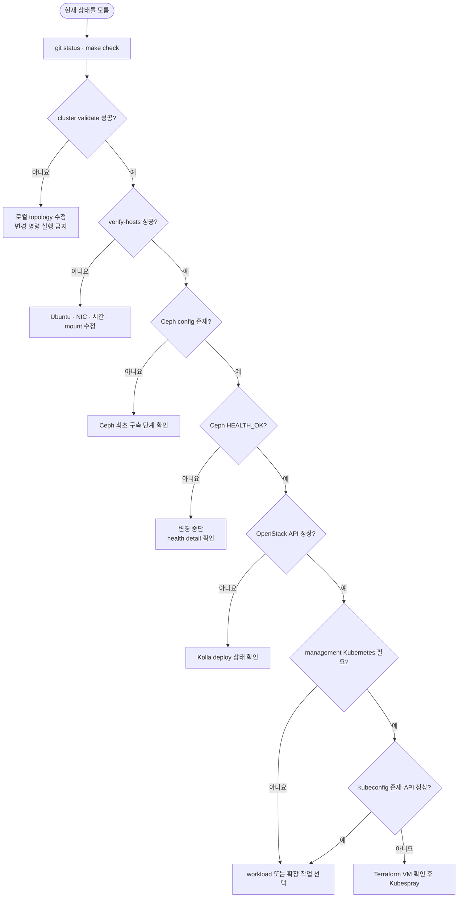
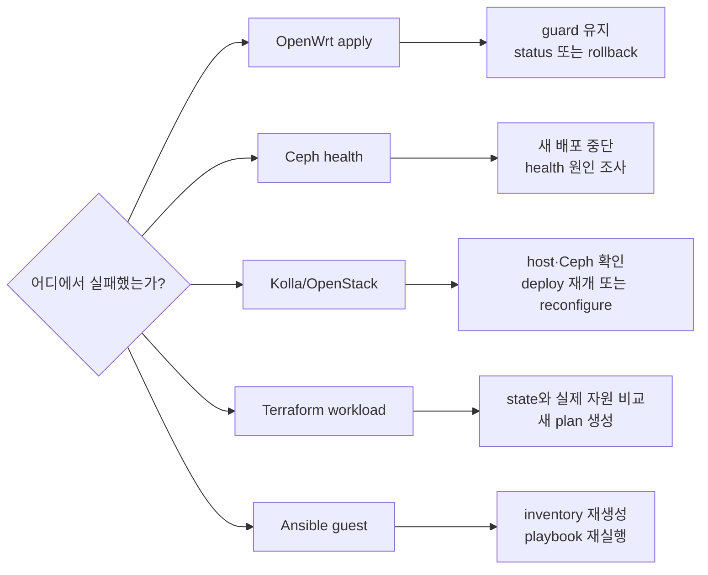
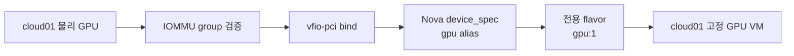

# 상황별 운영 가이드

> 문서 위치: [전체 문서](../README.md) · [운영과 복구](README.md)

이 문서는 최초 구축 이후 자주 생기는 상황에서 어느 명령과 기준 문서를 사용해야 하는지
찾기 위한 안내서다. 설치를 처음 시작할 때는 이 문서의 일부만 골라 실행하지 말고
[전체 설치 런북](../getting-started/installation.md)을 순서대로 따른다.



## 먼저 현재 상태 확인

변경 전에 저장소, 로컬 입력과 실제 서비스 상태를 분리해서 확인한다.

```bash
git status --short
make check
./scripts/cluster.sh validate
./scripts/cluster.sh render
./scripts/cluster.sh verify-hosts
sudo ./scripts/ceph-cluster.sh status
sudo ./scripts/cluster.sh verify-openstack
```

아직 구축하지 않은 단계의 검증 명령은 실패할 수 있다. 이때 다음 단계로 건너뛰지 말고 아래
표에서 마지막으로 성공한 지점을 찾는다.

| 확인 결과 | 현재 지점 | 다음 기준 |
| --- | --- | --- |
| `validate` 실패 | 로컬 topology 입력 전 | [로컬 설정·비밀·상태](local-data-and-recovery.md) |
| `verify-hosts` 실패 | Ubuntu·네트워크 준비 중 | [설치 런북 4~6단계](../getting-started/installation.md#4-도구와-세-호스트-준비) |
| Ceph config가 없고 디스크 preflight 성공 | Ceph bootstrap 전 | [Ceph 최초 구축](ceph-initial-deployment.md) |
| Ceph는 정상이고 OpenStack API가 없음 | Kolla 배포 전 | [설치 런북 8단계](../getting-started/installation.md#8-3노드-openstack-배포) |
| OpenStack은 정상이고 management VM이 없음 | Terraform 적용 전 | [설치 런북 9단계](../getting-started/installation.md#9-management-kubernetes-3대) |
| VM은 있고 Kubernetes kubeconfig가 없음 | Kubespray 적용 전 | `cluster.sh deploy-kubernetes` |

## 상황 선택

| 상황 | 실행 경로 | 자동화 상태 |
| --- | --- | --- |
| 세 노드를 처음 구축 | 설치 런북 1단계부터 실행 | 지원 |
| 설치가 중간에 중단 | 읽기 전용 검증으로 마지막 완료 단계 확인 | 단계별 재개 |
| OpenWrt 적용 후 연결 실패 | rollback guard 확인 또는 rollback 실행 | 지원 |
| Ceph가 `HEALTH_WARN/ERR` | 변경 중단 후 원인 확인 | 자동 복구하지 않음 |
| Kolla 설정 변경 | render, 검토, `openstack.sh reconfigure` | 지원 |
| 일반 VM 추가·변경 | workload plan/show/apply | 지원 |
| VM scheduling·network·volume 문제 | OpenStack CLI로 읽기 중심 진단 | 지원 |
| VM guest 서비스 구성 | workload inventory/configure | 지원 |
| workload state 유실 | 백업 복원 또는 명시적 import | 자동 복구하지 않음 |
| cloud04 이후 compute 추가 | `expand-openstack` | 조건부 지원 |
| 기존 Ceph에 OSD 균형 추가 | `osd-expand-plan/apply/status` | 적용 코드 구현, 실환경 미검증 |
| Ceph OSD 교체·제거 | Ceph day-2 identity·safe-to-destroy 검토 | apply 자동화 미지원 |
| management Kubernetes 노드 추가 | Terraform 변경 후 Kubespray scale | 추가 지원, 제거 차단 |
| management Node/PVC/LoadBalancer 문제 | Kubernetes와 OpenStack desired state 비교 | 읽기 중심 진단 지원 |
| HBA/HDD VM 생성 | cloud01 전용 workload | 조건부 지원 |
| GPU VM 생성 | cloud01 전용 PCI workload | 조건부 지원 |
| 정기 backup과 복원 시험 | 동일 시점 복구 세트 생성·checksum·격리 복원 | DB backup 지원, 전체 restore 수동 검토 |
| 상태 감시와 알림 | CLI baseline 후 metrics/alert 설계 | 기본 metrics stack 비활성화 |
| host·OSD·API 장애 훈련 | 한 번에 장애 하나, 중단 기준과 복구 시간 기록 | 절차 지원, 자동 주입 안 함 |
| 버전 업그레이드 | 계층별 branch·backup·격리 검증 | release upgrade apply 미지원 |
| 운영 PC나 credential 노출 | key·token 회전과 새 backup | 홈랩 수동 대응 |

물리 host 장애, 혼합 OSD class, 단일 Ceph switch, local state와 모니터링의 현재 보장 범위는
[현재 한계와 운영 전 검토](../architecture/current-limitations.md)를 먼저 확인한다.

장애가 발생한 구성요소에 따라 변경 가능한 범위도 달라진다.



## 설치가 중간에 중단된 경우

확인 문자열이 필요한 명령을 추측해서 반복하지 않는다. 먼저 읽기 전용 상태를 확인한다.

```bash
./scripts/cluster.sh validate
./scripts/cluster.sh verify-hosts
sudo ./scripts/ceph-cluster.sh status
sudo ./scripts/cluster.sh verify-openstack
```

- Ceph `bootstrap`은 `/etc/ceph/ceph.conf`나 기존 cephadm FSID가 있으면 두 번째 cluster 생성을
  거부한다. 이미 bootstrap됐다면 `status`로 확인하고 다음 단계로 간다.
- `osd-plan`과 `osd-apply`는 OSD가 하나라도 있으면 중단한다. 부분 적용이나 장치 장애를 최초
  설치 명령으로 해결하지 않는다.
- Kolla deploy가 실패했다면 호스트와 Ceph 상태를 먼저 정상화하고 같은 topology를 render한
  뒤 `deploy-openstack`을 다시 실행한다. 이미 운영 중인 cloud의 설정 변경에는
  `openstack.sh reconfigure`를 사용한다.
- Terraform apply가 실패했다면 새 plan을 만들기 전에 state와 실제 OpenStack 자원을 확인한다.
  state 파일을 삭제하거나 빈 state로 다시 적용하지 않는다.

## OpenWrt 변경 뒤 연결이 끊긴 경우

`openwrt-apply`는 모든 OpenStack 노드의 probe와 router 검증이 끝날 때까지 rollback guard를
해제하지 않는다.

```bash
./scripts/cluster.sh openwrt-status
./scripts/cluster.sh openwrt-rollback
```

apply 직후 검증이 실패했다면 전원을 끄지 않는다. SSH가 가능하면 저장된 transaction의 정확한
rollback 확인값으로 되돌리고, SSH도 끊겼다면 설정된 rollback deadline까지 기다린다. 연결이
돌아오면 `openwrt-discover`와 `openwrt-plan`부터 다시 실행한다.

## Ceph가 정상이 아닌 경우

OpenStack 배포, workload 대량 변경과 OSD 작업을 멈추고 원인을 먼저 확인한다.

```bash
sudo ./scripts/ceph-cluster.sh status
sudo cephadm shell -- ceph -s
sudo cephadm shell -- ceph health detail
sudo cephadm shell -- ceph orch ps
sudo cephadm shell -- ceph osd tree
```

이 저장소는 기존 OSD purge, 교체, 추가와 pool 복구를 자동화하지 않는다. 장애 디스크를
topology에서 지우거나 `osd-apply`를 다시 실행하지 않는다. MON quorum, 실패한 daemon, 디스크
SMART와 네트워크 상태를 확인하고 별도 유지보수 계획을 작성한다.

## Kolla 설정을 바꾼 경우

추적되는 설정과 ignored 로컬 설정을 수정한 뒤 생성 결과를 검토한다.

```bash
./scripts/cluster.sh validate
./scripts/cluster.sh render
git diff -- kolla ansible inventory
sudo ./scripts/openstack.sh reconfigure
sudo ./scripts/openstack.sh validate-config
sudo ./scripts/openstack.sh check
sudo ./scripts/cluster.sh verify-openstack
```

컨트롤러 추가는 이 흐름 대신 DB 백업을 포함하는 `expand-openstack` 경로를 사용한다. Magnum/CAPI
프로필을 활성화한 뒤 물리 노드를 추가하는 작업은 현재 일반 확장 명령이 차단한다.

## 일반 VM을 새로 만드는 경우

서비스 수명주기가 같으면 한 stack의 `instances` map에 넣고, 백업·폐기 시점이 다르면 stack을
분리한다.

```bash
./scripts/cluster.sh workload-new web
${EDITOR:-vi} terraform/workloads/web/terraform.tfvars \
  ansible/inventory/workloads/web.local.yml
./scripts/cluster.sh workload-plan web
./scripts/cluster.sh workload-show web
```

plan의 VM, boot volume, network, security group과 삭제·교체 항목을 검토한 뒤 출력된 SHA-256
확인값으로 적용한다.

```bash
export TERRAFORM_WORKLOAD_APPLY_CONFIRM='APPLY-TERRAFORM-WORKLOAD:web:<plan-sha256>'
./scripts/cluster.sh workload-apply web
./scripts/cluster.sh workload-output web
```

자세한 입력 규칙은 [서비스별 Terraform workload](../workloads/terraform.md)를 따른다.

## 기존 workload에 VM을 추가하거나 사양을 바꾸는 경우

`terraform.tfvars`의 `instances` map을 바꾼 뒤 항상 새 plan을 만든다. 기존 map key를 바꾸면
Terraform은 다른 인스턴스로 해석한다. 이름 정리를 위해 key를 바꾸거나 state에서 자원을
제거하지 않는다.

```bash
./scripts/cluster.sh workload-plan web
./scripts/cluster.sh workload-show web
# 새 확인값으로 workload-apply
```

root volume과 instance에는 `prevent_destroy`가 있다. 교체가 필요한 변경은 기존 VM을 즉시
교체하는 대신 새 key의 VM을 추가하고 서비스와 데이터를 옮긴 뒤 별도 폐기 변경을 검토한다.

VM이 `ERROR`이거나 network/volume이 예상 상태에 도달하지 않으면 CLI로 삭제하거나 state를
고치기 전에 [OpenStack 일상 운영과 진단](openstack-day2.md)의 quota, placement, port와 attachment
순서로 조사한다.

## VM에 Ansible 서비스를 구성하는 경우

`ansible/playbooks/workloads/<stack>.yml`을 만들고 `workload` 그룹을 대상으로 한다. 접속 정보는
Terraform output과 ignored 로컬 settings에서 생성한다.

```bash
./scripts/cluster.sh workload-inventory web
ansible-inventory -i .cache/ansible/workloads/web.yml --graph
./scripts/cluster.sh workload-configure web
```

Floating IP 또는 fixed IP가 바뀌면 생성 inventory를 직접 고치지 않고
`workload-inventory`를 다시 실행한다. SSH 사용자, key 또는 host별 변수가 바뀌면
`ansible/inventory/workloads/web.local.yml`을 수정한다. `workload-configure`는 매번 inventory를
다시 만든 뒤 playbook을 실행한다.

## Terraform state나 로컬 입력을 잃어버린 경우

새 `terraform.tfstate`를 만들거나 기존 OpenStack 자원을 다시 생성하지 않는다. 저장소 밖의
암호화 백업에서 다음을 같은 시점 기준으로 복원한다.

- 해당 stack의 `terraform.tfstate*`와 `terraform.tfvars`
- 사용한 `clouds.yaml` 또는 application credential
- 적용한 Git commit ID와 로컬 Ansible settings

복원 후 `workload-output`, `workload-plan`, `workload-show` 순으로 state와 실제 자원을 비교한다.
백업이 없으면 provider resource별 `terraform import` 계획을 세워 명시적으로 state를 복구한다.
자동 import나 state 재구성은 이 저장소가 제공하지 않는다.

## cloud04 이후 물리 노드를 추가하는 경우

노드는 한 대씩 추가할 수 있다. 처음 세 노드는 controller/network 역할을 유지하고 추가 노드는
기본적으로 compute로 둔다.

```bash
./scripts/cluster.sh validate
./scripts/cluster.sh render
./scripts/cluster.sh prepare-hosts
# 새 노드 재부팅
./scripts/cluster.sh verify-hosts

export OPENSTACK_EXPAND_CONFIRM='EXPAND-OPENSTACK:cloud01,cloud02,cloud03,cloud04'
sudo --preserve-env=OPENSTACK_EXPAND_CONFIRM ./scripts/cluster.sh expand-openstack
```

정확한 topology 편집, OpenWrt 반영과 사후 검사는
[3노드 이후 확장](cluster-expansion.md)을 따른다. 추가 노드의 디스크를 topology에 적는 것만으로
운영 Ceph OSD가 늘어나지는 않는다.

## management Kubernetes 노드를 추가하는 경우

`terraform/openstack/terraform.tfvars`의 노드를 추가하고 Terraform plan/apply 후
`deploy-kubernetes`를 실행한다. worker 추가는 scale playbook을 사용하고 control-plane/etcd
추가는 출력된 별도 확인값을 요구한다.

```bash
./scripts/cluster.sh terraform-plan
export TERRAFORM_APPLY_CONFIRM=APPLY-KUBERNETES-INFRA
./scripts/cluster.sh terraform-apply
./scripts/cluster.sh deploy-kubernetes
```

노드 제거와 role 제거는 자동화가 차단한다. `state/kubespray/openstack/applied-nodes.json`을
잃었는데 kubeconfig가 남아 있으면 scale을 진행하지 않고 상태 백업부터 복원한다.
Node NotReady, PVC attach와 LoadBalancer 문제는
[Management Kubernetes 일상 운영](kubernetes-day2.md)의 계층별 진단을 따른다.

## cloud01에 HDD 전용 VM을 만드는 경우

3노드 Ceph/OpenStack과 management Kubernetes 검증을 끝낸 후에만 진행한다. 별도 SATA HBA의
PCI 주소와 IOMMU group을 확인하고 Nova local config를 적용한 뒤 `storage` workload를 만든다.

```bash
sudo ./scripts/openstack.sh reconfigure
sudo ./scripts/openstack.sh check
./scripts/cluster.sh workload-new storage
```

이 VM은 cloud01 고정이며 HA와 live migration 대상이 아니다. 실제 PCI alias, host aggregate와
전용 flavor 구성은 [고정 스토리지 VM](../workloads/storage-vm.md)을 따른다.

## cloud01에 GPU 전용 VM을 만드는 경우

GPU와 같은 IOMMU group의 function을 확인하고 host가 해당 GPU를 사용하지 않아도 되는지 먼저
결정한다. GPU를 VFIO에 bind하고 Nova의 exact-address `device_spec`, `gpu` alias와 cloud01
aggregate를 구성한 뒤 전용 Terraform workload를 적용한다.



전체 GPU 한 장을 한 VM에 주는 구성이며 vGPU나 공유 GPU 구성이 아니다. VM은 live migration과
HA 대상이 아니다. 구체적인 설정과 검증 순서는 [PCI 패스스루 VM](../workloads/pci-passthrough.md)을
따른다.

## Git 변경을 가져오거나 운영 PC를 교체한 경우

Git에는 코드와 공개 예시만 있다. clone 후 ignored 로컬 파일, state, credential과 SSH 키를
암호화 백업에서 복원하고 권한을 다시 확인한다.

```bash
chmod 0700 ~/.ssh
chmod 0600 inventory/*.local.yml terraform/openstack/terraform.tfvars
find terraform/workloads -mindepth 2 -maxdepth 2 -name terraform.tfvars -exec chmod 0600 {} +
find ansible/inventory/workloads -maxdepth 1 -name '*.local.yml' -exec chmod 0600 {} +
make check
./scripts/cluster.sh validate
./scripts/cluster.sh render
```

`kolla/generated/passwords.yml`, Terraform state, `/etc/kolla`, `/etc/ceph`, kubeconfig와 Kubespray
적용 상태가 복구 기준이다. 전체 목록은 [로컬 설정·비밀·상태](local-data-and-recovery.md)에 있다.

## 정기 backup 또는 복원 시험을 하는 경우

변경 작업이 없는 시점에 Git commit, local 입력, credential, Terraform/Kubespray state와 Kolla
MariaDB full backup을 하나의 ID로 묶는다.

```bash
git status --short
sudo ./scripts/ceph-cluster.sh status
sudo ./scripts/cluster.sh verify-openstack
sudo ./scripts/openstack.sh backup
```

MariaDB backup 위치를 추측하지 않고 Docker volume inspect로 확인한다. archive 생성, checksum,
권한, workload 데이터와 실제 복원 순서는 [백업과 복원 실행서](backup-and-restore.md)를 따른다.
현재 wrapper는 MariaDB restore를 제공하지 않으므로 운영 DB 위에서 임의의 restore 명령을
실행하지 않는다.

## 모니터링 또는 장애 훈련을 준비하는 경우

Prometheus/Grafana를 바로 활성화하기 전에 CLI baseline, 실제 세 노드의 자원 여유, retention과
알림 목적지를 결정한다. 최소 신호와 초기 임계값은 [관측과 알림](observability.md)을 따른다.

장애 훈련은 최근 backup 검증과 `HEALTH_OK`를 전제로 한 번에 하나만 수행한다. Nova 자동
evacuation이 없으므로 host 장애 VM의 자동 복구를 합격 조건으로 두지 않는다. host, OSD daemon,
Ceph network, API와 management control plane별 예상 결과와 중단 기준은
[장애 훈련 실행서](failure-drills.md)에 있다.

## Ceph OSD를 증설하거나 교체하려는 경우

최초 구축용 `osd-plan/osd-apply`를 다시 실행하지 않는다. 현재 health, pool/CRUSH rule, 정확한
by-id/serial, host별 raw 용량, recovery 영향과 최근 backup을 변경 기록에 먼저 고정한다.

기존 class 또는 새 class의 **균형 OSD 추가**는 `ceph-osd-expansion.local.yml`과
`osd-expand-plan/apply/status`를 사용한다. 새 SSD/HDD class용 pool과 Cinder type, 장애 OSD 교체·
제거, identity 확인과 완료 기준은 [Ceph 운영 변경](ceph-day2.md)을 따른다.

## 버전을 올리려는 경우

`config/versions.env`를 수정하는 것만으로 운영 upgrade가 완료되지 않는다. Ubuntu, Ceph,
Kolla/OpenStack, Terraform, Kubernetes와 CAPI provider를 각각 별도 변경으로 다룬다. full backup,
지원 경로, 시험 환경과 rollback 가능 지점을 확정한 뒤 [업그레이드와 유지보수](upgrades.md)를
따른다. 현재 `openstack.sh`와 `ceph-cluster.sh`에는 release upgrade 진입점이 없다.

## 운영 PC·SSH key·credential을 잃거나 노출한 경우

이 홈랩에 저장된 실제 credential 목록부터 확인하고 분실 장비의 접속 경로를 차단한다. 새 SSH
key와 credential을 먼저 배포·검증한 뒤 기존 것을 폐기한다. Kolla passwords를 새로 생성해 운영
cloud에 바로 덮어쓰지 않는다. 자세한 순서는 [홈랩 보안](security.md)을 따른다.

## 아직 자동화하지 않은 작업

다음 상황에서는 기존 명령을 변형해 실행하지 않고 별도 변경 계획과 rollback 절차를 먼저
작성한다.

- 운영 Ceph OSD 교체·제거와 CRUSH/pool 정책 변경
- controller/network role 제거 또는 quorum 재구성
- management Kubernetes 노드·role 제거
- Terraform state 자동 재구성과 기존 자원 자동 import
- HBA passthrough VM의 다른 compute 이동
- Magnum/CAPI 활성화 후 물리 OpenStack host 확장

이 경계는 [자동화 범위와 승인 지점](../architecture/automation-boundaries.md)에 함께 정리되어 있다.
