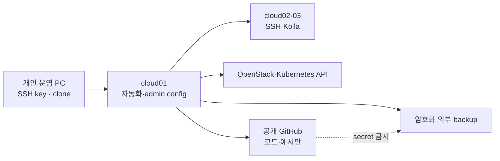

# 홈랩 보안과 자격 증명 운영

> 문서 위치: [전체 문서](../README.md) · [운영과 복구](README.md)

이 문서는 한 명이 관리하는 개인 홈랩을 기준으로 한다. 본인 운영 PC 분실, SSH private key 또는
백업 매체 노출, OpenStack/Kubernetes credential 유출에 대응하는 최소 절차를 정한다.

## 신뢰 경계



## 자격 증명 목록

| 자격 증명 | 위치 | 노출 시 영향 | 기본 처리 |
| --- | --- | --- | --- |
| 운영자 SSH private key | 운영 PC와 암호화 backup | 세 host shell 접근 | 새 key 배포 후 이전 key 제거 |
| Kolla `passwords.yml` | `kolla/generated/`, `/etc/kolla` | OpenStack 내부 서비스 인증 | 공개 금지, 전체 백업, 계획된 회전 |
| admin `clouds.yaml` | `/etc/kolla`, Terraform local copy | OpenStack 관리자 API | mode 0600, 운영 PC 복사 최소화 |
| Application Credential | `kubeconfig/openstack-management.env` 등 | 해당 project 자원 제어 | 새 credential 검증 후 이전 credential 폐기 |
| Terraform state | 각 root의 `terraform.tfstate*` | cloud-init·자원 정보 노출 가능 | mode 0600, 암호화 backup |
| Kubernetes admin kubeconfig | `kubeconfig/admin.conf` | management cluster 전체 제어 | mode 0600, 필요한 장비에만 보관 |
| Magnum ServiceAccount kubeconfig | `kolla/generated/magnum/kubeconfig` | management cluster의 높은 권한 | mode 0600, Kolla host와 backup만 |
| Ceph keyring | `/etc/ceph`, Kolla config | pool 데이터 접근 | client별 최소 권한 유지 |
| OpenWrt SSH/설정 backup | local inventory와 router | gateway/VLAN 변경 | host fingerprint 고정, backup 암호화 |

## 평상시 기준

```bash
find inventory terraform kubeconfig state kolla/generated \
  -type f \( -name '*.local.yml' -o -name 'terraform.tfstate*' \
  -o -name 'terraform.tfvars' -o -name 'clouds.yaml' -o -name 'admin.conf' \
  -o -name 'passwords.yml' -o -name 'kubeconfig' \) -ls
git ls-files -ci --exclude-standard
make check
```

민감 파일은 원칙적으로 mode `0600`, 이를 담는 디렉터리는 `0700` 또는 필요한 최소 권한을 쓴다.
공개 저장소에는 예시 주소와 schema만 올린다. `.gitignore`가 있어도 staging diff를 직접 확인한다.

OpenStack API와 Skyline을 인터넷에 직접 노출하지 않는다. 관리망 또는 개인 VPN을 통해 접근하고,
Provider network는 tenant workload의 외부 통신에만 사용한다. 현재 Skyline URL이 HTTP이므로 신뢰할
수 없는 network를 통과시키지 않는다. 외부 접근이 필요하면 TLS와 접근 제어를 별도 변경으로
구성한 뒤 검증한다.

## SSH key 정기 교체

기존 key를 지우기 전에 새 key로 세 host 모두 접속되는지 확인한다.

1. 운영 PC에서 새 Ed25519 key pair를 만들고 private key를 암호화 backup에 저장한다.
2. 새 public key를 `cloud01`~`cloud03`의 운영자 `authorized_keys`에 추가한다.
3. 별도 terminal에서 새 key로 각 host에 접속하고 `sudo -n true`를 확인한다.
4. local topology의 `cluster.ssh_private_key`를 새 절대경로로 바꾸고 validate/verify-hosts를 실행한다.
5. OpenWrt가 별도 key를 쓰면 같은 방식으로 새 key 접속과 fingerprint를 확인한다.
6. 모든 경로 검증 후 이전 public key를 host에서 제거하고 이전 private key backup의 보존 여부를
   결정한다.

```bash
ssh-keygen -t ed25519 -a 100 -f ~/.ssh/openstack-homelab-next
ssh -i ~/.ssh/openstack-homelab-next cloud01 'hostname; sudo -n true'
ssh -i ~/.ssh/openstack-homelab-next cloud02 'hostname; sudo -n true'
ssh -i ~/.ssh/openstack-homelab-next cloud03 'hostname; sudo -n true'
./scripts/cluster.sh validate
./scripts/cluster.sh verify-hosts
```

## 운영 PC를 분실한 경우

분실한 장비가 SSH key, clouds.yaml, kubeconfig 또는 backup 복호화 수단을 보관했다면 모두 노출된
것으로 가정한다. 안전한 console 또는 이미 신뢰된 다른 장비에서 다음 순서로 처리한다.

1. router/VPN에서 분실 장비의 접속 경로와 고정 lease를 차단한다.
2. 새 운영 SSH key를 세 host와 OpenWrt에 추가하고 접속을 확인한 뒤 분실 key를 제거한다.
3. OpenStack admin credential과 장비에 저장됐던 Application Credential을 새로 만든다.
4. Kubernetes admin kubeconfig와 Magnum token이 있었다면 새 credential을 배포한 후 기존 token을
   폐기한다.
5. backup 복호화 key가 있었다면 새 암호화 세트를 만들고 이전 매체를 신뢰하지 않는다.
6. GitHub token이 있었다면 GitHub에서 폐기하고 저장소 commit/history에 secret이 없는지 검사한다.
7. 변경 후 OpenStack, Kubernetes, Terraform read-only plan과 backup을 다시 검증한다.

분실 장비가 disk encryption과 강한 로그인 보호를 사용했더라도 회전 범위는 실제 저장돼 있던
credential 목록으로 결정하고 기록을 남긴다.

## 공개 저장소에 secret을 올린 경우

Git history에서 파일을 지우는 작업보다 credential 폐기가 먼저다.

```bash
git log --all --name-only -- <노출된-경로>
git ls-files -ci --exclude-standard
git status --short
```

1. 노출된 SSH key, token, password 또는 application credential을 즉시 폐기한다.
2. 새 credential을 만들어 실제 서비스와 자동화가 동작하는지 확인한다.
3. 파일을 index에서 제거하고 ignore 규칙을 보강한다.
4. 공개 history 정리가 필요하면 별도 backup과 협업 영향 검토 후 수행한다.
5. 어떤 credential이 언제부터 노출됐는지와 회전 완료 시각을 로컬 incident 기록에 남긴다.

## Application Credential 교체

기존 credential을 먼저 삭제하면 management Kubernetes의 CCM/CSI가 중단될 수 있다. 새 project
범위 credential을 만들고 mode `0600` 환경 파일과 Kubernetes Secret을 갱신한 뒤 API 호출과
volume attach를 시험한다. 정상 확인 후 이전 credential을 폐기한다.

`prepare-k8s-cloud`는 최초 credential 생성 guard를 제공하지만 무중단 회전 전체를 자동화하지
않는다. 회전 전 다음 참조 위치를 확인한다.

- `kubeconfig/openstack-management.env`
- management Kubernetes의 OpenStack cloud Secret
- Kubespray external cloud provider 설정
- CAPO/ORC가 사용하는 workload project Secret

## Kolla password와 인증서

Kolla 내부 password 전체 회전과 OpenStack endpoint TLS 전환은 현재 wrapper 범위 밖이다.
`passwords.yml`을 새로 생성해 기존 운영 cloud에 덮어쓰지 않는다. 서비스별 영향, 순서, DB와
RabbitMQ credential 동기화, rollback을 검토한 별도 유지보수 작업으로 수행한다.

매월 다음을 확인한다.

- SSH host key가 예상 fingerprint와 같은지
- OpenStack application credential 만료 시각
- kubeconfig certificate/token 만료 또는 폐기 계획
- TLS를 활성화한 endpoint의 certificate 만료 시각
- 암호화 backup을 현재 key로 복호화하고 checksum 검증할 수 있는지

## 사고 종료 기준

- 분실·노출된 모든 credential이 폐기됐다.
- 새 SSH key, OpenStack API와 Kubernetes API 접근이 검증됐다.
- Terraform plan에 예상하지 않은 변경이 없다.
- 공개 Git index에 ignored secret이 없다.
- 새 credential과 같은 시점의 암호화 backup을 만들고 복원 검증을 완료했다.
