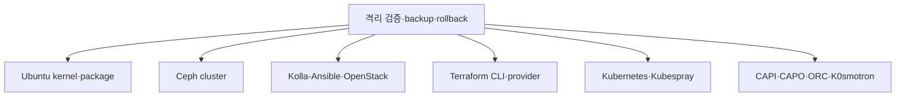

# 업그레이드와 정기 유지보수

> 문서 위치: [전체 문서](../README.md) · [운영과 복구](README.md)

이 저장소는 `config/versions.env`에 Kolla-Ansible, Terraform, Kubespray, Ceph, CAPI/CAPO/ORC와
CLI 버전을 고정한다. 버전 문자열 변경과 실제 운영 cluster 업그레이드는 같은 작업이 아니다.
실제 장비에서 검증하지 않은 버전을 운영 환경에 바로 적용하지 않는다.

## 변경 계층



한 유지보수에서 여러 계층의 major/minor 버전을 동시에 바꾸지 않는다. 문제가 발생했을 때 원인과
rollback 단위를 분리하기 위해 OS, Ceph, OpenStack, Kubernetes와 플랫폼 provider 변경을 각각
별도 Git commit과 작업 기록으로 수행한다.

## 공통 사전조건

```bash
git status --short
git rev-parse HEAD
make check
./scripts/cluster.sh validate
./scripts/cluster.sh verify-hosts
sudo ./scripts/ceph-cluster.sh status
sudo ./scripts/cluster.sh verify-openstack
```

- 최근 [백업과 복원](backup-and-restore.md)의 checksum 및 restore 시험이 정상이어야 한다.
- [장애 훈련](failure-drills.md)에서 한 host 장애 결과와 복구 시간이 기록돼 있어야 한다.
- Ceph recovery/backfill, Terraform apply와 workload migration이 동시에 실행 중이면 안 된다.
- release note와 지원 version matrix에서 출발·목표 버전의 직접 upgrade 지원 여부를 확인한다.
- 목표 artifact의 checksum을 `versions.env`에 기록하고 repository check를 추가한다.

## 변경 준비 절차

1. 전용 Git branch에서 버전과 필요한 설정 migration만 수정한다.
2. `make check`와 formatter를 실행한다.
3. 새 도구 cache를 별도 환경에 설치하고 render/plan 결과를 기존 버전과 비교한다.
4. 운영과 같은 3노드 topology의 시험 환경 또는 복구 가능한 격리 환경에서 전체 작업을 실행한다.
5. API, VM boot, Cinder attach, network, Kubernetes와 backup/restore를 검증한다.
6. 작업 시간, host별 순서, 중단 조건과 rollback 가능 지점을 기록한다.

버전만 바꿨는데 생성 inventory나 Kolla globals가 예상보다 크게 달라지면 적용하지 않는다.

## Ubuntu host 유지보수

세 converged host를 동시에 재부팅하지 않는다. 한 host씩 workload 영향을 확인하고 업데이트한다.

1. 대상 host의 VM과 Ceph OSD/MON 역할을 기록한다.
2. Host Monitor가 비활성화된 초기 구성에서는 자동 evacuation이 없으므로 대상 host VM의 중단 허용 여부를 결정한다.
3. Ceph와 controller quorum이 나머지 두 host에서 유지될지 확인한다.
4. package/kernel 변경 후 대상 하나만 재부팅한다.
5. `verify-hosts`, Ceph `HEALTH_OK`, OpenStack service와 Kubernetes node 복귀를 확인한다.
6. recovery가 끝난 뒤 다음 host로 이동한다.

일반적인 무차별 `dist-upgrade` 명령을 runbook에 고정하지 않는다. 실제 변경 package와 reboot 필요
여부를 plan 출력으로 검토하고, Ubuntu release 자체 변경은 별도 재설치/upgrade 설계로 다룬다.

## Ceph 업그레이드

Ceph upgrade는 cephadm orchestration과 pin된 image 변경을 사용해야 한다. 현재 wrapper에는 운영
Ceph upgrade command, 진행률 guard와 rollback이 구현돼 있지 않다.

적용 전에 다음을 별도 작업서에 확정한다.

- 현재/목표 cluster release와 지원되는 직접 upgrade 경로
- MON/MGR/OSD 순서와 한 번에 변경되는 daemon 수
- 새 image digest와 registry 접근
- 최소 client compatibility와 Kolla의 Ceph client 호환성
- 중단 조건, upgrade pause/resume과 rollback 가능 범위

업그레이드 중 `ceph -s`, `ceph orch ps`와 progress를 계속 관찰하고, 완료 후 모든 daemon version,
pool I/O와 Cinder attach를 검증한다.

## Kolla-Ansible과 OpenStack 업그레이드

`openstack.sh reconfigure`는 같은 배포 계열의 설정 조정 명령이며 release upgrade 대체가 아니다.
현재 wrapper에는 `kolla-ansible upgrade` 진입점이 없으므로 Kolla/OpenStack series 변경은 자동화
범위 밖이다.

정식 upgrade workflow를 추가할 때 다음 순서를 강제한다.

1. full MariaDB backup과 `/etc/kolla`, passwords, Ceph client config 보관
2. 목표 Kolla prechecks와 config migration 검토
3. image pull 결과와 registry digest 기록
4. controller quorum을 유지하는 upgrade 순서
5. DB migration 결과와 service endpoint 검증
6. Nova/Neutron/Cinder/Glance 시험 workload lifecycle
7. Skyline 및 management Kubernetes cloud integration 확인

DB schema migration 이후에는 단순히 이전 container image로 되돌리는 rollback이 불가능할 수 있다.
그래서 실제 DB restore 시험 없이 OpenStack release upgrade를 시작하지 않는다.

## Terraform 변경

Terraform CLI와 OpenStack provider를 바꿀 때 모든 root를 한꺼번에 apply하지 않는다.

```bash
make check
.cache/terraform/bin/terraform -chdir=terraform/openstack init -upgrade
.cache/terraform/bin/terraform -chdir=terraform/openstack plan
```

lock file 변경, provider schema와 plan을 검토한다. management root 한 곳을 검증한 뒤 workload
stack별로 `init/plan`하고 예상하지 않은 교체·삭제가 없을 때만 적용한다. state backup 없이 provider
upgrade를 실행하지 않는다.

## Kubernetes와 플랫폼 provider

Kubernetes는 control plane과 worker의 지원 skew를 지키며 한 minor 단계씩 검토한다. Kubespray
version 변경, cluster Kubernetes version 변경과 OS package 변경을 하나의 작업으로 묶지 않는다.

CAPI/CAPO/ORC는 management cluster와 workload cluster lifecycle을 모두 조정하므로 다음을 확인한다.

- CRD storage version과 conversion
- 기존 Cluster/Machine의 reconciliation
- 새 workload cluster 생성과 기존 cluster scale
- provider controller restart 후 상태 수렴
- Magnum 상태 변환과 credential 호환성

K0smotron은 현재 apply하지 않으므로 version pin 변경만으로 활성화하지 않는다. 완료 기준은
[관리형 플랫폼 문서](../platform/managed-services.md#apply-자동화-완료-기준)를 따른다.

## 완료와 rollback 판정

| 판정 | 조건 |
| --- | --- |
| 진행 | 현재 단계 health 정상, 예상 migration만 발생, 다음 host/서비스 준비 완료 |
| 일시 정지 | recovery 지속, latency 증가, 일부 service 비정상이나 데이터 무결성 유지 |
| rollback/복원 | quorum·API·데이터 접근 상실, 예상하지 않은 schema/resource 변경 |

완료 후 version 목록, Git commit, backup ID, 실제 중단 시간, health 결과와 발견한 수동 단계를
기록한다. 문서와 자동화를 같은 commit에서 갱신하고 새 [장애 훈련](failure-drills.md)을 수행한다.
