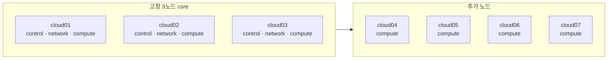

# 3노드 구축 이후 5·7노드 확장

최초 설치는 `cloud01`~`cloud03`의 control, network, compute와 Ceph를 완성한 상태에서
끝난다. 이 문서는 검증된 3노드 클라우드에 `cloud04` 이후 호스트를 추가하는 절차다.

## 역할 배치



컨트롤러와 network 역할은 처음 세 노드에 유지한다. `cloud04` 이후는 기본적으로 compute만
추가하며, Ceph OSD를 추가할지는 별도 storage 계획으로 결정한다. 물리 노드는 한 대씩 추가할
수 있지만 Ceph device class 용량은 장애 도메인별 균형을 고려해야 한다.

## 1. 새 노드 준비

`inventory/openstack-cluster.local.yml`에 노드를 추가하되 처음에는 `enabled: false`로 둔다.
실제 MAC, 관리 IP, OS 디스크 시리얼과 역할을 넣고 노드별 Ubuntu seed를 만든다.

```bash
./scripts/render-ubuntu-autoinstall.sh cloud04
./scripts/build-autoinstall-seed.sh cloud04
```

Ubuntu 설치, SSH host key 검증과 `sudo -n true` 확인을 마친 뒤 `enabled: true`로 바꾼다.
Ceph OSD를 넣지 않는 compute 노드는 `ceph_osd_devices: []`로 둔다. 현재 renderer는 Ceph
client망 연결을 위해 모든 OpenStack 호스트에 `ceph_interface`, MAC과 주소를 요구한다.

## 2. topology와 라우터 검토

```bash
./scripts/cluster.sh validate
./scripts/cluster.sh render
./scripts/cluster.sh openwrt-discover
./scripts/cluster.sh openwrt-plan
```

새 host가 management와 Provider VLAN probe에 포함됐는지 확인한 뒤 OpenWrt 변경을 먼저
적용한다. 기존 세 노드의 주소나 API VIP를 바꾸지 않는다.

## 3. 호스트 준비와 검증

```bash
./scripts/cluster.sh prepare-hosts
# 새 노드 재부팅
./scripts/cluster.sh verify-hosts
```

검증은 hostname, 관리/Provider/Ceph NIC, 시간 동기화, 이름 해석과 Docker 용량을 확인한다.
추가 노드가 OS SSD에서 Docker를 사용한다면 `require_docker_mount: false`로 명시한다.

## 4. OpenStack 서비스 확장

DB와 Kolla 상태를 외부에 백업하고 렌더된 inventory를 검토한다. 예를 들어 `cloud04`와
`cloud05`를 추가했다면 다음 확인값을 사용한다.

```bash
export OPENSTACK_EXPAND_CONFIRM='EXPAND-OPENSTACK:cloud01,cloud02,cloud03,cloud04,cloud05'
sudo --preserve-env=OPENSTACK_EXPAND_CONFIRM \
  ./scripts/cluster.sh expand-openstack
```

`expand-openstack`은 다음 순서로 동작한다.

1. 활성 관리형 플랫폼 프로필이 없는지 확인
2. 모든 host 사전 검사
3. MariaDB full backup
4. Kolla gather-facts와 bootstrap
5. deploy, config validation과 service check
6. Nova/Neutron/Cinder 등록 상태 검증

기존 VM은 자동으로 이동하지 않는다. Nova scheduler가 새 VM부터 추가 compute를 사용할 수
있다.

## 5. 확장 후 검사

```bash
sudo ./scripts/cluster.sh verify-openstack
sudo openstack compute service list
sudo openstack hypervisor list
sudo openstack network agent list
sudo ceph -s
```

- 활성 compute 수가 topology와 같은지 확인한다.
- 기존 세 controller의 Galera/RabbitMQ/OVN quorum을 확인한다.
- 새 compute에서 Ceph image boot와 Cinder volume attach를 시험한다.
- Provider Floating IP의 외부 통신을 시험한다.

## Ceph OSD 증설 경계

`scripts/ceph-cluster.sh osd-plan/osd-apply`는 빈 클러스터의 최초 OSD 배포 전용이다. 운영
cluster에 OSD가 존재하면 중단한다. 따라서 새 compute의 디스크를 topology에 추가하는 것만으로
Ceph가 확장되지 않는다.

운영 OSD 증설에는 다음 검토가 필요하다.

- 새 OSD를 둘 host와 CRUSH failure domain
- 기존 `nvme`, 미래 `ssd`/`hdd` class별 pool 정책
- 추가 전후 utilization과 예상 rebalance 시간
- recovery가 VM latency에 미치는 영향
- 장치 장애 시 제거와 교체 절차

세 호스트에 SATA SSD를 하나씩 추가한다면 `ssd` 전용 CRUSH rule과 Cinder volume type을
만드는 방식이 적합하다. HDD는 별도 `hdd` pool로 두고 백업·아카이브 워크로드에만 사용한다.

## 관리형 플랫폼 이후의 물리 확장

Magnum/CAPI 프로필을 활성화한 뒤에는 `cluster.sh expand-openstack`이 자동 중단한다. 물리
host 추가가 필요하면 management Kubernetes, Magnum, Octavia와 compute 영향까지 포함한
별도 유지보수 계획으로 Kolla 확장을 수행한다. 가능하면 필요한 물리 host 확장을 먼저 마친
뒤 관리형 플랫폼을 활성화한다.
