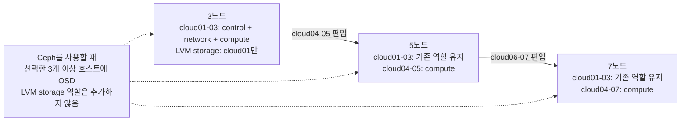

# cloud01에서 3노드 이상 OpenStack으로 확장

이 절차는 이미 운영 중인 단일 `cloud01`에 정족수를 구성할 `cloud02`와
`cloud03`을 우선 추가하고, 필요하면 `cloud04` 이후를 compute 노드나 Ceph OSD
호스트로 더 편입해 5노드·7노드 등으로 확장하는 방법을 다룬다. Kolla
인벤토리의 기존 호스트 이름 `cloud01`과 비밀번호 파일은 계속 유지한다.

확장은 다음 두 작업으로 나뉜다.

1. LVM을 유지하며 OpenStack 제어·네트워크 정족수를 3노드로 만들고 compute 용량을 확장
2. 별도 유지보수 작업으로 Ceph를 준비하고 데이터를 이전

첫 작업만 끝낸 상태에서는 데이터 HA가 아니다.

## 전체 노드 수와 controller 수

물리 노드 수와 controller 수는 같은 값이 아니다. 활성 물리 노드는 1대 또는
3대 이상일 수 있지만 controller는 1대 또는 3대 이상의 홀수여야 한다. 전체가
5대나 7대라고 모든 노드를 controller로 만들 필요는 없다. 이 규모에서는
`cloud01`∼`cloud03` 세 대에 control과 network를 유지하고, `cloud04` 이후는 우선
compute로 추가하는 배치를 권장한다. 전체 물리 노드 수 자체는 홀수일 필요가 없어서
controller 3대를 유지한 4·6·8노드 구성도 같은 방식으로 렌더링할 수 있다.

| 전체 물리 노드 | control·network | compute | 스토리지 원칙 |
| --- | --- | --- | --- |
| 3노드 | `cloud01`∼`cloud03` | 기존처럼 `cloud01`∼`cloud03` | LVM은 `cloud01` 단일, Ceph는 3개 이상 OSD 호스트 |
| 5노드 | `cloud01`∼`cloud03` | 기존 역할은 유지하고 `cloud04`∼`cloud05` 추가 | 선택한 3개 이상 호스트에 Ceph OSD |
| 7노드 | `cloud01`∼`cloud03` | 기존 역할은 유지하고 `cloud04`∼`cloud07` 추가 | 선택한 3개 이상 호스트에 Ceph OSD |

권장 역할 배치는 다음 그림처럼 확장된다. `cloud04` 이후를 추가해도 기존 세
controller의 정족수와 network 역할은 그대로 유지한다.



controller를 5대나 7대로 늘리는 구성도 검증은 통과하지만, 제어부의 DB·메시지
큐·API 배치가 함께 커진다. 해당 장애 도메인과 용량이 필요하다는 근거가 있을 때
별도로 검토한다. network 역할은 전체가 3노드 이상이면 최소 3대에 있어야 한다.

이 물리 노드 수는 Terraform의 `kubernetes_nodes` map에 정의하는 Kubernetes VM
수와 독립적이다. OpenStack 물리 호스트가 5대나 7대가 되어도 Kubernetes VM이
자동으로 5대나 7대로 늘지 않는다. management Kubernetes control plane은 기본적으로
3개 VM을 유지하고, Nova가 이 VM들을 가용한 compute 호스트에 배치한다.

## 기본 3노드 역할

| 역할 | 물리 노드 | 장애 특성 |
| --- | --- | --- |
| control | `cloud01`, `cloud02`, `cloud03` | 세 컨트롤러의 정족수 사용 |
| network | `cloud01`, `cloud02`, `cloud03` | 새 에이전트를 세 노드에 배치 |
| compute | `cloud01`, `cloud02`, `cloud03` | Nova 스케줄링 대상 확대 |
| monitoring | `cloud01` | 현재 모니터링 서비스는 비활성화됨 |
| storage, LVM | `cloud01` | Cinder와 Glance 데이터가 cloud01에 의존 |

LVM 단계에서 `cloud02`나 `cloud03`에 storage 역할을 추가하지 않는다. 같은 이름의 로컬
VG를 여러 노드에 만들어도 데이터가 복제되지 않는다. 5노드나 7노드로 늘려도
`cluster.storage_backend: lvm`인 동안 인벤토리의 storage 역할은 정확히
`cloud01` 하나만 허용된다. 추가 디스크와 노드를 하나의 HA 스토리지로 쓰려면
Ceph 전환과 데이터 이전이 필요하다.

기존 `cloud01`의 Neutron backend는 최초 설치 때 선택한 OVN을 유지한다. 확장 과정에서
OVS에서 OVN으로 변환하지 않으며, 새 network·compute 노드에도 같은 OVN 구성을 배포한다.

## 1. 추가 물리 노드 준비

각 노드에는 다음 항목이 필요하다.

- Ubuntu Server 24.04 x86-64
- 32GB 이상 RAM과 compute 역할당 8개 이상의 CPU 스레드
- 고유한 OS 디스크, 관리 NIC MAC과 관리 주소
- `operator` SSH 계정, 등록된 공개키와 암호 없는 sudo
- 별도로 마운트된 `/var/lib/docker`
- untagged 관리망과 tagged VLAN 10을 전달하는 스위치 포트
- 동기화된 시간

관리 주소는 `cloud02=192.0.2.4/24`, `cloud03=192.0.2.5/24`로 예약한다.
`cloud04` 이후에는 같은 관리망의 사용하지 않는 주소를 고정할당하고,
`192.0.2.10`은 기존 API VIP로 유지한다. 이 주소들은 문서용 예시이므로 실제
로컬 파일에서 운영 대역으로 바꾼다.

Ceph 전환 전에는 [망분리 설계](network-segmentation.md)에 따라 OSD를 둘 최소 세 호스트에
같은 Ceph public/client망을 준비한다. 두 번째 NIC가 있다면 이 망에 우선 배정하고, 같은 단일 NIC에서
VLAN만 나눈 경우에는 Ceph `cluster_network`를 비워 둔다. 별도 OVN tunnel망과 Ceph망은
Netplan·Kolla·Ceph 설정을 함께 바꾸기 전까지 활성화된 것으로 간주하지 않는다.

cloud01용 자동 설치 seed와 `prepare-openstack-storage.sh`에는 cloud01의 고정 MAC과 디스크
시리얼이 들어 있다. 이를 추가 노드에서 사용하지 않는다. 모든 추가 노드의 Ubuntu
설치와 Docker 데이터 디스크 구성은 각 장비의 실제 시리얼을 확인해 별도로 수행한다. Ceph OSD로 쓸
장치는 이 단계에서 파티션, 파일시스템, LVM에 넣지 않는다.

일반 `operator` 사용자의 SSH `known_hosts`에 새 노드의 실제 지문을 등록하고 연결을 확인한다.

```bash
ssh operator@192.0.2.4 true
ssh operator@192.0.2.5 true
```

`cloud04` 이후에도 같은 지문 검토와 SSH 접속 시험을 반복한다.

이 trust context는 일반 사용자로 실행하는 `prepare-hosts`와 `verify-hosts`에 사용된다. 반면
`expand-openstack`과 이후 Kolla 명령은 로컬 root로 실행되므로, 확장 전에 같은 검토된 지문을
`/root/.ssh/known_hosts`에도 등록해야 한다. 다른 방법은
`ANSIBLE_SSH_COMMON_ARGS='-o UserKnownHostsFile=/home/operator/.ssh/known_hosts'`로 파일을
명시하고 Kolla 명령의 `sudo --preserve-env` 목록에 `ANSIBLE_SSH_COMMON_ARGS`를 추가하는 것이다.
host key 검사를 비활성화하거나 `accept-new`로 첫 연결을 자동 승인하지 않는다.

## 2. 로컬 토폴로지 수정

Git에서 제외된 입력 파일을 사용한다.

```bash
umask 077
test -e inventory/openstack-cluster.local.yml || \
  cp inventory/openstack-cluster.yml inventory/openstack-cluster.local.yml
chmod 0600 inventory/openstack-cluster.local.yml
```

`cloud02`와 `cloud03`에서 다음 값을 실제 장비에 맞게 바꾼다. `cloud04` 이후는
공개 예시에 블록이 없으므로 `inventory/openstack-cluster.local.yml`에서 `cloud03`의
전체 블록을 복사하고 새 이름으로 바꾼다.

- `enabled: true`
- `management_mac`
- `os_disk_serial`
- 필요하면 `ansible_host`, `management_address`, DNS와 인터페이스 이름
- `cloud04` 이후의 고유한 `ceph_address`와 `ceph_osd_devices`

LVM 확장 단계의 역할은 다음처럼 유지한다.

```yaml
cloud02:
  enabled: true
  roles:
    - control
    - network
    - compute

cloud03:
  enabled: true
  roles:
    - control
    - network
    - compute
```

5노드 구성의 새 블록은 다음 역할 원칙을 따른다. 아래는 역할만 보여 주는
예시이며, 복사한 블록의 주소·MAC·OS 디스크 시리얼·인터페이스를 모두 고유한
실제 값으로 채워야 한다.

```yaml
cloud04:
  enabled: true
  connection: ssh
  roles:
    - compute

cloud05:
  enabled: true
  connection: ssh
  roles:
    - compute
```

7노드는 같은 방식으로 `cloud06`과 `cloud07`을 추가한다. Ceph OSD로 쓸 노드에는
별도 Ceph 입력 파일에서 검토한 `ceph_osd_devices`를 정의하지만, LVM 단계의
`storage` 역할을 추가하는 것은 아니다.

`cluster.storage_backend: lvm`, `cluster.ceph.enabled: false`,
`cloud01.roles`의 `storage`는 그대로 둔다. 어떤 추가 노드에도 LVM storage 역할을 넣지
않는다.

## 3. 토폴로지 검증과 인벤토리 검토

```bash
./scripts/cluster.sh validate
./scripts/cluster.sh render
```

렌더러는 두 노드 구성, 짝수 컨트롤러, 중복 IP·MAC, 하드웨어 placeholder와 LVM storage 역할
오배치를 차단한다. 생성된 다음 파일을 직접 검토한다.

```bash
sed -n '1,180p' .cache/cluster/ansible-inventory.yml
sed -n '1,80p' kolla/inventory/multinode.local
sed -n '1,160p' kolla/generated/globals.yml
```

control과 network 그룹에는 최소 `cloud01`부터 `cloud03`까지 있어야 한다. 5노드나
7노드에서는 새 `cloud04` 이후가 compute 그룹에 추가되고, LVM storage 그룹에는
`cloud01`만 남아 있어야 한다. `kolla/generated/passwords.yml`의 수정 시간과 내용이 기존
배포와 같은지도 확인한다.

## 4. 새 Ubuntu 호스트 준비와 재부팅

```bash
./scripts/cluster.sh prepare-hosts
```

이 명령은 활성화된 모든 호스트에 호스트명, 이름 해석, 네트워크 파일, 시간 동기화, IOMMU와
필수 패키지를 적용한다. playbook 자체가 `become: true`를 사용하므로 wrapper는 일반
`operator` 사용자로 실행한다. 재부팅은 자동으로 수행하지 않는다. 새 노드만 먼저 재부팅한다.

```bash
ssh operator@192.0.2.4 sudo reboot
ssh operator@192.0.2.5 sudo reboot
```

두 노드가 돌아온 뒤 호스트 검증을 실행한다.

```bash
./scripts/cluster.sh verify-hosts
```

검증이 성공하려면 활성화된 모든 호스트에서 실제 호스트명과 인벤토리 이름이 같고, `mgmt0`과
`mgmt0.10`이 존재하며, 시간이 동기화되고, `/var/lib/docker`가 별도 마운트여야 한다.
LVM VG 검사는 storage 역할이 있는 cloud01에서만 수행한다.

### 새 노드의 OpenWrt Provider 경로

OpenStack에 이미 편입된 `cloud01`에는 `br-ex`가 있으므로 임시 provider 주소를 붙이지 않는다.
`inventory/openwrt-router.local.yml`에서 활성 노드 전체를 다음처럼 기존 노드와 신규 probe
노드로 나눈다.

```yaml
networks:
  provider:
    deployed_nodes:
      - cloud01
    probe_addresses:
      cloud02: 198.51.100.3
      cloud03: 198.51.100.4
```

새 노드가 OpenWrt에 직접 연결된다면 실제 포트를 `provider_tagged_ports`에 추가한다. 관리형
스위치를 통하면 OpenWrt uplink는 유지하고 새 서버 포트에 untagged 관리망과 tagged VLAN 10을
별도로 구성한다. `cloud04` 이후도 모두 `probe_addresses`에 고유한 provider 검증
주소로 추가한다. 그 뒤 새 계획과 UCI batch를 검토해 OpenStack 확장 전에 적용한다.

```bash
./scripts/cluster.sh openwrt-plan
cat .cache/openwrt/uci.batch
export OPENWRT_APPLY_CONFIRM='APPLY-OPENWRT:<plan이 출력한 실제 값>'
export OPENWRT_CONFIRM='CONFIRM-OPENWRT:<plan이 출력한 실제 값>'
./scripts/cluster.sh openwrt-apply
```

자동화는 기존 배포 노드의 `mgmt0.10`이 실제 `br-ex` 포트이고 호스트 IPv4 주소가
없는지 읽기 전용으로 확인하고, 새 probe 노드의 `mgmt0.10`에서는 임시 주소로 gateway를
검사한다.
두 목록의 합이 활성 노드 전체와 다르거나 새 probe 노드가 없으면 적용 계획을 거부한다. 상세
복구 절차는 [OpenWrt Provider VLAN 자동화](openwrt-router.md)를 따른다.

## 5. 확장 전 보호 조치

다음 상태를 외부 저장소에 보관한다.

- `kolla/generated/passwords.yml`
- `/etc/kolla/clouds.yaml`과 Kolla 사용자 설정
- Terraform state와 실제 변수
- Cinder 볼륨과 Glance 이미지의 별도 백업
- 대표 VM 또는 볼륨의 복원 시험 결과

`expand-openstack`은 Kolla의 전체 MariaDB 백업을 먼저 실행하지만, 그 백업을 서버 외부로
복사하거나 복구 시험까지 수행하지 않는다. 외부 백업을 마친 뒤 유지보수 시간을 잡는다.

Kolla의 bootstrap은 기존 cloud01의 Docker 엔진과 컨테이너를 다시 시작할 수 있다. 단일
컨트롤러에서 세 컨트롤러로 넘어가는 동안 API 중단이 발생할 수 있다.

## 6. OpenStack 확장 실행

확인 문자열은 controller 목록이 아니라 인벤토리에서 `enabled: true`인 모든
물리 호스트 목록과 정확히 일치해야 한다. 3노드 확장 예시는 다음과 같다.

```bash
export OPENSTACK_EXPAND_CONFIRM='EXPAND-OPENSTACK:cloud01,cloud02,cloud03'
sudo --preserve-env=OPENSTACK_EXPAND_CONFIRM ./scripts/cluster.sh expand-openstack
```

`cloud04`와 `cloud05`까지 한 번에 편입하는 5노드 확장은 다음 값을 사용한다.

```bash
export OPENSTACK_EXPAND_CONFIRM='EXPAND-OPENSTACK:cloud01,cloud02,cloud03,cloud04,cloud05'
sudo --preserve-env=OPENSTACK_EXPAND_CONFIRM ./scripts/cluster.sh expand-openstack
```

7노드는 같은 순서로 `cloud06,cloud07`까지 포함한다. 임의로 입력하기보다
`expand-openstack`이 오류와 함께 출력하는 예상 값을 렌더된 인벤토리와 대조한 뒤
그대로 사용한다.

단일 노드에서 처음 확장할 때는 먼저 `cloud01`∼`cloud03`으로 제어부 정족수를 만들고
검증한 다음, 별도 유지보수 작업에서 `cloud04` 이후를 추가하는 순서를 권장한다. 렌더러는
1→5·7 구성을 허용하지만 자동화는 신규 노드만 추적하는 delta deploy가 아니라 활성화된
전체 인벤토리에 Kolla bootstrap과 deploy를 다시 실행한다.

이 명령은 다음 순서로 실행된다.

1. 토폴로지와 호스트 상태 재검증
2. 기존 Kolla 비밀번호를 사용한 MariaDB 전체 백업
3. 전체 인벤토리 사실 수집
4. 활성화된 모든 노드의 Kolla bootstrap
5. Kolla precheck, 이미지 pull과 deploy
6. post-deploy와 서비스 설정 검증
7. 컨테이너 상태 검사
8. OpenStack API와 등록된 컴퓨트 서비스 검사

bootstrap과 deploy는 별개 명령으로 구현되어 있다. 일반적인 설정 변경에는
`openstack.sh reconfigure`를 사용하고, 새 물리 호스트 편입에는 deploy 절차를 사용한다.

## 7. 확장 후 검증

```bash
sudo ./scripts/cluster.sh verify-openstack
```

자동 검사는 관리자 토큰, Nova 컴퓨트 수, 하이퍼바이저, 컴퓨트 서비스, 네트워크 에이전트와
Cinder 서비스를 출력한다. 이어서 다음 운영 시험을 수행한다.

1. compute 역할 노드 수와 같은 수의 nova-compute 서비스가 enabled/up인지 확인한다.
2. network·compute 역할을 준 모든 노드의 Neutron 에이전트가 등록됐는지 확인한다.
3. 새 테스트 VM을 만들고 Floating IP, 콘솔, 재부팅과 볼륨 연결을 시험한다.
4. anti-affinity 서버 그룹으로 만든 VM이 서로 다른 물리 호스트에 놓이는지 확인한다.
5. 기존 VM은 자동으로 재배치되지 않으므로 필요할 때 검토한 대상만 라이브 마이그레이션한다.
6. 기존 DHCP·라우터 자원도 새 네트워크 노드에 자동 균등 분산된다고 가정하지 않고 에이전트
   배치를 확인한다.

cloud01을 끄는 시험은 Cinder와 Glance 데이터를 Ceph로 이전한 뒤 수행한다. LVM 단계에서
cloud01이 멈추면 기존 볼륨과 이미지에 접근할 수 없다.

## 8. Ceph는 별도 안전 workflow로 준비

기존 LVM 클라우드의 기본 `inventory/openstack-cluster.local.yml`은 계속
`storage_backend: lvm`으로 유지한다. Ceph 계획은 별도 ignored 파일에서만 만든다.

```bash
umask 077
test -e inventory/openstack-cluster.ceph.local.yml || \
  cp inventory/openstack-cluster.local.yml inventory/openstack-cluster.ceph.local.yml
chmod 0600 inventory/openstack-cluster.ceph.local.yml
```

Ceph 전용 파일에서만 다음 항목을 검토한다.

- `cluster.storage_backend: ceph`
- `cluster.ceph.enabled: true`
- OpenStack RBD 풀에 사용할 `cluster.ceph.openstack_pool_device_class`
- Ceph에 편입할 모든 노드의 실제 `ceph_address`
- 적어도 세 호스트의 명시적인 `ceph_osd_devices`
- 각 장치의 `/dev/disk/by-id`, 시리얼, 최소 크기와 장치 class

모든 Ceph 명령에는 전용 입력 파일을 명시한다.

```bash
export OPENSTACK_CLUSTER_CONFIG=inventory/openstack-cluster.ceph.local.yml
sudo ./scripts/ceph-cluster.sh setup
./scripts/ceph-cluster.sh validate
./scripts/ceph-cluster.sh preflight
```

`ceph-cluster.sh`은 Ceph bootstrap, 호스트 추가, OSD 계획·적용, 풀 구성과 Kolla client 설정
내보내기를 제공한다. OSD 생성은 렌더된 manifest의 SHA-256이 포함된
`CEPH_OSD_CONFIRM=WIPE-CEPH-OSDS:<sha>` 없이는 실행되지 않는다. `osd-plan`은 bootstrap과
호스트 등록 후 실행한다. bootstrap, 호스트 등록, 풀 구성과 Kolla client 내보내기에도 각각
별도 확인 문자열이 필요하다. 정확한 순서는 [자동화 안전 경계](automation-boundaries.md)를
따른다. 풀 구성은 세 OSD 호스트가 `up/in`이고 Ceph가 `HEALTH_OK`일 때만 진행된다.
선택한 class는 적어도 세 OSD 호스트에 있어야 하며 자동화는 `images`, `volumes`, `vms` 풀을 그
class 전용 host failure-domain CRUSH rule에 고정한다. 같은 제조사나 모델일 필요는 없지만
HDD, SSD, NVMe class를 한 풀에서 자동으로 섞지는 않는다.

현재 자동화는 최초에 선언한 Ceph 호스트와 OSD 세트를 구축하는 경로를 대상으로 한다.
이미 운영 중인 Ceph 클러스터에 새 물리 호스트나 OSD를 incremental로 추가하고,
리밸런싱·장애 도메인·풀 안전성을 끝까지 검증하는 workflow는 아직 자동화되지
않았다. 기존 클러스터에 최초 OSD 적용 절차를 그대로 재실행하지 않는다. 가까운
시기에 5노드나 7노드로 늘릴 계획이 있다면 가능한 한 그 물리 노드를 최초 Ceph
bootstrap과 풀 생성 전에 편입한다.

기존 클라우드에서는 Ceph 전용 입력으로 `cluster.sh deploy-openstack`이나
`cluster.sh expand-openstack`을 실행하지 않는다. 이 입력이 만드는 Kolla globals는 LVM을
비활성화하기 때문이다.

`ceph-cluster.sh export-kolla`는 `ceph.conf`와 서비스 keyring만
`kolla/generated/ceph-config/`에 내보낸다. LVM에서 Ceph로의 전환은 다음 별도 작업으로
수행한다.

1. 운영용 hybrid Kolla 설정에서 기존 LVM·iSCSI를 유지하며 Ceph backend를 추가
2. Kolla reconfigure 후 새 Ceph 볼륨과 이미지의 생성·연결·복원 시험
3. 기존 Glance 이미지와 Cinder 볼륨을 백업하며 수동 이전
4. 모든 소비자가 Ceph 데이터를 사용하는지 확인
5. 복구 시험이 끝난 뒤에만 LVM backend 비활성화

자동화는 LVM 볼륨과 Glance 데이터를 Ceph로 옮기거나 기존 VG를 지우지 않는다.

## 9. 3노드 이상과 Ceph 이후 플랫폼 서비스

최초 Kubespray 클러스터는 management/hosting cluster의 부트스트랩이다. 다음 조건을 모두
검증할 때까지 Skyline/OpenStack API와 핵심 OpenStack, 기존 Kubernetes 관리 기능만 운영한다.

- 세 control 노드 사이의 API VIP 이동과 모든 compute·network 서비스 상태
- Ceph `HEALTH_OK`, Cinder·Glance의 Ceph backend 동작과 실제 복원
- management cluster의 3노드 배치, etcd·kubeconfig 백업과 복구

조건을 충족한 다음 최종 Ceph 토폴로지에서
`cluster.platform.magnum_capi.enabled: true`로 바꾸고
`cluster.platform.container_service.enabled: false`를 유지한다. 렌더링 후
`cluster.sh platform-apply`가 고정 버전 ORC·CAPI·CAPO를 management cluster에 설치하고,
Magnum용 장기 kubeconfig와 OpenStack Magnum·Barbican·Octavia OVN 기반을 구성한다.

managed platform을 활성화한 뒤 물리 OpenStack 노드를 더 편입하는 통합 workflow는 아직
완성되지 않았다. Magnum/CAPI가 켜진 토폴로지에서 일반 `expand-openstack`을 바로
실행하는 경로도 사용하지 않는다. 해당 확장은 Kolla 서비스 배치와
Magnum·Octavia·management cluster 영향을 함께 검토하는 별도 작업이 필요하다. 따라서 가까운
시기에 계획한 5노드·7노드는 Ceph 구축과 `magnum_capi.enabled: true` 전에 먼저
편입하고 검증하는 것을 권장한다.

먼저 Terraform 변수에서 `k8s-01`~`k8s-03`을 control plane·etcd·worker로 선언한다. 기존
`k8s-01`의 `volume_type = "fast"`는 유지하고 새 `k8s-02`, `k8s-03`만
`volume_type = "ceph"`로 지정한다. 실행 순서는 다음과 같다.

```bash
./scripts/cluster.sh render

export OS_CLIENT_CONFIG_FILE="$PWD/terraform/openstack/clouds.yaml"
./scripts/cluster.sh terraform-plan
export TERRAFORM_APPLY_CONFIRM=APPLY-KUBERNETES-INFRA
./scripts/cluster.sh terraform-apply

./scripts/cluster.sh prepare-k8s-cloud
export MANAGEMENT_CLOUD_CONFIRM='CREATE-K8S-CLOUD-PRINCIPAL:<project-id>:kubespray-management:member'
./scripts/cluster.sh prepare-k8s-cloud
export KUBERNETES_CONTROL_PLANE_SCALE_CONFIRM='SCALE-KUBERNETES-CONTROL:k8s-02,k8s-03'
./scripts/cluster.sh deploy-kubernetes

sudo --preserve-env=OPENSTACK_CLUSTER_CONFIG ./scripts/cluster.sh platform-plan
export PLATFORM_SERVICES_CONFIRM='<plan이 출력한 APPLY-MAGNUM-CAPI 값>'
sudo --preserve-env=OPENSTACK_CLUSTER_CONFIG,PLATFORM_SERVICES_CONFIRM \
  ./scripts/cluster.sh platform-apply
sudo --preserve-env=OPENSTACK_CLUSTER_CONFIG ./scripts/cluster.sh platform-status
```

기존 `k8s-01`의 volume type을 바로 `ceph`로 바꾸면 boot volume 교체가 필요해
`prevent_destroy`에 차단된다. 이 노드의 Ceph 이전은 별도 Cinder/VM migration과 복구 시험을
마친 뒤 수동으로 state와 변수를 맞추며, 현재 자동화는 수행하지 않는다.

실제 Kubernetes 변경 대상이 다르면 스크립트가 출력한 control-plane 확인 문자열을 사용한다.
`prepare-k8s-cloud`의 첫 실행이 출력한 실제 프로젝트 ID를 확인 문자열에 사용한다. 두 번째
실행은 전용 non-admin `member` 사용자와 restricted application credential을 만들고 secret을
출력하지 않은 채 `kubeconfig/openstack-management.env`에 mode `0600`으로 저장한다. Magnum 플래그가 켜진
Kubespray 배포는 external OpenStack CCM, Cinder CSI의 기본 `ceph` StorageClass와 Octavia
OVN LoadBalancer 변수를 자동으로 렌더링한다.

Terraform의 `management_api_address`는 최종 topology의 `cluster.api_vip`와 같아야 한다.
Kolla HAProxy가 이 주소의 6443 포트를 세 control-plane Floating IP로 전달하고 Magnum
kubeconfig도 이 HA endpoint를 사용한다. `state/kubespray/openstack/applied-nodes.json`,
두 kubeconfig와 management cloud credential 파일을 같은 복구 세트로 외부 백업한다.

EKS와 유사한 서비스 API는 Magnum과 Kolla 2026.2 Magnum 이미지에 포함된 VEXXHOST
`magnum-cluster-api` driver를 사용하고 CAPO가 OpenStack 인프라를 구현하는 구조다. 자동화는
이미지의 `k8s_cluster_api` driver가 비활성화되지 않았는지 검사한다.
Magnum의 Heat driver는 OpenStack 2026.2에서 제거되었으므로 새 배포에 사용하지 않는다.
이 단계에서 Kubernetes `LoadBalancer`용 Octavia OVN provider와 Magnum/CAPI를 함께 검토해
활성화한다. 한 노드 단계에서는 이 managed-service 플래그를 켜지 않는다.

ECS와 유사한 서비스는 자체 포털의 container-runtime API가 Kubernetes workload를
조정하도록 만든다. Kolla-Ansible 2026.2에는 Zun·Kuryr 배포 지원이 없으므로 노드가 세 대가
되어도 `enable_zun`이나 `enable_kuryr`를 설정하지 않는다. 2025.2 기반 legacy Zun은 현재
클러스터와 분리된 수명주기 결정을 거쳐야 한다.

k0smotron v2.3.0은 필요할 때 tenant control plane을 hosting cluster의 Pod로 운영하는 별도
control-plane provider로 도입한다. `cluster.sh hosted-plan`은
`.cache/platform/`에 검토용 manifest만 만들며 provider 설치나 manifest 적용은 하지 않는다.
OpenStack, Magnum, CAPI 또는 CAPO가 제공하는 내장 기능이 아니며 controller, etcd PVC,
API endpoint와 복구 설계가 따로 필요하다.

```text
단일 핵심 OpenStack + Kubespray management/hosting cluster
  -> 3노드 OpenStack 제어/네트워크/컴퓨트
  -> Ceph 구축, 데이터 이전과 복원 검증
  -> management cluster 3노드화
  -> CAPI + CAPO + Magnum CAPI driver
  -> Kubernetes 기반 container-runtime API와 자체 포털
  -> 필요할 때 k0smotron v2.3.0 Hosted Control Plane
```

호환되는 workload image의 Glance 등록, Magnum cluster template 생성과 첫 cluster의
생성·접속·확장·업그레이드·삭제 lifecycle 검증, container-runtime API와 자체 포털은 후속
작업이다. 자세한 경계는 [managed services 문서](managed-services.md)에 있다.
Hosted Control Plane 기준과 버전 근거는
[Kolla-Ansible 2026.1 릴리스 노트](https://docs.openstack.org/releasenotes/kolla-ansible/2026.1.html),
[VEXXHOST Magnum Cluster API driver](https://vexxhost.github.io/magnum-cluster-api/),
[Magnum Cluster API 시작 안내](https://vexxhost.github.io/magnum-cluster-api/user/getting-started/),
[Magnum workload image](https://vexxhost.github.io/magnum-cluster-api/user/images/),
[CAPO Hosted Control Plane](https://cluster-api-openstack.sigs.k8s.io/topics/hosted-control-plane),
[k0smotron v2.3.0](https://docs.k0smotron.io/v2.3.0/install/),
[Octavia OVN provider](https://docs.openstack.org/kolla-ansible/latest/reference/networking/octavia.html)를 따른다.

PCI 패스스루 GPU나 HBA가 있는 VM은 특정 컴퓨트 호스트에 묶일 수 있다. 해당 VM은 일반
라이브 마이그레이션과 분리해 백업·복구 절차를 둔다.
