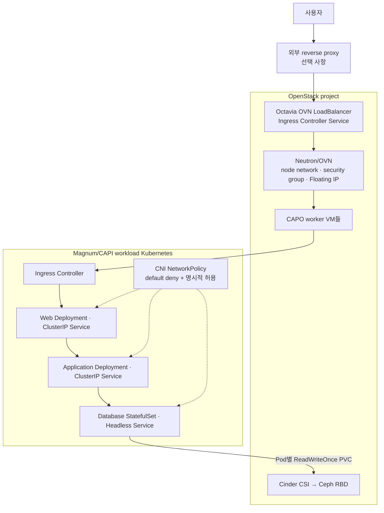

# 관리형 Kubernetes 3티어 workload

> 문서 위치: [전체 문서](../README.md) · [OpenStack workload](README.md) · [관리형 플랫폼](../platform/README.md)

Magnum/CAPI가 만든 workload Kubernetes에서 3티어를 구성할 때 Neutron network 세 개에 Pod를
직접 나누지 않는다. Neutron/OVN은 cluster node VM, API endpoint, Octavia LoadBalancer와 Cinder
volume의 OpenStack 경계를 담당한다. Pod 사이의 Web→Application→Database 경계는 CNI와
Kubernetes NetworkPolicy가 담당한다.

이 구조가 AWS EKS, Azure AKS와 GCP GKE의 공통 관리 경험에 대응하는 범위와 아직 부족한 서비스는
[관리형 클라우드 대응 목표](../architecture/managed-cloud-equivalence.md)에 정리한다.



## 두 네트워크 계층의 역할

| 계층 | 관리 대상 | 이 저장소에서의 구현 |
| --- | --- | --- |
| Neutron/OVN | workload cluster의 control-plane·worker VM port, subnet, security group, API/LB 주소 | Magnum/CAPI/CAPO와 OpenStack CCM |
| Octavia OVN | `type: LoadBalancer` Service의 VIP와 외부 연결 | 관리형 플랫폼 활성화 후 cloud controller 연동 |
| Kubernetes CNI | Pod IP와 node 사이 전달 | cluster template에서 policy 지원 CNI 선택 |
| NetworkPolicy | namespace와 Pod label 기준 Web→App→DB 허용 | 애플리케이션 manifest |
| Cinder CSI | StatefulSet PVC용 Ceph-backed volume | 기본 비로컬 `ceph` StorageClass |

현재 management Kubernetes는 Calico를 사용하지만 Magnum/CAPI가 생성하는 각 workload cluster도
동일하다고 가정하지 않는다. cluster template과 실제 DaemonSet을 확인하고 NetworkPolicy를
강제하는 CNI인지 시험한다. 정책을 지원하지 않는 CNI에서는 NetworkPolicy object가 생성되어도
통신이 차단되지 않을 수 있다.

```bash
kubectl --kubeconfig <workload-kubeconfig> -n kube-system get daemonset
kubectl --kubeconfig <workload-kubeconfig> get networkpolicy --all-namespaces
```

## Kubernetes resource 구성

애플리케이션 repository에는 다음 resource를 둔다.

| tier | workload | Service | replica와 저장소 |
| --- | --- | --- | --- |
| 진입 | Ingress Controller | `LoadBalancer` | 2개 이상, Octavia VIP 한 개 |
| Web | `Deployment` | `ClusterIP` | 2개 이상, stateless |
| Application | `Deployment` | `ClusterIP` | 2개 이상, stateless 또는 외부 상태 저장 |
| Database | `StatefulSet` | Headless + 필요 시 client `ClusterIP` | 보통 3개, Pod마다 별도 RWO PVC |

Web과 Application에는 readiness/liveness/startup probe, rolling update, PodDisruptionBudget와
topology spread constraint를 둔다. `kubernetes.io/hostname` 기준으로 replica를 worker에 분산하되
worker 수와 남은 자원이 부족하면 scheduling이 멈출 수 있으므로 `DoNotSchedule` 사용 여부를
실제 N+1 용량에 맞춘다.

Database StatefulSet의 여러 Pod가 하나의 ReadWriteOnce volume을 공유하게 하지 않는다.
`volumeClaimTemplates`로 member마다 Cinder volume을 만들고 DB 제품 자체의 복제를 구성한다.
Cinder/Ceph는 block 보존 계층이며 leader election, transaction 복제와 DB backup을 대신하지
않는다.

## NetworkPolicy 기준

추적된 [정책 예시](../../kubernetes/workloads/three-tier/network-policies.example.yml)는 다음 흐름을
표현한다.

```text
Ingress Controller → Web:8080
Web → Application:8080
Application → Database:5432
Database ↔ Database: 제품별 replication/consensus port
모든 Pod → kube-system DNS:53
그 외 ingress·egress: 차단
```

예시를 그대로 적용하지 않는다. namespace, ingress controller label, container port, DB peer port와
Pod label을 실제 서비스에 맞춰 복사한 파일에서 바꾼다. default-deny egress를 사용하므로
Application이 외부 API, SMTP, object storage 등에 접근해야 한다면 목적지와 port가 제한된 정책을
추가한다. 임시 해결을 위해 `0.0.0.0/0` 전체 egress를 추가하면 정책의 의미가 크게 줄어든다.

NetworkPolicy는 additive 방식이므로 송신 Pod의 egress와 수신 Pod의 ingress가 모두 허용되어야
한다. 다음 검증 Pod를 사용해 허용·차단 행렬을 실제로 시험한다.

| 출발 | 목적지 | 예상 |
| --- | --- | --- |
| ingress controller | Web service port | 성공 |
| Web | Application service port | 성공 |
| Web | Database port | 실패 |
| Application | Database port | 성공 |
| 외부 임시 Pod | Application·Database port | 실패 |
| 모든 tier | DNS | 성공 |
| Database | 임의 인터넷 주소 | 실패 |

## Neutron과 공개 진입점

일반 애플리케이션 Pod마다 Neutron Floating IP를 만들지 않는다. Ingress Controller의
`LoadBalancer` Service 하나를 OpenStack CCM이 Octavia에 연결하고, DNS 또는 기존 reverse proxy가
그 VIP를 사용한다. 기존 reverse proxy를 active/passive로 운영한다면 두 proxy가 동일한 Octavia
VIP로 전달하도록 구성하고 proxy failover와 Kubernetes ingress failover를 별도로 시험한다.

OpenStack security group은 workload cluster node와 Octavia health monitor가 필요한 port를
허용해야 한다. Pod tier port를 Neutron security group만으로 구분하려 하면 모든 Pod가 worker VM
port 뒤에 있으므로 의도한 Pod 단위 경계가 되지 않는다. Pod별 Neutron port를 제공하는 별도 CNI를
도입하지 않는 현재 구조에서는 NetworkPolicy가 tier 격리의 기준이다.

## 배포와 검증 순서

1. Magnum/CAPI로 workload cluster를 만들고 Node, CCM, Cinder CSI와 Octavia 연동을 검증한다.
2. policy 지원 CNI와 DNS label·주소를 확인한다.
3. 애플리케이션 namespace와 default-deny 정책을 먼저 적용한다.
4. Database operator 또는 StatefulSet과 member별 PVC를 배포하고 복제·백업·복원을 확인한다.
5. Application을 배포해 Database 연결과 schema 호환성을 확인한다.
6. Web과 Ingress를 배포하고 내부 요청을 시험한다.
7. `LoadBalancer` external address와 Octavia member health를 확인한다.
8. 허용·차단 통신 행렬, replica drain, worker 장애와 PVC 재연결을 시험한다.

```bash
kubectl --kubeconfig <workload-kubeconfig> get nodes -o wide
kubectl --kubeconfig <workload-kubeconfig> get pods,svc,ingress,pvc -A
kubectl --kubeconfig <workload-kubeconfig> get networkpolicy -A
kubectl --kubeconfig <workload-kubeconfig> describe service -n ingress-nginx <controller-service>
```

애플리케이션 image, Helm values, Secret과 실제 배포 manifest는 이 인프라 저장소에 섞지 않고 해당
애플리케이션 repository에서 GitOps 또는 검토된 배포 pipeline으로 관리한다. 이 저장소에는
OpenStack 연동 기준과 비밀 없는 NetworkPolicy 예시만 둔다.

## VM 3티어와 선택 기준

[Neutron VM 3티어](three-tier.md)는 Web·Application·Database가 각각 일반 VM에서 동작할 때
사용한다. 관리형 Kubernetes workload에는 `workload-new <stack> three-tier-vm`을 실행하지 않는다.

| 조건 | 선택 |
| --- | --- |
| 기존 VM용 제품, systemd 서비스, appliance, OS 단위 튜닝 필요 | Neutron VM 3티어 |
| 컨테이너 image, rolling update, HPA와 Pod 재배치 활용 | 관리형 Kubernetes 3티어 |
| Database operator를 충분히 검증하지 못함 | Web/App는 Kubernetes, DB는 전용 VM도 가능 |

혼합 구조에서는 Kubernetes Application에서 VM Database로 가는 Neutron route와 security group을
추가하고 DB port만 cluster node CIDR에 허용한다. NetworkPolicy에도 VM DB CIDR로 나가는 egress를
명시해야 하며, DB를 인터넷 또는 Provider 전체 CIDR에 열지 않는다.
