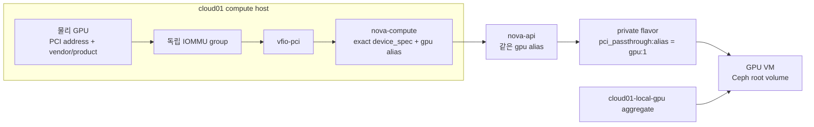
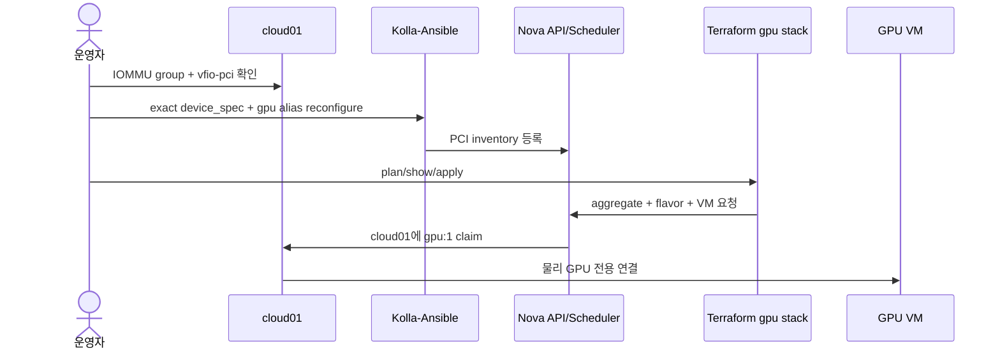

# cloud01 PCI 패스스루 VM

> 문서 위치: [전체 문서](../README.md) · [OpenStack workload](README.md)

이 문서는 `cloud01`의 GPU 한 장을 OpenStack VM 한 대에 전용 할당하는 절차를 설명한다.
4TB·3TB HDD용 HBA도 같은 Nova PCI alias 구조를 사용하지만 실제 스토리지 구성은
[고정 스토리지 VM](storage-vm.md)을 따른다.

GPU 패스스루는 물리 GPU 전체를 VM에 넘기는 방식이다. vGPU 분할이나 여러 VM의 공유 GPU는
이 구성에 포함하지 않는다.



## 운영 제약

- GPU VM은 `cloud01`에 고정하며 live migration과 다른 compute로의 evacuate 대상이 아니다.
- `cloud01`이 멈추면 Ceph root volume은 남아 있어도 GPU VM을 다른 노드에서 같은 형태로
  시작할 수 없다.
- host console이나 부팅에 필요한 유일한 GPU는 넘기지 않는다. headless 운영이 가능한지 먼저
  확인한다.
- GPU의 HDMI audio나 USB function이 같은 IOMMU group에 있으면 group 전체의 사용 관계를
  검토한다. host가 쓰는 function과 섞인 group은 사용하지 않는다.
- host가 GPU를 사용 중인 상태에서 driver를 강제로 해제하지 않는다. persistent VFIO bind와
  reboot 절차는 GPU 모델과 기존 driver에 맞춰 별도로 검토한다.

## 1. 장치와 IOMMU group 확인

`cloud01`에서 GPU와 연결된 모든 PCI function을 확인한다.

```bash
lspci -nnk
find /sys/kernel/iommu_groups/ -type l -printf '%p -> %l\n' | sort
cat /proc/cmdline
lsmod | grep -E '^vfio|^vfio_pci'
```

기록할 값은 다음과 같다.

| 값 | 예시 형식 | 사용 위치 |
| --- | --- | --- |
| PCI address | `0000:01:00.0` | compute `device_spec` |
| vendor ID | `10de` | compute와 API alias |
| product ID | `2684` | compute와 API alias |
| IOMMU group | 정수 group 번호 | passthrough 가능 여부 판단 |
| 현재 driver | `nouveau`, `nvidia`, `amdgpu`, `vfio-pci` | bind 계획과 검증 |

Ansible host 준비는 IOMMU kernel option과 VFIO module load를 설정하지만 특정 GPU를 임의로
host driver에서 해제하지 않는다. `prepare-hosts` 뒤 reboot가 끝났고 IOMMU group이 실제로
생성됐는지 확인해야 한다.

## 2. Nova 로컬 설정

기존 로컬 파일을 덮어쓰지 않고 없을 때만 예시에서 만든다.

```bash
umask 077
test -e kolla/config/nova/nova-compute.conf || \
  cp kolla/config/nova/nova-compute.conf.example \
    kolla/config/nova/nova-compute.conf
test -e kolla/config/nova.conf || \
  cp kolla/config/nova.conf.example kolla/config/nova.conf
chmod 0600 kolla/config/nova/nova-compute.conf kolla/config/nova.conf
```

`kolla/config/nova/nova-compute.conf`에는 실제 GPU의 exact address를 포함한 `device_spec`과
`gpu` alias를 추가한다. `kolla/config/nova.conf`에는 같은 vendor/product와 이름의 alias를
추가한다. HBA alias가 이미 있으면 지우지 않고 두 alias를 함께 유지한다.

```ini
# kolla/config/nova/nova-compute.conf
[pci]
device_spec = {"address":"0000:REPLACE_GPU_ADDRESS","vendor_id":"REPLACE_GPU_VENDOR","product_id":"REPLACE_GPU_PRODUCT"}
alias = {"vendor_id":"REPLACE_GPU_VENDOR","product_id":"REPLACE_GPU_PRODUCT","device_type":"type-PCI","name":"gpu"}
```

```ini
# kolla/config/nova.conf
[pci]
alias = {"vendor_id":"REPLACE_GPU_VENDOR","product_id":"REPLACE_GPU_PRODUCT","device_type":"type-PCI","name":"gpu"}
```

vendor/product만 넓게 허용하지 않고 `device_spec`에 주소를 고정해 다른 장치를 Nova inventory에
넣지 않는다. 설정 후 Kolla를 재구성한다.

```bash
./scripts/cluster.sh validate
./scripts/cluster.sh render
sudo ./scripts/openstack.sh reconfigure
sudo ./scripts/openstack.sh validate-config
sudo ./scripts/openstack.sh check
sudo ./scripts/cluster.sh verify-openstack
```

재구성 전에 GPU가 `vfio-pci`에 bind됐는지 `lspci -nnk -s <PCI-address>`로 다시 확인한다.

## 3. GPU 전용 Terraform workload

GPU VM의 수명주기를 다른 서비스와 분리한다.

```bash
./scripts/cluster.sh workload-new gpu
```

`terraform/workloads/gpu/terraform.tfvars`에서 일반 network, subnet, image와 key pair 값을 실제
OpenStack UUID/이름으로 바꾸고 전용 flavor와 aggregate를 활성화한다.

```hcl
flavor_id = null

managed_flavor = {
  name      = "gpu.1"
  ram       = 16384
  vcpus     = 8
  disk      = 0
  is_public = false
  extra_specs = {
    "pci_passthrough:alias"                    = "gpu:1"
    "aggregate_instance_extra_specs:local_gpu" = "true"
  }
}

host_aggregate = {
  name     = "cloud01-local-gpu"
  hosts    = ["cloud01"]
  metadata = { local_gpu = "true" }
}

instances = {
  "01" = {
    root_volume_size = 80
    root_volume_type = "ceph"
    key_pair         = "operator"
  }
}
```

Nova가 표시하는 실제 compute hostname과 aggregate의 `hosts` 값이 같아야 한다.

```bash
export OS_CLIENT_CONFIG_FILE="$PWD/terraform/openstack/clouds.yaml"
OS_CLOUD=admin .cache/kolla-venv/bin/openstack hypervisor list
./scripts/cluster.sh workload-plan gpu
./scripts/cluster.sh workload-show gpu
```

plan에서 private flavor, cloud01 aggregate, Ceph boot volume과 GPU VM 한 대만 생성되는지 확인한다.
wrapper가 출력한 SHA-256 확인값으로 적용한다.

```bash
export TERRAFORM_WORKLOAD_APPLY_CONFIRM='APPLY-TERRAFORM-WORKLOAD:gpu:<plan-sha256>'
./scripts/cluster.sh workload-apply gpu
./scripts/cluster.sh workload-output gpu
```



## 4. guest 드라이버와 검증

GPU driver는 host가 아니라 VM guest에 설치한다. 반복 가능한 설치가 필요하면
`ansible/playbooks/workloads/gpu.yml`에 작성하고 자동 생성 inventory로 실행한다.

```bash
./scripts/cluster.sh workload-inventory gpu
ansible-inventory -i .cache/ansible/workloads/gpu.yml --graph
./scripts/cluster.sh workload-configure gpu
```

guest 안에서 `lspci -nnk`와 제조사 도구로 GPU와 driver를 확인한다. GPU 작업을 실행한 상태에서
reboot 후에도 장치가 다시 연결되는지 확인한다.

## 변경과 제거

GPU alias, aggregate 또는 flavor를 바꾸기 전에 VM을 정상 종료하고 Terraform plan의 교체·삭제
항목을 확인한다. workload module의 instance와 root volume에는 `prevent_destroy`가 있으므로
기존 VM을 즉시 교체하는 변경은 차단된다. 새 구성이 필요하면 새 map key나 새 stack으로 VM을
먼저 만들고 데이터와 서비스를 옮긴다.

VM이 GPU를 claim한 동안 Nova alias와 host `device_spec`을 먼저 제거하지 않는다. PCI 장치를
host 용도로 돌리는 작업은 VM 폐기, Nova inventory 제거, persistent VFIO bind 해제와 reboot를
포함한 별도 유지보수 절차로 수행한다.
