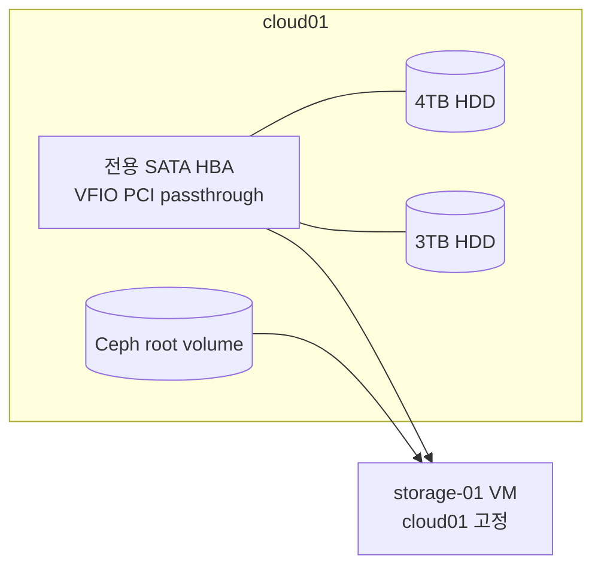

# cloud01 고정 스토리지 VM

> 문서 위치: [전체 문서](../README.md) · [OpenStack workload](README.md)

4TB와 3TB HDD는 Ceph OSD로 사용하지 않는다. 3노드 Ceph/OpenStack과 management Kubernetes
검증이 끝난 뒤, 두 HDD만 연결된 전용 SATA HBA를 `cloud01`의 스토리지 VM 한 대에 PCI
패스스루한다.



## 전제조건

- OS SSD나 Ceph OSD가 연결된 motherboard SATA controller를 넘기지 않는다.
- 4TB·3TB HDD만 연결한 별도 HBA를 사용한다.
- HBA와 모든 function이 독립적인 IOMMU group에 있어야 한다.
- HDD를 host에서 mount하거나 LVM/Ceph에 등록하지 않는다.
- VM은 live migration과 HA 대상이 아니다.

HBA 전체를 한 VM이 직접 제어하므로 guest에서 SMART와 기존 partition을 볼 수 있다. 기존
데이터가 있다면 패스스루 전에 별도 백업에서 대표 파일 복원을 확인한다.

## 1. cloud01 장치 확인

```bash
lspci -nn
find /sys/kernel/iommu_groups/ -type l
lsblk -o NAME,SIZE,MODEL,SERIAL,TYPE,FSTYPE,MOUNTPOINTS
```

HBA의 PCI address, vendor ID와 product ID를 기록한다. 같은 IOMMU group에 host가 사용해야
하는 장치가 있으면 진행하지 않는다.

## 2. Nova local config

```bash
umask 077
cp kolla/config/nova/nova-compute.conf.example \
  kolla/config/nova/nova-compute.conf
cp kolla/config/nova.conf.example kolla/config/nova.conf
chmod 0600 kolla/config/nova/nova-compute.conf kolla/config/nova.conf
```

`nova-compute.conf`의 `device_spec`에는 **cloud01 HBA의 정확한 PCI address**를 넣고 두 파일의
alias를 `storage-hba`로 맞춘다. vendor/product 값만으로 motherboard controller까지
허용하지 않는다. 전역 `nova.conf` 예시는 cloud01 aggregate metadata를 flavor에서 사용할 수
있도록 Nova 기본 filter 목록에 `AggregateInstanceExtraSpecsFilter`를 추가한다.

Kolla 설정을 적용한다.

```bash
sudo ./scripts/openstack.sh reconfigure
sudo ./scripts/openstack.sh check
```

HBA가 `vfio-pci`에 bind되고 Nova PCI inventory에 나타나는지 확인한다. 실제 bind 방식은 HBA
driver와 부팅 순서에 따라 달라지므로 자동화가 임의로 driver를 해제하지 않는다.

## 3. Terraform stack

먼저 일반 workload root를 만든다.

```bash
./scripts/cluster.sh workload-new storage
```

생성된 `terraform/workloads/storage/terraform.tfvars`에서 template의 선택적 managed flavor와
host aggregate를 활성화한다.

```hcl
flavor_id = null

managed_flavor = {
  name      = "storage.hba"
  ram       = 8192
  vcpus     = 4
  disk      = 0
  is_public = false
  extra_specs = {
    "pci_passthrough:alias"                         = "storage-hba:1"
    "aggregate_instance_extra_specs:local_storage" = "true"
  }
}

host_aggregate = {
  name     = "cloud01-local"
  hosts    = ["cloud01"]
  metadata = { local_storage = "true" }
}

instances = {
  "01" = {
    root_volume_size = 40
    root_volume_type = "ceph"
    key_pair         = "operator"
  }
}
```

workload template가 aggregate, private flavor와 VM을 같은 state에서 관리한다. Host
Aggregate의 host 문자열은 `openstack hypervisor list`에 표시되는 실제 Nova hostname과
정확히 같아야 한다.

```bash
export OS_CLIENT_CONFIG_FILE="$PWD/terraform/openstack/clouds.yaml"
OS_CLOUD=admin .cache/kolla-venv/bin/openstack hypervisor list
./scripts/cluster.sh workload-plan storage
./scripts/cluster.sh workload-show storage
```

출력된 plan과 SHA-256을 검토한 뒤 wrapper가 출력한 정확한 확인값으로 적용한다.

## guest 디스크 구성

용도에 따라 선택한다.

| 구성 | 용량 | 장애 특성 |
| --- | ---: | --- |
| 두 filesystem 독립 사용 | 4TB + 3TB | 한 디스크 장애가 다른 디스크에 직접 영향 없음 |
| ZFS/Btrfs mirror | 약 3TB | 한 디스크 장애 허용, 1TB 미사용 |
| mergerfs | 약 7TB | 파일 단위 묶음, 자체 복제 없음 |
| stripe | 약 7TB | 한 디스크 장애로 전체 손실 가능 |

미디어와 일반 파일이라면 독립 filesystem 또는 mergerfs가 단순하다. 중요한 데이터의 유일한
복사본을 이 VM에 두지 않는다.

## 운영 제약

- `cloud01` 장애 시 VM root는 Ceph에 남아도 HBA/HDD에 접근할 수 없다.
- 다른 compute로 evacuate하거나 live migrate하지 않는다.
- HBA를 flavor에서 제거하거나 Nova config를 바꾸기 전에 VM을 정상 종료한다.
- HDD SMART, guest filesystem과 외부 백업을 별도로 모니터링한다.
