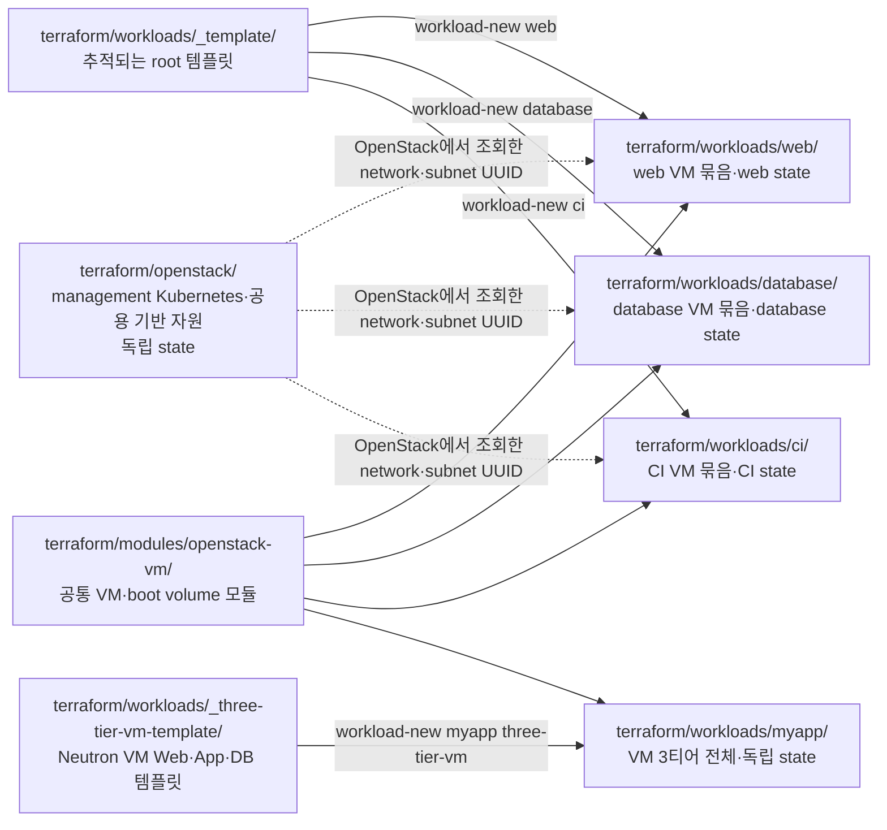
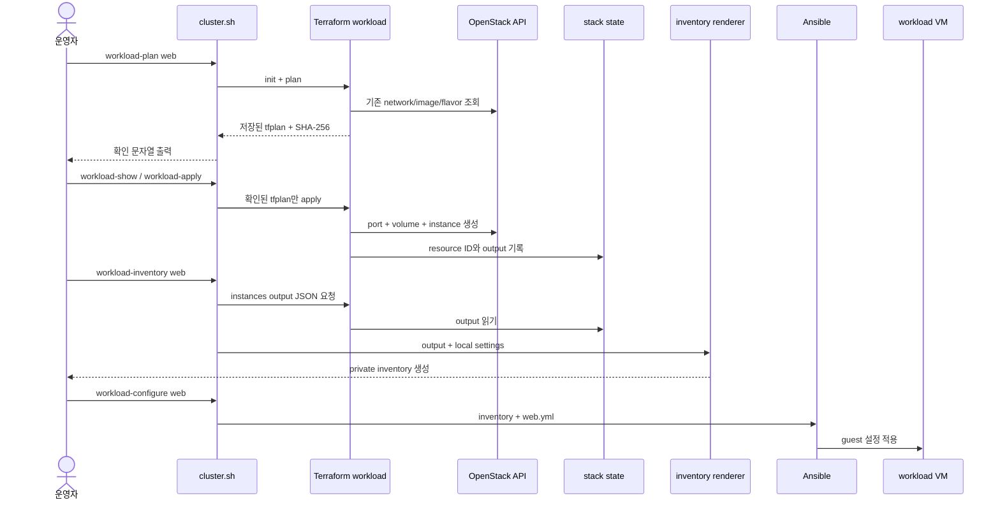

# 서비스별 OpenStack VM Terraform 스택

> 문서 위치: [전체 문서](../README.md) · [OpenStack workload](README.md)

일반 애플리케이션 VM은 management Kubernetes를 만드는 `terraform/openstack/`에 추가하지
않는다. 서비스 또는 수명주기가 같은 VM 묶음마다 `terraform/workloads/<stack>/`을 독립적인
Terraform root로 만든다. 각 root는 자신의 변수, plan과 state만 읽으므로 한 서비스의 변경을
검토하고 적용할 때 다른 서비스 VM이 같은 plan에 섞이지 않는다.



`terraform/openstack/`은 Kubernetes/platform 전용 root와 state로 계속 유지한다.
`terraform/modules/openstack-vm/`은 직접 초기화하거나 적용하는 root가 아니다.
`terraform/workloads/_template/`과 `_three-tier-vm-template/`도 복사 원본이므로 해당
디렉터리에서 `terraform apply`를 실행하지 않는다.

VM 생성과 guest 구성의 전체 호출 관계는 다음과 같다.



## 스택을 나누는 기준

같이 생성·확장·백업·폐기하는 VM은 한 스택의 `instances` map에 둔다. 배포 시점, 서비스 수명주기
또는 복구 정책이 다르면 별도 스택으로 나눈다. 예를 들어 `web`의 세 replica는 한 스택에 두고,
별도 백업과 폐기 승인이 필요한 `database`는 다른 스택에 둔다.

```text
terraform/
├── openstack/                 # management Kubernetes/platform root와 state
├── modules/
│   └── openstack-vm/          # 여러 workload root가 호출하는 공통 모듈
└── workloads/
    ├── _template/             # 추적되는 새 root 원본
    ├── _three-tier-vm-template/ # Neutron VM Web·Application·Database 원본
    ├── web/                   # web 서비스 root와 로컬 state
    ├── database/              # database 서비스 root와 로컬 state
    └── ci/                    # CI 서비스 root와 로컬 state
```

한 스택이 다른 스택의 `terraform.tfstate`를 직접 읽게 하지 않는다. 공용 네트워크와 이미지처럼
이미 OpenStack에 존재하는 자원은 UUID를 조회해 각 스택의 `terraform.tfvars`에 입력한다. 이
구조는 한 state 유실이나 잘못된 plan의 영향 범위를 해당 서비스로 제한한다. OpenStack 자원
자체가 HA가 되는 것은 아니므로 VM replica와 볼륨 백업 정책은 서비스별로 따로 설계해야 한다.
다만 platform root가 소유한 공유 network·subnet을 삭제하거나 바꾸면 이를 참조하는 모든
workload가 영향을 받으므로 platform plan에서는 해당 UUID의 소비자도 함께 확인한다.

## 새 스택 만들기

먼저 `cluster.sh setup`으로 저장소에 고정된 Terraform과 OpenStack CLI를 준비하고 provider가
읽을 cloud 설정을 선택한다. `workload-plan`, `workload-show`, `workload-apply`,
`workload-output`에서 변수를 지정하지
않으면 `/etc/kolla/clouds.yaml`을 사용한다. 운영자용 로컬 복사본을 사용할 때는 다음처럼
명시한다.

```bash
./scripts/cluster.sh setup
export OS_CLIENT_CONFIG_FILE="$PWD/terraform/openstack/clouds.yaml"
./scripts/cluster.sh workload-new web
```

Web·Application·Database를 서로 다른 Neutron network와 security group으로 만드는 경우에는
3티어 profile을 지정한다. 세부 network와 traffic matrix는
[Neutron 3티어 workload](three-tier.md)를 따른다.

```bash
./scripts/cluster.sh workload-new myapp three-tier-vm
```

`workload-new`는 선택한 `_template` 또는 `_three-tier-vm-template`의 정해진 `*.tf`,
`.terraform.lock.hcl`, `README.md`와
`terraform.tfvars.example`만 `terraform/workloads/web/`로 복사하고 example에서 mode
`0600`의 `terraform.tfvars`를 만든다. 템플릿 아래에 우연히 남은 state, provider cache,
credential과 override 파일은 복사하지 않는다. 스택 이름은
`^[a-z0-9][a-z0-9-]{0,62}$` 형식의 1∼63자만 허용한다.
`_template` 자체, 기존 디렉터리와 깨진 symbolic link를 포함해 같은 경로가 이미 있으면
덮어쓰지 않고 실패한다.

새 root의 `*.tf`, `.terraform.lock.hcl`, `README.md`와 `terraform.tfvars.example`은 Git에
추적해 다른 운영자가 같은 코드와 provider 버전을 재현하게 한다. 실제 `terraform.tfvars`,
`.terraform/`, plan과 `terraform.tfstate*`는 ignore 규칙에 맡기고 staging 결과에도 없는지
확인한다.

각 root는 고정 `terraform.tfvars`와 기본 Terraform workspace만 사용한다. wrapper는 state와
locking 경계를 바꿀 수 있는 `TF_CLI_ARGS*`, `TF_DATA_DIR`, `TF_REATTACH_PROVIDERS`,
`TF_WORKSPACE`, `TF_VAR_*` 환경을 거부한다. Git에서 숨겨지는 `*.auto.tfvars*`,
`terraform.tfvars.json`, `override.tf*`와
`*_override.tf*`도 자동으로 읽지 않고 실패한다. 필요한 코드 변경은 추적 가능한 일반 `.tf`에,
로컬 값은 mode `0600`의 `terraform.tfvars`에 둔다.

다음 명령으로 현재 cloud의 자원 ID를 확인한다. 이름이 같거나 나중에 이름이 바뀌어도 다른
자원을 선택하지 않도록 조회한 ID를 사용한다.

```bash
.cache/kolla-venv/bin/openstack --os-cloud admin network list --long
.cache/kolla-venv/bin/openstack --os-cloud admin subnet list --long
.cache/kolla-venv/bin/openstack --os-cloud admin image list --long
.cache/kolla-venv/bin/openstack --os-cloud admin flavor list --long
.cache/kolla-venv/bin/openstack --os-cloud admin keypair list
.cache/kolla-venv/bin/openstack --os-cloud admin server group list
.cache/kolla-venv/bin/openstack --os-cloud admin security group list
.cache/kolla-venv/bin/openstack --os-cloud admin volume type list
```

`admin`은 예시다. `cloud_name`에 사용할 실제 `clouds.yaml` 항목 이름으로 바꾼다.

입력 종류를 혼동하지 않도록 다음 기준을 사용한다.

| 입력 | 값 |
| --- | --- |
| `network_id`, `subnet_id`, 공통 `image_id` | 위에서 조회한 OpenStack UUID |
| 공통·인스턴스별 `flavor_id` | Nova flavor ID. 환경에 따라 `1` 같은 숫자 문자열 또는 UUID |
| `managed_flavor` | stack이 private flavor를 직접 만들 때 사용. 이 경우 공통 `flavor_id = null` |
| `host_aggregate` | 특정 compute 고정이 필요할 때 Nova hostname, aggregate metadata를 지정 |
| 인스턴스별 `image_id` | 공통값과 다를 때만 지정하는 Glance image UUID |
| `additional_security_group_ids`, `floating_ip_subnet_id`, `server_group_id` | 사용할 때만 지정하는 OpenStack UUID |
| `cloud_name` | `clouds.yaml`의 cloud 항목 이름 |
| `key_pair`, `root_volume_type`, `floating_ip_pool` | 기존 key pair, Cinder volume type, 외부 network의 이름 |
| `fixed_ip`, `floating_ip_address` | 실제 대상 subnet의 주소. 자동 할당하려면 생략 |
| `ssh_ingress_cidr`, `internal_ingress_cidr`, 추가 ingress | 실제 허용 원본 CIDR |
| `root_volume_size` | 필수 boot volume 크기(GiB 단위 양의 정수) |
| `associate_floating_ip` | 해당 VM에 Floating IP가 필요할 때만 `true`; 이때 `floating_ip_pool` 필수 |
| `config_drive`, `metadata` | 인스턴스별 config drive 사용 여부와 비밀이 없는 metadata |

일반 VM은 기존 `flavor_id`를 사용한다. PCI 패스스루처럼 stack 전용 extra spec이 필요할 때만
`managed_flavor`와 `host_aggregate`를 함께 사용한다. 두 resource에도 `prevent_destroy`가
적용되며, aggregate의 host 이름은 Nova hypervisor 목록과 정확히 같아야 한다.

`terraform/workloads/web/terraform.tfvars`에서 cloud 이름, 위 UUID, 허용 CIDR과
`instances` map을 실제 값으로 바꾼다. 처음에는 반드시 다음 안전 스위치를 유지한다.

```hcl
enable_instances = false
```

UUID 조회 명령이 cloud 인증과 조회 권한을 확인한다. `enable_instances = false` 상태의 첫
Terraform plan은 선택한 credential 파일, provider 초기화와 입력 형식을 확인한다. 첫 plan이
VM이나 볼륨 생성을 표시하면 진행하지 말고 입력과 코드를 다시 확인한다.

```bash
./scripts/cluster.sh workload-plan web
./scripts/cluster.sh workload-show web
```

첫 plan이 자원 변경 없이 끝나면 `enable_instances = true`로 바꾸고 다시 plan을 만든다.
`workload-plan`은 성공한 plan을 mode `0600`으로
`.cache/terraform/workloads/web.tfplan`에 원자 교체한다. 함께 생성하는
`web.tfplan.context.json`은 plan SHA-256과 현재 `clouds.yaml`, 관련 secure/config 파일 및
`OS_*` 인증 환경의 지문을 결합한다. provider가 실제로 검색하는 workload root,
`~/.config/openstack`, `/etc/openstack`의 첫 `secure.yaml`/`secure.yml`과
`clouds-public.yaml`/`clouds-public.yml`도 포함한다. YAML의 `cacert`, client certificate와 key
경로는 절대경로여야 하며 파일 내용도 지문에 들어간다. `workload-show`와 `workload-apply`는
`terraform init` 전에 같은 context인지 먼저 확인하며 설정 파일·인증서·인증 환경을 바꿨다면
새 plan부터 만든다. 출력된 SHA-256 확인 문자열을 사용하고 VM 이름,
image·flavor·network ID, boot volume, Floating IP와 security group 변경을 모두 검토한다.

```bash
./scripts/cluster.sh workload-plan web
./scripts/cluster.sh workload-show web

export TERRAFORM_WORKLOAD_APPLY_CONFIRM='APPLY-TERRAFORM-WORKLOAD:web:<plan-sha256>'
./scripts/cluster.sh workload-apply web
./scripts/cluster.sh workload-output web
```

`<plan-sha256>`를 직접 추측하지 말고 방금 `workload-plan`이 출력한 정확한 값을 복사한다.
`workload-apply`는 모든 workload 스택이 공유하는 Terraform lock을 잡고 현재 plan의 SHA-256을
다시 확인한 뒤 그 스택의 저장된 plan만 `parallelism=1`로 적용한다. Terraform도 state가 plan
뒤에 달라진 stale plan을
거부한다. 코드나 입력을 바꿨다면 기존 확인 문자열을 재사용하지 말고 plan과 검토부터 다시
수행한다. `workload-output`은 해당 root가 구성한 local 또는 remote backend에서
VM·포트·Floating IP 등의 출력을 읽는다. `security_group_id`와
`instances[<key>].{instance_id,instance_name,port_id,fixed_ips,root_volume_id,floating_ip}`를
이후 운영 입력에 사용할 수 있다.

3티어 profile의 `instances` output은 같은 필드에 `tier`와 선택적 `data_volume_id`를 추가하고,
network와 security group ID를 별도 output으로 제공한다.

## Ansible inventory 자동 생성

`workload-new`는 Terraform root와 함께
`ansible/inventory/workloads/<stack>.local.yml`을 mode `0600`으로 만든다. 이 파일에는
VM 접속 사용자, SSH 개인키의 절대경로와 주소 선택 방식을 기록한다. 개인키 본문은 넣지 않는다.

```yaml
address_source: auto
ansible_user: ubuntu
ansible_port: 22
ansible_ssh_private_key_file: /home/operator/.ssh/id_ed25519
ansible_ssh_common_args: null
group_vars: {}
host_vars: {}
```

Terraform 적용 후 다음 명령은 `instances` output을 JSON으로 읽고 Floating IP 또는 fixed IP를
선택해 mode `0600`의 `.cache/ansible/workloads/web.yml`을 원자적으로 생성한다. `auto`는
Floating IP를 우선 사용한다. Terraform `instances` map key별 변수가 필요하면 `host_vars`에
같은 key로 추가한다.

```bash
./scripts/cluster.sh workload-inventory web
```

서비스 설정은 `ansible/playbooks/workloads/web.yml`에 작성하고 생성 inventory의 `workload`
그룹을 대상으로 한다. 3티어 output은 `workload_web`, `workload_application`,
`workload_database` 그룹도 만든다. 다음 명령은 최신 Terraform output으로 inventory를 다시
생성한 뒤 해당 playbook을 실행한다.

```bash
./scripts/cluster.sh workload-configure web
```

Terraform이 VM을 만들기 전이거나 output에 인스턴스가 없으면 inventory 생성을 거부한다. 선택한
주소가 없거나 IP 형식이 잘못된 경우, settings에 존재하지 않는 instance key를 넣은 경우와 SSH
키 경로가 상대경로·읽기 불가능한 파일인 경우에도 실패한다. 생성 inventory는 캐시이므로 직접
수정하지 않고 Terraform output 또는 `<stack>.local.yml`을 고친 뒤 다시 생성한다.

## VM 추가와 map key

기존 스택에 VM을 추가할 때는 `instances` map에 새 항목을 넣고 같은 plan/show/apply 순서를
반복한다. map key는 Terraform resource 주소의 일부가 된다. 예를 들어 `node-01`은
`module.instance["node-01"]`에 결합되므로 VM을 운영하는 동안 key를 바꾸지 않는다.
wrapper는 스택 이름을 `workload_name`으로 고정한다. 실제 OpenStack port와 instance 이름은
`<stack>-<key>`, boot volume 이름은 `<stack>-<key>-root`가 된다. 따라서 `web` 스택의
`node-01` key는 `web-node-01` VM과 port, `web-node-01-root` volume을 만든다.

표시 이름만 정리하려고 key를 `node-01`에서 `frontend-01`로 바꾸면 Terraform은 기존 자원
삭제와 새 자원 생성을 계획한다. 이 저장소의 `prevent_destroy`가 적용을 막더라도 안전한
이름 변경으로 해석해서는 안 된다. key를 정한 뒤에는 그대로 두고, 교체가 필요하면 새 key의
VM을 먼저 추가해 서비스와 데이터를 이전한다.

스택 이름도 state와 plan 경로를 결정하므로 생성 후 이름을 바꾸지 않는다. 서비스 분리가
필요하면 새 스택을 만든 뒤 일반적인 migration과 복구 검증을 거쳐 이동한다.

## state, 변수와 cloud-init 보관

각 workload root는 기본 local backend를 사용하므로 상태 파일은 해당 디렉터리의
`terraform.tfstate`와 `terraform.tfstate.backup`이다. state에는 VM 설정과 cloud-init
user data가 포함될 수 있다. 다음 파일은 Git에 올리지 않고 저장소 밖의 암호화된 백업에
스택별로 보관한다.

- `terraform/workloads/<stack>/terraform.tfstate*`
- `terraform/workloads/<stack>/terraform.tfvars`
- 사용한 `clouds.yaml`과 제한된 OpenStack application credential
- state와 일치하는 Git commit ID, 적용 전후 plan 검토 기록

state 유실은 OpenStack의 VM 삭제를 뜻하지 않지만 Terraform과 실제 자원의 결합이 사라진다.
새 state를 빈 상태로 적용하지 말고 백업을 복원하거나 각 자원을 명시적으로 import한다.
여러 운영자가 동시에 다뤄야 한다면 적용을 시작하기 전에 암호화와 locking이 있는 검토된
remote backend로 스택별 state를 이전한다. wrapper의 공용 `flock`은 한 checkout 안의 명령만
직렬화하므로 여러 운영자나 checkout 사이의 동시 실행은 remote backend 자체 locking으로
막아야 한다. 이 저장소는 backend 선택이나 `migrate-state`를 자동화하지 않으므로 backend별
암호화·locking·복구 절차를 별도 변경으로 검토한 뒤 이전한다. backend credential은 추적되는
`.tf`에 쓰지 않고 로컬 전용 환경 또는 해당 backend의 안전한 인증 방식으로 공급한다. 로컬
state 파일을 메신저나 Git으로 공유하지 않는다.

`terraform.tfvars`와 state는 mode `0600`으로 유지한다. `*.tfplan`과 `.terraform/`은
재생성할 수 있고 Git에서 제외되지만 plan에도 민감한 값이 들어갈 수 있으므로 외부에
게시하지 않는다.

cloud-init에 비밀번호, 장기 token, SSH 개인키 또는 application credential secret을 직접
넣지 않는다. cloud-init 값은 state와 plan에도 복사될 수 있기 때문이다. 추적되는 `.tf`,
`*.example`과 cloud-init 예시에는 비밀 없는 초기 설정만 둔다. 부팅 시 비밀이 필요하면
서비스별 secret 관리 방식과 짧은 수명의 인증 절차를 별도로 설계한다.

## 의도적인 VM 폐기

공통 모듈은 VM과 root volume에 `prevent_destroy = true`를 설정하고, 인스턴스의 boot volume은
`delete_on_termination = false`로 연결한다. `instances` key 삭제, `enable_instances = false`
전환 또는 VM·root volume 교체가 필요한 변경이 두 자원을 지우지 못하게 하는 경계다. Port,
security group과 Floating IP에는 같은 lifecycle 보호가 없으므로 plan에서 교체·삭제 여부를
별도로 확인한다. 이 저장소는 `workload-destroy` 같은 자동 폐기 명령을 제공하지 않는다.

폐기는 두 단계의 별도 운영 변경으로 처리한다.

1. 애플리케이션 트래픽을 새 VM으로 옮기고 VM·볼륨을 백업한 뒤 실제 복원을 시험한다.
   연결된 Floating IP, DNS, 로드밸런서와 다른 서비스의 의존 관계도 확인한다.
2. 폐기할 정확한 스택과 key, Terraform resource 주소, lifecycle 보호 처리, 실제 삭제 대상과
   복구 방법을 명시한 별도 변경을 작성해 검토받는다. 공통 모듈의 보호 변경은 다른 스택에도
   영향을 줄 수 있으므로 해당 스택의 삭제 plan과 영향 범위를 승인받은 절차에서만 실행한다.

`terraform destroy`, `terraform state rm`, `-target`으로 보호 절차를 우회하는 흐름은 자동화하지
않으며 이 저장소에는 범용 폐기 명령이나 자동 절차가 없다. `state rm`은 OpenStack 자원을
삭제하지 않고 관리만 포기하므로 폐기나 state 복구를 대신하지 않는다. 삭제 작업에는 일반
적용과 별도의 변경 기록, 백업과 사람의 검토가 필요하다.
