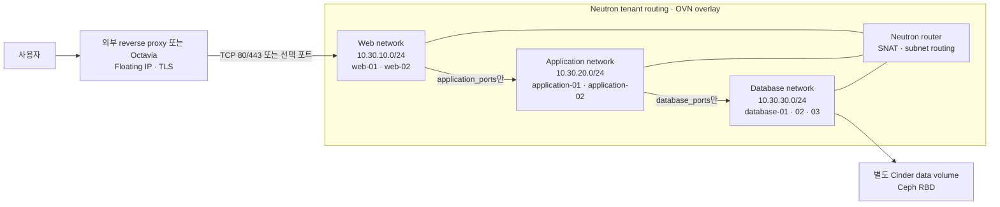

# Neutron VM 3티어 workload

> 문서 위치: [전체 문서](../README.md) · [OpenStack workload](README.md)

이 설계는 하나의 서비스에 필요한 Web, Application, Database VM을 OpenStack Neutron tenant
network에서 분리한다. 물리 switch에 서비스별 VLAN을 추가하지 않는다. Neutron이 세 logical
network, subnet, router와 port security를 만들고 현재 cloud의 OVN backend가 overlay 전달을
처리한다.

## 구성과 데이터 경로



reverse proxy가 기존 Nginx 계열 VM이라면 proxy의 tenant CIDR만 `ingress_cidrs`에 넣는다. Octavia를
사용한다면 listener와 member health check를 별도 stack에서 관리하고 load balancer가 Web member에
접근할 때 보이는 source CIDR을 허용한다. 이 profile은 어느 workload VM에도 Floating IP 입력을
제공하지 않는다. 공개 endpoint는 Octavia 또는 승인된 reverse proxy에만 둔다.

## Neutron 경계

세 subnet은 하나의 Neutron router에 연결되어 IP routing은 가능하지만 security group이 실제 허용
경로를 제한한다. security group은 VM의 Neutron port에 적용된다.

| 대상 port | 허용 원본 | 허용 범위 |
| --- | --- | --- |
| Web | `ingress_cidrs` | `web_ports`, 기본 80·443 |
| Application | Web security group | `application_ports`, 기본 8080 |
| Database | Application security group | `database_ports`, 기본 5432 |
| 각 tier | 같은 tier security group | cluster heartbeat·replication을 위한 tier 내부 통신 |
| 모든 tier SSH | `admin_cidr` | TCP/22 |

Web→Application과 Application→Database 규칙은 고정 CIDR 대신 Neutron
`remote_group_id`를 사용한다. VM 주소를 늘리거나 바꿔도 올바른 tier security group이 붙은 port만
다음 계층에 접근한다. 기본 Neutron egress 규칙은 유지하므로 패키지 mirror, DNS와 외부 API로
나가는 통신을 별도로 제한하려면 서비스 요구사항을 정한 뒤 egress 규칙을 추가한다.

Database 계층은 Web에서 직접 접근할 수 없고 외부 ingress도 받을 수 없다. router가 있다는 이유로
격리가 사라지는 것은 아니지만, security group을 VM에서 제거하거나 넓은 추가 security group을
붙이면 이 경계가 무너지므로 plan에서 각 port의 group을 확인한다.

## VM과 HA 배치

기본 예시는 Web 2대, Application 2대, Database 3대다. 각 tier는 별도의 Nova
`soft-anti-affinity` server group을 사용해 가능한 경우 서로 다른 compute에 분산한다. 3개 물리
노드에서 권장하는 초기 자원 범위는 다음과 같다.

| tier | VM 수 | VM당 시작 사양 | 저장소 |
| --- | ---: | --- | --- |
| Web | 2 | 1~2 vCPU, RAM 2GiB | 20GiB Ceph boot volume |
| Application | 2 | 2 vCPU, RAM 4GiB | 30GiB Ceph boot volume |
| Database | 3 | 2~4 vCPU, RAM 8GiB | 30GiB boot + 서비스에 맞춘 별도 data volume |

이 수치는 시작점이며 실제 애플리케이션 측정값에 따라 flavor와 volume을 조정한다. Database를 단일
VM으로 줄이면 3티어 망은 유지되지만 DB 고가용성은 사라진다. 세 DB VM을 만든 것만으로 복제나
자동 승격이 구성되지는 않는다. PostgreSQL이라면 Patroni 계열, MySQL이라면 Galera 또는 해당
제품의 복제 방식을 Ansible에서 별도로 구성하고 split-brain 시험을 해야 한다.

모든 예시 VM은 `HA_Enabled=True` metadata를 사용한다. 현재 Masakari Instance Monitor는 비정상
QEMU 종료 복구를 시도하지만 Host Monitor가 비활성화되어 물리 host 장애 후 자동 evacuation은
아직 수행하지 않는다. 스마트 플러그 fencing을 검증한 뒤의 경계는
[Masakari VM 복구](../operations/masakari.md)를 따른다. DB 자체 failover 시간과 Masakari 복구
시간이 겹치더라도 동일한 DB member를 두 개의 VM으로 중복 실행하지 않도록 장애 시험을 수행한다.

## 데이터와 백업

Database VM은 OS boot volume과 data volume을 분리한다. Terraform은 data volume을 만들고 VM에
연결하지만 filesystem 생성, mount, database 초기화는 하지 않는다. Ansible playbook에서 volume
UUID를 확인한 뒤 filesystem과 mount를 구성한다.

Ceph replica는 OSD나 물리 디스크 장애로부터 block을 유지하기 위한 것이며 논리 삭제, 잘못된 schema
migration과 application 오류를 복구하는 백업이 아니다. 다음을 별도로 둔다.

- database-native 전체 백업과 WAL/binlog 같은 증분 기록
- OpenStack/Cinder snapshot을 사용할 경우 application-consistent 정지 또는 flush 절차
- 저장소 밖의 암호화된 백업 사본
- 새 VM과 빈 database에 실제 복원하는 정기 시험

## Terraform 생성과 적용

별도 profile로 stack을 만든다.

```bash
./scripts/cluster.sh workload-new myapp three-tier-vm
```

다음 두 로컬 파일이 생성된다.

```text
terraform/workloads/myapp/terraform.tfvars
ansible/inventory/workloads/myapp.local.yml
```

`terraform.tfvars`에서 외부 Neutron network UUID, image, flavor, key pair, 실제 subnet CIDR, proxy
CIDR과 서비스 port를 설정한다. 기존 tenant·management·VPN 주소와 세 CIDR이 겹치면 안 된다.
첫 plan은 `enable_resources = false`로 provider와 입력만 검사한다.

```bash
./scripts/cluster.sh workload-plan myapp
./scripts/cluster.sh workload-show myapp
```

그다음 `enable_resources = true`로 바꾸고 plan을 다시 만든다. 다음 항목을 확인한다.

1. Neutron network와 subnet이 정확히 세 개만 생성된다.
2. router external gateway가 의도한 Provider external network UUID다.
3. 모든 workload VM에 Floating IP가 없고 공개 주소는 별도 Octavia 또는 proxy가 소유한다.
4. security group remote group 방향이 Web→Application→Database다.
5. VM 수, flavor, Ceph boot volume과 Database data volume 크기가 맞다.
6. 각 tier가 자신의 soft anti-affinity server group을 사용한다.

출력된 실제 SHA-256 확인값으로 적용한다.

```bash
export TERRAFORM_WORKLOAD_APPLY_CONFIRM='APPLY-TERRAFORM-WORKLOAD:myapp:<plan-sha256>'
./scripts/cluster.sh workload-apply myapp
./scripts/cluster.sh workload-output myapp
```

network, subnet, router, VM boot volume과 Database data volume은 `prevent_destroy`로 보호한다.
일반적인 `enable_resources = false` 전환으로 폐기할 수 없다. 제거는 트래픽 전환, DB 백업·복원
검증과 정확한 삭제 plan을 갖춘 별도 변경으로 수행한다.

## Ansible guest 구성

`instances` output은 VM을 평면 목록으로 제공하면서 `tier`를 포함한다. inventory renderer는 전체
`workload` 그룹과 다음 하위 작업용 그룹을 만든다.

```text
workload_web
workload_application
workload_database
```

Database host에는 Terraform output의 `openstack_data_volume_id`도 host variable로 전달된다.
Ansible은 이 ID와 guest에서 보이는 device를 대조한 뒤 새 빈 volume에만 filesystem을 생성해야
한다. 장치 이름이 `/dev/vdb`일 것이라고 가정하지 않는다.

App·DB는 Floating IP가 없으므로 운영 PC가 tenant subnet으로 route를 갖거나 SSH ProxyJump를
사용해야 한다. `ansible/inventory/workloads/myapp.local.yml`의
`ansible_ssh_common_args`에 검토된 bastion 경로를 기록할 수 있다. Terraform instance key는 output
기준 `web-01`, `application-01`, `database-01` 형식이다.

서비스 playbook은 tier 순서와 health check를 명시한다.

```yaml
---
- name: Configure database tier
  hosts: workload_database
  become: true
  serial: 1
  roles: [myapp_database]

- name: Configure application tier
  hosts: workload_application
  become: true
  serial: 1
  roles: [myapp_application]

- name: Configure web tier
  hosts: workload_web
  become: true
  serial: 1
  roles: [myapp_web]
```

이 파일을 `ansible/playbooks/workloads/myapp.yml`로 만들고 role에 실제 제품 설정과 검증을 넣은 뒤
실행한다.

```bash
./scripts/cluster.sh workload-inventory myapp
./scripts/cluster.sh workload-configure myapp
```

DB schema migration은 일반 package 배포와 분리한다. 이전 버전 Application과 호환되는 migration을
먼저 적용하고, Application을 한 대씩 교체한 다음 Web health check와 실제 요청을 확인한다.
